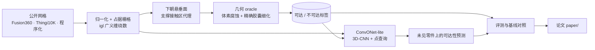

# SAF — Support Accessibility Field

[](https://github.com/OzzieNicholas/SAF/actions/workflows/gate.yml)

金属增材制造**支撑接触区**表面的几何可达性代理评价与**形状条件神经预测**。

给定一个公开三维零件和构建方向，SAF 先找出需要支撑的接触表面（用「下朝悬垂面」做代理），再用几何方法判断：球形工具能不能沿某个方向直线伸到这些点上去清理支撑；最后训练一个神经网络，在**没见过的零件**上直接预测这个结果。它给 DfAM（面向增材的设计）提供一个不同于「支撑体积 / 悬垂面积」的后处理风险维度。

这是几何 / AI 课题，不是材料或工艺实验，也不是生产认证：结果只是一个几何代理，不保证真实支撑一定可拆。

## 方法一览



- **判定语义**：存在某个下半球逼近方向，使半径 r 的球工具沿直线从无穷远到达该点而不碰撞，则该点可达。只计零件本体遮挡，因此是遮挡下界。
- **标签**：先在占据栅格的距离场上做多方向 ray-march，处在边界带的点再用精确的胶囊-网格求交定夺，使低分辨率下的标签也稳定。
- **模型**：整块占据经 3D-CNN 编码，在查询点采样局部特征并拼上坐标，MLP 输出不可达 logit；也可输出每个逼近方向的可达性（方向级场）。

## 目录结构

| 目录 | 内容 |
|---|---|
| `src/support_accessibility/` | 唯一的 Python 包：`oracle`（几何判定）、`data`（数据与网格前端）、`models`、`baselines`、`eval`（指标）、`runtime`（路径与运行记录） |
| `experiments/` | 可复现实验脚本，每个对应结果账本里的一条结论 |
| `tools/` | 数据集构建脚本、全量实验复现入口 `reproduce_experiments.py`、缓存清理 `prune_artifacts.py`、布局检查 `check_structure.py` |
| `tests/` | `acceptance/` 验收性质（工程规格）、`unit/` 单元测试、`paper_pipeline/` 论文流水线测试、`gate.py` 验收门 |
| `configs/` | `oracle_params.yaml` 冻结的标签口径；`paths.yaml` 唯一的路径配置 |
| `governance/` | 问题定义、铁律、决策台账、文献证据、结果账本、研发路线、工程规范 |
| `docs/` | 研究背景参考文档与文献入口（只读） |
| `paper/` | 论文下游包：源稿、图件脚本、审计与构建流水线、成品图、证据清单 |
| `data/` | 数据根（默认位置，不入库）：原始网格与处理后数据集，见 [data/README.md](data/README.md) |
| `artifacts/` | 机器运行产物（不入库）：`runs/` 保留证据，`cache/` 可清理 |

## 快速开始

所有命令在仓库根目录、已激活 `saf` 环境下运行。

```bash
conda env create -f environment.yml      # 一次性：创建环境并以可编辑方式安装本包
conda activate saf
python -m pytest tests -q                # 测试
python tests/gate.py                     # 工程验收门（加 --format md 输出表格，--paper 额外检查论文证据）
```

准备数据（下载两个公开数据集并构建，详见 [data/README.md](data/README.md)）：

```bash
python tools/build_procedural_dataset.py
python tools/build_fusion360_dataset.py
python tools/build_thingi10k_dataset.py
```

数据位置的优先级为：命令行参数 > 环境变量 `SAF_DATA_ROOT` > 不入库的 `configs/paths.local.yaml` > `configs/paths.yaml` 的默认值。

### 实验脚本

| 脚本 | 回答的问题 |
|---|---|
| `contact_area_vs_accessibility.py` | 支撑接触量（点数与真实三角面积）能否预示可达性 |
| `tool_radius_effect.py` | 不可达点中有多少对零半径射线可见（工具尺寸的影响） |
| `label_audit.py` | 真实网格标签是否可信（差分、跨分辨率稳定、分布） |
| `oracle_differential_audit.py` | 快速判定器与暴力参考在随机案例上是否一致（差分对拍） |
| `mesh_quality_audit.py` | 原始网格是否可读、水密，有无非流形边（网格质量披露） |
| `holdout_model.py` | 固定留出协议下以多个训练种子训练点级网络；下面七项共用这组权重 |
| `baseline_comparison.py` | 与多数类、局部规则、零半径射线、粗判定、局部学习模型的对照；也是回归门的依据 |
| `shape_context_ablation.py` | 形状上下文和感受野的价值 |
| `failure_analysis.py` | 误判集中在哪里（按可达方向数分箱） |
| `cost_accuracy_frontier.py` | 不同方向数的体素判定、两级判定器与网络的单件耗时和精度 |
| `screening_evaluation.py` | 在含全可达零件的全部未见零件上，零件级检出、误报与排序能力 |
| `orientation_evaluation.py` | 对 6 个轴向候选构建方向，网络与接触面积能否排出可达性风险的高低（方向评价，不做优化） |
| `cross_domain_robustness.py` | 同一组模型在 Thingi10K 网格上的表现（跨来源） |
| `cross_model_prediction.py` | 切分随机性下的未见零件表现（重复随机留出） |
| `direction_field_prediction.py` | 能否预测每个逼近方向是否被挡，并推荐可达方向（方向级模型） |

脚本用法见各文件开头的说明；权威数值和复现命令见 [结果账本](governance/结果账本.md)。`python tools/reproduce_experiments.py --list` 列出全部规范运行，`--only 名称,名称` 选跑部分，不带参数则按顺序全部重跑。

### 论文

```bash
python -m paper.pipeline.build_paper               # 构建：冻结证据、出图、审计、渲染并编译 PDF
python -m paper.pipeline.paper_gate               # 论文门：源稿审计、证据、成品图、论文 PDF、外部数据
```

详见 [paper/README.md](paper/README.md)。

## 文档导航

| 想知道 | 去看 |
|---|---|
| 做什么、为什么、指标、非目标 | [问题定义](governance/问题定义.md) |
| 不可违反的铁律 | [铁律约束](governance/铁律约束.md) |
| 判定语义和冻结口径为什么这么定 | [决策台账](governance/决策台账.md) |
| 做出了哪些结果、怎么复现 | [结果账本](governance/结果账本.md) |
| 现在处在研发的哪个阶段 | [研发路线](governance/研发路线.md) |
| 文献依据和相关工作 | [文献证据](governance/文献证据.md)、[文献矩阵](docs/文献矩阵与相关工作.md) |
| 代码、测试、文档的编写规范 | [工程规范](governance/工程规范.md) |
| 治理文件的整体地图与决策对应的验收性质 | [governance/README.md](governance/README.md) |
