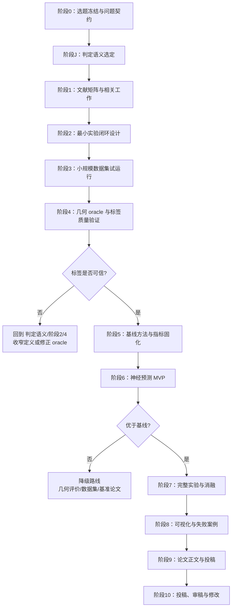
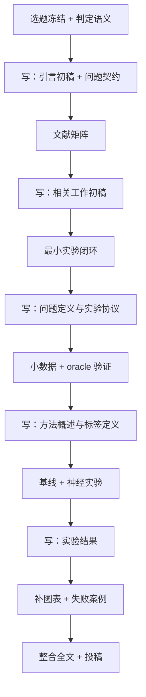
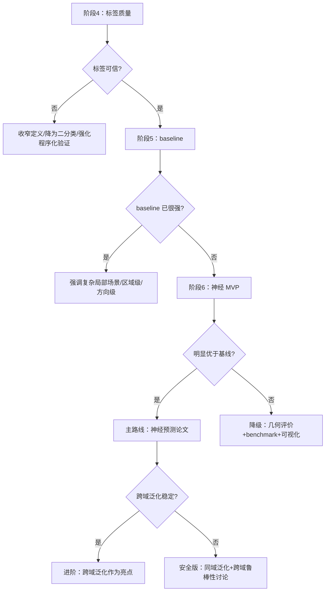

# 0_执行路线与阶段门
 
> 文档职责：论文的执行路线与阶段门计划——从选题冻结到投稿修改的完整流程、每阶段目标/交付物/退出标准、决策与降级路线。
> 文档性质：辅助/执行文档，不是论文正文。
> 引用编号：全局唯一编号 [R1]–[R23]，定义见 `2_文献矩阵与相关工作`。
> 文档间指向：问题定义与判定语义见 `1_选题与研究定位` 第二部分；实验闭环细节见 `3_实验闭环设计`。
 
---
 
## 目录
 
- [1. 总体执行顺序](#1-总体执行顺序)
- [2. 总体路线图](#2-总体路线图)
- [3. 阶段清单与阶段门](#3-阶段清单与阶段门)
- [4. 写作与实验并行策略](#4-写作与实验并行策略)
- [5. 交付物清单](#5-交付物清单)
- [6. 决策点与降级路线](#6-决策点与降级路线)
- [7. 常见错误与避免](#7-常见错误与避免)
- [8. 建议目录结构](#8-建议目录结构)
---
 
## 1. 总体执行顺序
 
执行顺序不是简单的“先数据、再实验、再论文”，而是：
 
> **先冻结问题定义、判定语义与最小实验闭环 → 再做小规模数据与标签验证 → 标签可信后建基线 → 基线成立后做神经预测 → 实验扩大过程中同步写论文 → 最后按结果强弱决定投稿版本。**
 
原因：本选题真正的瓶颈不是神经网络，也不是下载多少模型，而是**判定语义是否清晰、几何 oracle 与标签是否可信**。若标签定义不清，后续模型训练、消融和论证都会失去基础。
 
四条主干原则：
 
1. **判据与标签先于模型**——判定语义与 oracle 未验证前，不进入正式神经实验；
2. **小闭环先于大数据**——先用程序化模型与少量公开模型跑通全链路，再扩大到 ABC、Thingi10K 子集；
3. **基线先于复杂模型**——若简单几何规则或传统可见性基线已足够好，神经模型必须证明额外价值；
4. **写作与实验并行**——引言、相关工作、问题定义、实验协议不必等实验全部完成才写。
贯穿全程的一条边界纪律：每个阶段都避免把论文写成多零件排布、防互锁、真实工艺认证或企业系统复现。
 
---
 
## 2. 总体路线图
 

 
判定语义（阶段 J）显式排在数据之前，因为可达性判定语义属于问题定义层，必须在数据生成之前冻结，否则后续标签会失去统一含义。
 
---
 
## 3. 阶段清单与阶段门
 
### 阶段 0：选题冻结与论文问题契约
 
**目标**：把选题压缩成可执行研究契约，回答“研究什么、不研究什么、最低要证明什么”。
 
**事项**：固定题目；写 200–400 字研究问题说明；写输入/输出/对象/评价；写明确不涉及内容；写最小可发表版与进阶版；写与企业项目隔离的公开边界说明。
 
**阶段门**：能用 3 分钟说清“论文做什么”；能说清它与 DeepMill、PARC、普通构建方向优化的**对象差异**（本课题与 DeepMill 方法同源，差异在评价对象，见 `1_选题与研究定位` 第 4 节）；能说清为什么不用真实打印也成立；能说清为什么不触碰公司项目。
 
### 阶段 J：判定语义选定
 
**目标**：冻结“支撑接触区可达性标签究竟判定什么”。这是问题定义层，不是实现层。
 
**事项**：在三种候选判据（局部可容纳 / 连通路径 / 多方向直线插入）中选定；写清盲腔判例的预期输出；说明与运动规划边界的兼容；确定工具模型（球/柱）与构建方向族。
 
**阶段门**：判据已选定并有文献背书（DeepMill [R6]、IMF [R3]）；盲腔案例给出正确标签；不踩“不做路径规划”的边界。产物见 `1_选题与研究定位` 第 10 节。判据未定不进入数据。
 
### 阶段 1：文献矩阵与相关工作框架
 
**目标**：把文献阅读从泛读变成为论证服务，建立相关工作矩阵，明确本文站位。
 
**必读六类**：
 
| 类别 | 目的 | 代表依据 |
|---|---|---|
| AM 支撑结构综述 | 证明支撑与后处理可达性是正当问题 | [R1] |
| 支撑移除规划 | 证明支撑接触区是后处理关键对象 | [R2] |
| IMF / 支撑可去除性 | 证明可达性可表达为场（支撑体积口径） | [R3][R4] |
| AM 神经支撑相关 | 明确 AM 支撑已有神经工作（支撑检测） | [R5] |
| 神经制造可达性 | 明确可达性可被神经学习（含跨模型、工具条件） | [R6][R7] |
| 形状条件神经场与公开数据 | 支撑跨模型泛化与公开数据闭环 | [R8][R9][R10][R11][R18][R19] |
 
**其中 DeepMill [R6] 与 PARC [R7] 需精读到方法细节层**，因为它们与本课题方法同源，相关工作中必须逐项说明与它们的对象差异，泛读得到的二手概括不足以支撑这种辨析。
 
**阶段门**：矩阵覆盖上述六类；DeepMill、PARC 有到方法层的阅读记录；能写出“与 DeepMill 的对象差异表”“与 PARC 的差异表”“为什么不是普通构建方向优化”“为什么用 ABC/Thingi10K/程序化模型”。
 
### 阶段 2：最小实验闭环设计
 
**目标**：动手前固定闭环——最小版本验证什么、数据从哪来、标签怎么产生、指标如何评价、什么算成功。
 
**最小闭环**：
 
```text
公开/程序化单零件 → 少量构建方向 → 提取支撑接触区
→ 几何 oracle 生成可达/不可达标签（判据见阶段J）
→ 训练形状条件神经预测 → 与几何基线和简单神经基线对比
→ 点级/区域级/方向级/效率指标 → 热图与失败案例
```
 
**阶段门**：有清晰的输入/输出/标签/指标/基线/可视化方案；确定第一版做二分类还是分档；确定训练/验证/测试按**模型级**切分而非按点；确定哪些属于进阶不混进第一篇。细节见 `3_实验闭环设计`。
 
### 阶段 3：数据策略与小规模数据集试运行
 
**目标**：先验证数据能否支撑问题，不一开始下载处理全部数据，只做数据探索与小规模试运行。
 
**数据分工**：程序化模型（可控变量、可解释、调试）；ABC 子集 [R18]（机械 CAD、主训练/测试）；Thingi10K 子集 [R19]（真实打印网格、跨域鲁棒性）。
 
**推进四轮**：D0（10–30 程序化，验证接触区与 oracle）→ D1（50–100 公开，跑通预处理）→ D2（数百，正式闭环）→ D3（上千/跨域，效果好再做）。
 
**切分原则**：按**模型级**切分，禁止同一零件的点随机分到 train/test（否则泛化结论虚高）。
 
**阶段门**：至少一批程序化与一批公开模型能进入完整流程；能统计接触区点数、正负比例、复杂度；能发现并记录坏模型；有固定数据切分清单；不依赖企业模型。
 
### 阶段 4：几何 oracle 与标签质量验证
 
**目标**：建立可解释、可复核、可批量生成的几何代理标签。**这是整篇论文最关键的阶段——oracle 不可信，神经结果无意义。**
 
**标签优先级**：可达/不可达二分类 → 分档可达性 → 截断余量 → 连续有符号余量。第一层不稳定不进入更高层。
 
**oracle 需回答**：某点是否属于支撑接触区；给定 d 与工具条件该点是否几何可接近（按阶段 J 判据）；不可达区是否集中在深槽/盲孔/窄腔/遮挡区；标签随工具尺寸增大是否更严格；随方向变化是否可解释；能否抽样可视化复核。
 
**质量检查四类**：程序化模型趋势检查、人工可视化抽样、统计检查（正负比例/面积/分布）、对照检查（与射线可见性/支撑面积对比）。
 
**阶段门**：至少一批程序化标签符合几何直觉；至少一批公开模型热图无系统性错误；标签异常有记录而非静默删除；可解释为何是几何代理而非生产认证；导师/合作者能接受 oracle 定义。**未通过绝不进入正式神经实验。**
 
### 阶段 5：基线方法与评价指标固化
 
**目标**：神经模型之前建立对比基线。基线用来证明“神经预测有必要”。
 
**必保基线**：支撑接触面积/过悬面积评分；仅射线可见性（不含工具半径）；局部几何规则/特征评分；无形状条件的点查询模型；逐零件 overfit 神经场（对照 PARC 类逐零件表示 [R7]）。
 
**指标四层**：点级（Acc/Precision/Recall/F1/AUROC/PR-AUC）；区域级（IoU/不可达面积误差/可达比例误差）；方向级（评分误差/排序相关/Top-k）；效率级（oracle 查询时间/神经推理时间/显存）。
 
**阶段门**：每个指标含义明确；每个基线能解释为何存在；基线与神经模型用相同数据切分；评价脚本可重复；不再临时增删主指标。
 
### 阶段 6：神经预测模型 MVP
 
**目标**：验证形状条件神经预测能否在未见模型上优于基线。不追求最复杂网络，只证明核心主张。
 
**MVP 要求**：输入含零件几何信息；查询对象是支撑接触区点；条件含构建方向与工具条件中至少一个；输出可达概率/二分类/分档；测试与训练模型互不重叠；与基线同数据集比较。
 
**进入下一阶段的条件**（不是“能跑起来”）：至少点级或区域级稳定优于简单基线；典型热图视觉合理；未见模型效果非随机；对深槽/盲孔/遮挡有可解释优势；失败案例可归因。
 
**阶段门**：MVP 能在未见模型生成预测；至少一组指标优于基线；热图能说明问题；有失败案例分析；结果可复现。**不能优于基线则进入降级路线，而非盲目堆模型。**
 
### 阶段 7：完整实验、消融与鲁棒性
 
**目标**：从“模型能工作”到“论文结果完整”。形成正式实验表、消融与主结论。
 
**六组实验**：主结果、baseline 对比、消融、跨数据测试、参数敏感性、效率。
 
**消融围绕主张**（非删网络层）：去形状条件、去方向条件、去工具条件、预测全表面而非仅接触区、去局部高频表示。
 
**鲁棒性**：网格分辨率、法向扰动、尺度归一化、工具半径、悬垂阈值、程序化变量、ABC→Thingi10K 跨域下降。
 
**阶段门**：主表格支撑结论；baseline/消融/鲁棒性/效率完整；至少 4–6 张核心图；失败案例被解释而非隐藏；能判断投稿版本。
 
### 阶段 8：可视化、失败案例与图表固化
 
**目标**：把结果转化为审稿人能看懂的证据。几何论文尤其依赖可视化。
 
**必备图**：总体框架图、支撑接触区示意、可达性热图、预测 vs oracle 对比、方向球面热图、工具半径敏感性、失败案例图。
 
**原则**：每张图一个观点；热图颜色统一；不只放成功案例；程序化模型说明规则、公开模型说明复杂性；所有图可由固定数据与结果重新生成。
 
**阶段门**：主图齐全；每图对应一个结论；图例/尺度/方向/颜色统一；失败案例可解释；文件与结果版本固定。
 
### 阶段 9：论文正文写作与投稿准备
 
**目标**：把实验转化为完整论文。定稿在阶段 7、8 之后。
 
**结构**：题目/摘要/关键词 → 引言 → 相关工作 → 问题定义 → 方法概述 → 数据与实验设置 → 实验结果与分析 → 讨论与局限 → 结论 → 参考文献。
 
**摘要不要写**：完整支撑自动移除系统；保证支撑可移除；证明真实生产可行；解决多零件排布互锁；提出全新哈希编码方法；首创跨模型神经可达性预测（DeepMill 在先 [R6]）。
 
**摘要应写**：几何代理评价；公开模型；支撑接触区；形状条件神经预测；可解释热图；不依赖真实打印。
 
**投稿前检查**：题目与实验一致；相关工作正面讨论 DeepMill 与 PARC；数据公开可复现；标签定义清楚；指标完整；图表支撑结论；边界表述保守；避免企业用语；参考文献格式统一；有导师/同行预审。
 
### 阶段 10：投稿、审稿意见与修改
 
**目标**：从“自己觉得完整”到“能回应审稿质疑”。
 
**常见质疑与预案**：
 
| 质疑 | 预案 |
|---|---|
| 标签只是代理，非真实制造验证 | 声明定位为 DfAM 几何风险评价，非生产认证 |
| 与 DeepMill 太像 | 承认方法同源，强调对象差异（支撑接触区表面 vs 全表面）、AM 后处理语义、构建方向条件 [R6] |
| 与 PARC 太像 | 强调跨模型预测 + 支撑接触区对象，非逐零件 overfit [R7] |
| 数据规模不够 | 说明安全版目标与公开/程序化组合，必要时补实验 |
| 神经优势不明显 | 强化区域级/方向级/效率/复杂局部分析 |
| 没有真实打印 | 说明几何代理范围，补局限与 future work |
| 工具模型简化 | 说明简化工具条件下的几何评价，可扩展 |
| 网格质量影响 | 补鲁棒性与数据筛选规则 |
| 支撑间相互遮挡未建模 | 声明只算零件本体遮挡下界，未建模支撑间遮挡与移除顺序 |
 
**修改策略**：先判断意见属于概念不清（补定义/边界）、文献不全（补相关工作/差异表）、实验不足（补 baseline/消融/可视化）、结论夸大（收缩表述）、还是数据质疑（补筛选/来源/统计），再针对性回应。
 
---
 
## 4. 写作与实验并行策略
 

 
各阶段可提前写：阶段 0/J（题目、摘要草稿、研究问题、判定语义）；阶段 1（相关工作、差异表、研究空白）；阶段 2（问题定义、实验设计、指标）；阶段 3–4（数据来源、标签定义、oracle 说明、局限）；阶段 5–7（实验设置、主结果、消融）；阶段 8（图表说明、失败案例、讨论）；阶段 9（摘要、结论、格式）。
 
原则是不等实验全部完成才写。至少从阶段 1 开始建立论文草稿，以提前发现问题定义、相关工作与实验闭环的漏洞。
 
---
 
## 5. 交付物清单
 
| 阶段 | 核心交付物 | 是否进入论文 |
|---|---|---|
| 0 | 研究问题契约、边界清单 | 引言、问题定义 |
| J | 判定语义选定（并入 `1_选题与研究定位`） | 问题定义 |
| 1 | 相关工作矩阵、DeepMill/PARC 差异表、精读记录 | 相关工作 |
| 2 | 实验闭环设计、指标表、baseline 表 | 实验设置 |
| 3 | 数据清单、切分表、数据统计 | 数据部分 |
| 4 | 标签质量报告、典型热图 | 方法与实验 |
| 5 | baseline 结果表 | 主结果与对比 |
| 6 | 神经 MVP 结果 | 决定是否继续主路线 |
| 7 | 主结果、消融、鲁棒性、效率表 | 实验主体 |
| 8 | 论文主图、失败案例图 | 实验与讨论 |
| 9 | 论文初稿、投稿清单 | 投稿材料 |
| 10 | 审稿回复、修改稿 | 发表流程 |
 
---
 
## 6. 决策点与降级路线
 

 
**降级路线 A：几何评价与基准数据论文。** oracle、数据、可视化扎实但神经不够强时，降级为“面向 AM 支撑接触区的几何可达性评价方法与公开基准构建”。贡献变为问题定义、几何代理标签、公开数据子集、baseline 与可视化，仍可能适合中文工程/图学应用类期刊。
 
**降级路线 B：逐零件可达场加速与可视化。** 跨模型泛化过难但逐零件效果好时，降级为“面向支撑接触区的逐零件神经几何可达场建模与可视化”。风险是接近 PARC 的 future work [R7]，需谨慎表述并降低投稿预期。
 
**降级路线 C：程序化几何控制变量分析。** 不强调神经网络，以几何评价指标与方向热图为主，展示支撑面积无法反映后处理风险。发表难度较低，创新性也较弱。
 
**进阶路线：** 神经效果好时升级为连续构建方向条件、连续工具半径条件、ABC→Thingi10K 系统跨域、工具半径外推、局部高频细化。只在安全版结果稳定后加入。
 
---
 
## 7. 常见错误与避免
 
**一开始就处理全量数据**：oracle 一旦有问题所有标签重做。→ 先程序化与小规模，判据/标签稳定后扩大。
 
**先训练网络，后补问题定义**：易变成“用了 AI 的工程实验”，创新点不清。→ 先固定问题定义、判定语义与评价协议。
 
**只报 accuracy**：样本不均衡时虚高。→ 同时报 F1、AUROC/PR-AUC、IoU、不可达面积误差。
 
**把方向评价写成方向优化**：易被归入传统多目标优化。→ 方向只是可达场的应用展示，核心是支撑接触区可达性评价与预测。
 
**把哈希编码写成主创新**：Instant-NGP 已成熟且裸哈希不解决跨模型泛化 [R11]。→ 哈希只作局部高频/逐零件细化模块。
 
**回避或轻描淡写 DeepMill 和 PARC**：审稿人一旦指出会显得定位不诚实。→ 正面比较并承认方法同源：DeepMill 面向减材全表面可达性且已实现跨模型预测 [R6]，PARC 偏逐零件神经隐式可达场 [R7]，本文差异在**对象**（AM 支撑接触区表面）与**后处理语义**。
 
**把跨模型预测当作本文首创**：DeepMill 已实现免重训跨模型预测 [R6]。→ 跨模型预测写为“采用”而非“提出”，创新锚定在对象定义与公开代理闭环。
 
**过度承诺真实制造可行性**：会被要求真实打印与后处理验证。→ 始终写“几何代理评价”“DfAM 前端风险提示”“不等同生产认证”。
 
---
 
## 8. 建议目录结构
 
用于个人研究管理，不代表工程实现方案。重点是每阶段有可追踪产物，避免实验做完后无法解释数据来源、标签规则与结果版本。
 
```text
paper_project/
  00_topic/
    研究问题契约.md
    研究边界清单.md
    判定语义选定.md          # 对应 1_选题与研究定位 第二部分
    投稿定位记录.md
  01_literature/
    相关工作矩阵.md
    DeepMill_PARC_差异表.md
    全局引用登记表.bib        # 对应 2_文献矩阵与相关工作
    文献笔记/
  02_experiment_design/
    最小实验闭环.md
    指标定义.md
    baseline清单.md
    数据切分原则.md
  03_data_records/
    数据来源说明.md
    数据筛选记录.md
    train_val_test_split.md
    数据统计表.md
  04_oracle_labels/
    标签定义.md
    标签质量报告.md
    标签异常案例.md
  05_experiments/
    baseline_results/
    neural_mvp_results/
    ablation_results/
    robustness_results/
  06_figures/
    problem_definition/
    heatmaps/
    comparisons/
    failure_cases/
  deliverables/paper/
    draft.md
    figures_list.md
    response_notes.md
  08_submission/
    target_journal.md
    checklist.md
    submitted_version/
```
 
