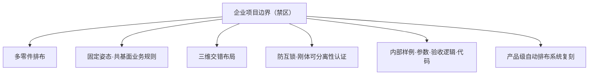
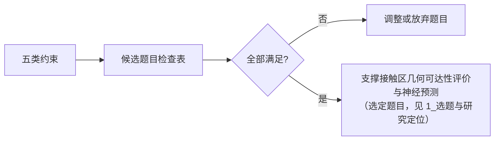

# 0_背景与边界
 
> 文档职责：固定论文选题的**输入约束**——个人背景与能力边界、设备与工具边界、发表目标、企业项目保密边界、明确排除的方向、可以靠近的方向。后续所有文档（选题、文献、实验、执行）都以本文档为前提。
> 文档性质：辅助/约束文档，不是论文正文。
> 引用编号：本项目采用全局唯一编号 [R1]–[R23]，定义与完整登记表见 `2_文献矩阵与相关工作`。
 
---
 
## 目录
 
- [1. 个人背景与能力边界](#1-个人背景与能力边界)
- [2. 设备与工具边界](#2-设备与工具边界)
- [3. 发表目标](#3-发表目标)
- [4. 企业项目背景与保密边界](#4-企业项目背景与保密边界)
- [5. 必须规避的方向](#5-必须规避的方向)
- [6. 可以靠近的方向](#6-可以靠近的方向)
- [7. 明确不想做的方向](#7-明确不想做的方向)
- [8. 约束到选题的映射](#8-约束到选题的映射)
---
 
## 1. 个人背景与能力边界
 
**工作领域**：3D 打印，偏金属 3D 打印，主要接触 LPBF、SLM、DMLS 这类粉床金属增材制造（metal powder-bed fusion）业务场景。
 
**知识背景（强项）**：计算机软件专业，熟悉图形学、计算几何、网格算法、几何建模、曲线曲面、NURBS、三角网格处理等方向；接触过 Rhino、SketchUp、Materialise Magics、CATIA 等软件。
 
**知识背景（弱项）**：不熟悉材料学、冶金、热力学、残余应力、组织性能、粉末流动等偏材料与工艺实验的知识。
 
**能力边界的直接含义**：
 
| 能力侧 | 结论 |
|---|---|
| 可依赖 | 计算几何、网格处理、图形学、几何建模、神经隐式表示、GPU 几何计算 |
| 不可依赖 | 材料实验、真实打印、工艺参数标定、热/力学仿真、显微组织与力学性能测试 |
 
因此论文方向应落在**几何 / 算法 / AI** 一侧，其正确性可以通过几何推理、程序化构造与公开数据复现来验证，而不依赖作者不具备验证能力的物理实验环节。
 
---
 
## 2. 设备与工具边界
 
**硬件**：个人电脑约 RTX 4060 显卡、32GB 内存。
 
**可接受的工具栈**：AI、深度学习、神经隐式表示、CUDA、GPU 加速、PyTorch、tiny-cuda-nn、Kaolin、PyTorch3D、Open3D、trimesh 等。
 
**两条边界（同时成立）**：
 
1. 不因为是个人设备就把方向限制得过低——中小规模神经网络、几何深度学习、神经隐式场在该硬件上完全可行；
2. 也不选择需要大型实验设备、真实打印实验、材料检测设备或大规模工业数据才能完成的方向。
**对方法规模的隐含约束**：模型规模、数据规模、训练时长都应控制在单卡可完成的范围内。这也是选择“单零件、公开模型、离散方向、简化工具条件”作为第一版范围的现实原因之一。
 
---
 
## 3. 发表目标
 
需要发表一篇论文。约束如下：
 
| 项目 | 要求 |
|---|---|
| 期刊级别 | 无特别高要求；中文期刊可，普通高校学报、图学、机械制造、智能制造、工程应用类期刊均可 |
| 首要标准 | 选题能形成论文、能做出完整实验闭环 |
| 次要标准 | 发表难度不宜太高 |
 
这条目标与本课题的真实创新强度是匹配的：本课题是对象层与应用语义层面的创新，不是方法层面的突破，适合中文期刊与中等英文应用期刊。强度判断与投稿定位详见 `1_选题与研究定位` 第 6 节。
 
---
 
## 4. 企业项目背景与保密边界
 
### 4.1 企业项目概述（仅用于界定边界，不作为论文对象）
 
作者在公司做过的项目核心业务是：**金属增材制造固定姿态共基面防互锁自动排布**。大致为：处理多个独立金属零件 STL 实例，在保持打印姿态的前提下，只允许 XY 平移和绕 Z 旋转，所有零件共用构建基准面，可利用真实三维空间交错、允许 XY 投影重叠，但要求打印排布包络之间无实体穿透、满足静态间距，并且打印完成、移除临时结构后，所有独立成品零件必须能通过连续刚体运动最终完全分离，不形成永久几何互锁。
 
### 4.2 保密原则
 
利用个人在公司项目中积累的**公共基础知识**（几何、网格、可达性等通用概念）降低学习成本是允许的；但不得泄露或复用公司的核心技术点、业务规则、算法、代码、参数、验收逻辑或内部数据。
 
论文与企业项目的隔离必须体现在**问题定义本身**——输入、输出、目标、数据、评价五个维度都不同，而不能只停留在“没用公司代码”这一层。隔离的具体落点见 `1_选题与研究定位` 第 2.4 节。
 
---
 
## 5. 必须规避的方向
 
推荐论文选题时，必须明确规避以下方向：
 
1. 不直接做多零件自动排布；
2. 不直接做固定姿态、共基面、逻辑无限 XY 平面上的多零件排布；
3. 不直接做多零件三维交错布局；
4. 不直接做防永久互锁、最终刚体可分离性认证、多刚体拆解、可分离运动规划；
5. 不复用“打印排布包络”“静态正间距”“可分离性三态结论”等公司文档中的业务定义作为论文核心；
6. 不使用公司零件、公司参数、公司测试样例、公司验收场景、公司代码或公司内部算法；
7. 不写成一个与公司产品功能高度类似的系统；
8. 不推荐可能触碰公司技术协议、知识产权边界或商业秘密的题目。

 
---
 
## 6. 可以靠近的方向
 
以下方向可以靠近，但必须是**公开研究问题**，且与公司项目在输入、输出、问题定义、实验对象和技术目标上有清晰区别：
 
金属增材制造、DfAM（面向增材制造的设计）、几何可制造性、支撑可去除性、工具可达性、构建方向、3D 几何场、神经隐式表示、GPU 加速几何计算、公开模型上的几何风险评价等。
 
本课题最终选定的“支撑接触区几何可达性评价与神经预测”即落在此范围内：它借用了几何/网格/可达性方面的公共知识，但对象是单零件公开模型的支撑接触区表面，与企业的多零件排布、防互锁在问题定义上完全不同。
 
---
 
## 7. 明确不想做的方向
 
以下方向作者明确不想做：
 
1. **不做“网格简化”类题目**。如“面向金属增材制造切片轮廓保真的关键特征约束网格简化方法”这类方向过于大众化，创新性有限。
2. **不做太纯工程实现的 C++ 项目**，如只是写一个 STL 检查工具、排布工具、切片辅助工具。
3. **不做严重依赖材料实验、打印实验、热仿真、残余应力、显微组织分析、力学性能测试的方向**。
4. **不做清粉、粉末流动、粉末排出这类作者背景较弱且难以验证正确性的方向**，除非能抽象成非常清晰、可复现、纯几何/AI 的问题。
5. **不做“改进遗传算法/粒子群/模拟退火做构建方向优化”这类容易显得普通的题目**。
6. **不做只是“优化”两个字包装的传统 AM 题目**。题目需要有明确的方法创新或问题定义创新，不能让审稿人一看就觉得只是普通多目标优化。
其中第 5、6 条对本课题有直接约束：本课题虽然涉及构建方向，但**方向只是决定支撑接触区分布的条件变量，不是优化对象**。论文不得写成“构建方向优化算法”，否则会被归入传统多目标优化。这条约束在 `1_选题与研究定位` 与 `3_实验闭环设计` 中被反复落实。
 
---
 
## 8. 约束到选题的映射
 
下表把上述约束汇总为对选题的正/负向要求，作为判断任何候选题目是否越界的检查表。
 
| 约束来源 | 负向要求（不可） | 正向要求（应当） |
|---|---|---|
| 能力边界 | 不依赖材料/工艺物理实验验证 | 用几何/程序化/公开数据验证 |
| 设备边界 | 不依赖大型设备与工业数据 | 单卡可完成的中小规模模型与数据 |
| 发表目标 | 不追求顶刊顶会 | 面向中文/中等英文应用期刊，闭环完整 |
| 企业边界 | 不碰多零件排布、防互锁、内部数据 | 单零件、公开模型、公开问题 |
| 个人取向 | 不做网格简化、纯工程、方向优化包装 | 有明确问题定义创新的几何/AI 题目 |
 

