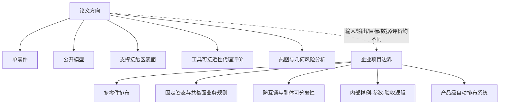
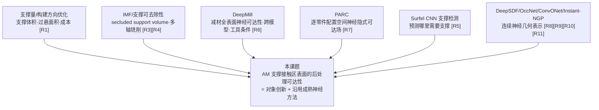
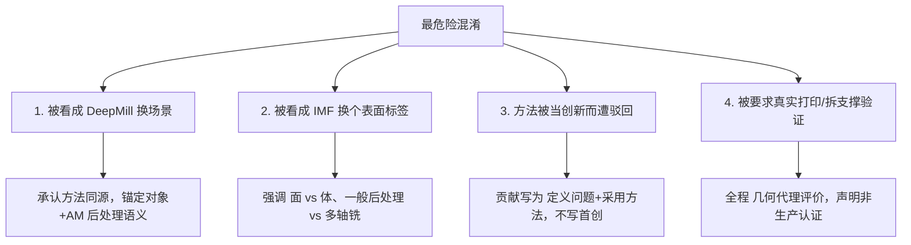
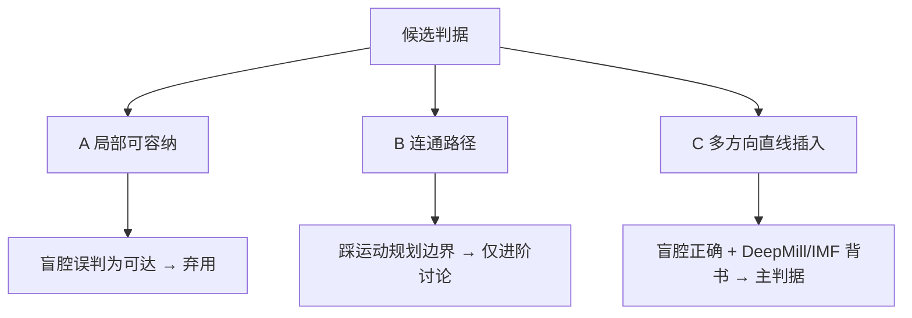
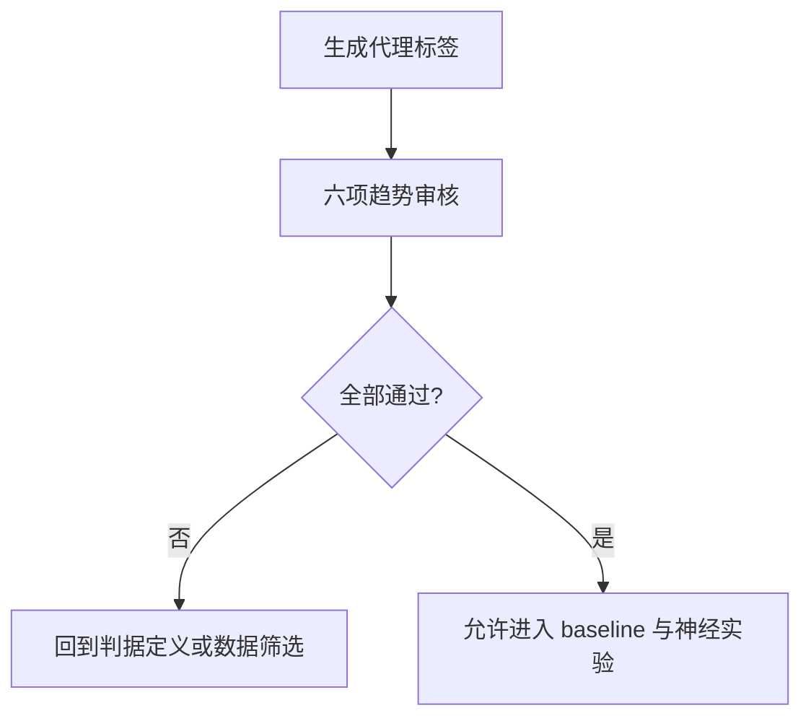

# 1_选题与研究定位
 
> 文档职责：固定论文“是什么”——选题与定位、研究对象与边界、文献立论、与近邻工作的差异、核心贡献、投稿定位、风险预案，以及问题定义与判定语义。
> 公开边界：不含企业内部零件、参数、测试样例、验收逻辑、代码或内部算法。
> 引用编号：全局唯一编号 [R1]–[R23]，定义与完整登记表见 `2_文献矩阵与相关工作`。
 
---
 
## 目录
 
**第一部分 · 选题与定位**
- [1. 选题与最终定位](#1-选题与最终定位)
- [2. 研究对象与公开安全边界](#2-研究对象与公开安全边界)
- [3. 文献立论：两条背景线](#3-文献立论两条背景线)
- [4. 与最近邻工作的差异（核心）](#4-与最近邻工作的差异核心)
- [5. 研究空白与核心贡献](#5-研究空白与核心贡献)
- [6. 创新强度与投稿定位](#6-创新强度与投稿定位)
- [7. 风险与审稿预案](#7-风险与审稿预案)
**第二部分 · 问题定义与判定语义**
- [8. 为什么判定语义是问题定义](#8-为什么判定语义是问题定义)
- [9. 支撑接触区的定义](#9-支撑接触区的定义)
- [10. 可达性判定语义的选定](#10-可达性判定语义的选定)
- [11. 输入输出与任务契约](#11-输入输出与任务契约)
- [12. 标签置信度与局限声明](#12-标签置信度与局限声明)
- [13. 参考文献](#13-参考文献)
---
 
# 第一部分 · 选题与定位
 
## 1. 选题与最终定位
 
### 1.1 推荐题目
 
中文（首选）：
 
> **面向金属增材制造支撑接触区的几何可达性评价与神经预测方法**
 
中文（方法强化版，实验较强时可升级）：
 
> **方向与工具条件下支撑接触区几何可达场的形状条件神经预测**
 
英文（首选）：
 
> **Shape-Conditioned Neural Prediction of Tool Accessibility for Support-Contact Regions in Metal Additive Manufacturing**
 
标题控制原则：不把网络细节（如 Hash Encoding）写进标题；不承诺连续余量场；不写“构建方向优化”。以下标题不建议采用：
 
| 不建议标题 | 原因 |
|---|---|
| 基于深度学习的金属 AM 构建方向优化方法 | 易被归入传统支撑量/过悬/多目标优化 |
| 基于哈希编码的支撑接触区可达场建模 | 哈希非新问题，易被认为套用 Instant-NGP [R11] |
| 金属 3D 打印支撑自动移除路径规划 | 会引入夹具、刀路、机器人运动学、真实后处理 |
| 金属增材制造支撑可移除性认证 | “认证”承诺过重，会要求真实打印验证 |
| 面向打印排布的支撑可达性优化系统 | 触碰企业项目边界 |
 
### 1.2 一句话定义
 
在单个公开三维零件上，识别由构建方向决定的支撑接触区，评价这些**表面区域**在简化工具条件下的几何可接近性，并用形状条件神经场在未见模型上预测该可达性，为 DfAM 预处理提供一种不同于支撑体积、过悬面积的后处理几何风险维度。
 
### 1.3 定位：问题与对象创新
 
本文的贡献定位在**问题与对象层面**，而非方法层面：
 
> 本文不声称首创神经可达性预测方法。本文的贡献在于把评价对象收缩到一个尚未被单独处理的对象——**AM 支撑接触区表面的后处理工具可接近性**，并在此对象上建立公开、可复现的几何代理评价与跨模型预测闭环。
 
这一定位的依据在第 4 节详述：跨模型神经可达性预测、工具尺寸条件、CAD/自由曲面双分布、密集实时热图等能力，已由 DeepMill [R6] 实现；支撑体积可达性已由 IMF 系列 [R3][R4] 处理；支撑区识别已由 Surfel CNN [R5] 处理。因此本文的立足点不是“提出新方法”，而是“定义一个新的评价对象并用成熟方法解决它”。
 
由此确定全文的表述姿态：**大方承认方法与 DeepMill 同源，把创新明确锚定在评价对象与 AM 后处理语义上**，不声称与 DeepMill 在方法上不同，也不把跨模型预测本身当作创新。这一姿态贯穿标题、摘要、贡献点、相关工作与审稿回应。
 
### 1.4 选题在 AM 流程中的位置
 

 
### 1.5 第一版范围控制
 
第一版不宜同时追求连续方向、连续工具半径、有符号余量、跨域泛化、哈希细化全部完成。第一版采用：
 
> **单零件、公开模型、离散构建方向、单一或少量工具条件、支撑接触区二分类或分档可达性、形状条件神经预测、公开数据实验与可解释热图。**
 
这已能构成完整论文闭环，且与企业内部多零件排布、防互锁、刚体可分离性认证保持清晰区别。连续方向、连续工具半径、跨域泛化、哈希细化等留待进阶版（见 `0_执行路线与阶段门` 的进阶路线）。
 
---
 
## 2. 研究对象与公开安全边界
 
### 2.1 研究对象
 
| 维度 | 内容 |
|---|---|
| 几何 | 单个公开 CAD/STL 或程序化生成的三维零件 |
| 中间对象 | 给定构建方向下的支撑接触区（下朝悬垂面代理，定义见第 9 节） |
| 评价目标 | 支撑接触区在简化工具条件下的几何可接近性 |
| 产物 | 几何代理可达性标签、跨模型预测、区域热图、方向评价、指标统计 |
 
本题属于：**面向增材制造预处理的三维几何智能评价问题**。不是材料学论文，不以显微组织、力学性能、热变形、残余应力、熔池、粉末流动为核心；也不是工艺实验论文，不要求真实打印、真实支撑拆除、材料检测或工业验证。
 
### 2.2 明确纳入与不纳入
 
**纳入**：单个公开零件；支撑接触区这一 AM 后处理几何对象；构建方向对其位置与可达性的影响；简化工具条件下的几何可接近性代理评价；基于公开/程序化模型的实验闭环；接触区热图、方向热图、可达性统计；形状条件神经场在未见模型上的预测。
 
**不纳入**：
 
| 类别 | 不纳入内容 |
|---|---|
| 企业项目对象 | 多零件排布、固定姿态共基面布局、多零件三维交错 |
| 企业项目目标 | 防互锁、最终刚体可分离性认证、多刚体拆解、取件顺序 |
| 企业术语/数据 | 打印排布包络、静态正间距、可分离性三态结论；公司零件、参数、样例、验收场景、代码 |
| 真实工艺 | 真实打印、真实支撑拆除、刀路/机器人/夹具规划、材料性能、热变形、残余应力、显微组织、清粉 |
| 承诺层级 | 不承诺真实后处理必然可执行，不做完整生产可行性认证 |
 
### 2.3 安全表述与避免表述
 
| 推荐表述 | 含义 |
|---|---|
| 支撑接触区可达性 | 支撑与零件连接区域是否易被工具接近 |
| 工具可接近性 | 简化工具模型下是否存在几何接近可能 |
| 几何可达场 | 表面/空间上的密集几何风险表达 |
| 后处理可达性代理评价 | 只评价几何风险，不承诺真实后处理成功 |
| DfAM 预处理几何评价 | 设计与制造准备阶段的风险提示 |
 
| 应避免表述 | 原因 |
|---|---|
| 多零件防互锁 | 与企业项目边界过近 |
| 自动排布合法性验证 | 易被理解为公司项目功能 |
| 完整生产可行性认证 | 承诺过重，引发真实实验要求 |
| 最终刚体可分离性 | 属另一类运动规划/拆解问题 |
| 企业内部业务定义 | 知识产权与保密风险 |
 
### 2.4 与企业项目的逻辑隔离
 
隔离体现在问题定义本身，不只是“没用公司代码”。输入、输出、目标、数据、评价五个维度全部不同。
 

 
---
 
## 3. 文献立论：两条背景线
 
论文的引言由两条背景线支撑：一条论证“支撑接触区可达性是正当且未被单独处理的问题”，一条论证“把它表达为可学习的几何场是合理且有先例的技术路径”。
 
### 3.1 背景线一：为什么支撑接触区值得研究
 
**支撑结构是 AM 长期问题**。支撑用于帮助复杂零件成形，但带来材料浪费、打印时间增加、能耗增加与后处理负担。Jiang、Xu、Stringer 的综述指出，支撑研究的重要目标之一是减少材料、时间与能源浪费，并强调金属工艺中的支撑移除可能需要切割、打磨或铣削，且手工移除支撑会受手或工具可达性限制 [R1]。
 
**传统支撑与方向研究多关注支撑量**。现有构建方向研究常关注支撑体积、支撑接触面积、构建高度、表面粗糙度、制造时间与成本 [R1]。这些指标重要，但不能完全等价于后处理难度：两个方向可能支撑体积相近，但一个接触区在开阔外表面、另一个在深槽/盲腔/狭窄凹陷中，后者即使支撑量不大也可能更难处理。因此从“支撑量评价”推进到“支撑接触区可达性评价”有明确价值。
 
**支撑接触区是后处理关键对象**。Nelaturi 等的自动支撑移除工作将后处理目标表述为切断支撑与零件之间的接触区域，并在避碰条件下安排移除过程 [R2]。这说明“支撑接触区”是支撑移除规划中的关键几何对象，而非随意选择的局部对象。本文不做完整移除路径规划，而把它收窄为可复现的前端几何评价问题。
 
**支撑可去除性可表达为连续场**。Mirzendehdel、Behandish、Nelaturi 将“不可接近支撑体积”纳入构建方向评价，用 inaccessibility measure field（IMF）度量给定工具与夹持条件下的不可达性 [R3]；同方向的拓扑优化工作进一步把支撑中不可达点的影响表达为连续空间场 [R4]。这说明“支撑可达性”不仅可作离散碰撞检测，也可表达为连续/密集几何场。
 

 
### 3.2 背景线二：为什么引入神经几何场
 
**传统几何可达性分析有成本问题**。工具可达性涉及三维遮挡、碰撞、间隙与方向条件。若对大量接触点、多个构建方向、多个工具条件逐一几何分析，计算成本快速上升。DeepMill 的动机正是传统几何可达性分析耗时且扩展性不足，它用神经框架预测减材制造中的不可达与遮挡区域，并报告面向复杂几何的快速推理 [R6]。这说明工具可达性可转化为可学习的几何预测问题。
 
**神经隐式表示适合表达连续几何属性**。DeepSDF 将形状表示为连续符号距离函数 [R8]；Occupancy Networks 将 3D 表面表示为神经分类器的连续决策边界，避免体素分辨率与内存限制 [R9]。这类工作说明连续可查询的神经场适合表达三维几何属性。对本文，支撑接触区可达性不应只输出总体分数，而应在表面区域上形成可视化、可统计、可比较的密集场。
 
**跨模型泛化需要形状条件表示**。单零件隐式场可逐零件拟合，但无法直接泛化到新模型。Convolutional Occupancy Networks 通过卷积编码器与隐式解码器结合引入局部信息与归纳偏置，展示了泛化能力 [R10]。因此主线是：网络先“看见”零件形状获得形状条件特征，再对支撑接触区上的查询位置与条件预测可达性。需要说明的是，本文对形状条件神经场的使用是**采用成熟范式来解决新定义的对象问题**，不把该范式本身作为方法贡献（见第 5.3 节贡献 C3）。
 
**哈希编码的合理位置**。Instant-NGP 的多分辨率哈希编码可提升神经图形基元的训练与查询效率 [R11]，但它不是本文学术核心。哈希编码适合作为局部高频查询与效率增强手段，不应写进标题或作为主贡献，否则易被认为只是套用成熟编码。
 
**机器人配置空间场提供跨域旁证**。机器人领域近年将碰撞安全、距离、可达性表达为连续/神经场：Configuration Space Distance Fields 将 SDF 推广到配置空间 [R13]；CSSDF-Net 用神经隐式表示处理配置空间距离场与安全运动规划 [R15]；相关综述强调神经场的紧凑性、可微性与规划控制结合潜力 [R14]。这些不直接研究 AM 支撑接触区，但说明“将几何安全性/距离/可达性表达为神经场”是跨领域趋势。本文借鉴该思想，但对象明确是 AM 支撑接触区。
 
---
 
## 4. 与最近邻工作的差异（核心）
 
本节是全文档重心，也是审稿时最受考验的部分。以下基于 DeepMill、IMF、PARC、Surfel CNN 原文，逐一说明本课题与它们的关系。
 
### 4.1 与 DeepMill 的关系：方法级重叠，对象级差异
 
DeepMill [R6] 是本课题**方法上最重要、也最需要正面处理的近邻**。它对不可达点的定义是：某点不可达，指刀具**从任意方向、即使从无穷远逼近、也无法在不碰撞的前提下到达该点**。逐项对照本课题设想的能力与 DeepMill 的覆盖：
 
| 本课题涉及的能力 | DeepMill 是否已实现 |
|---|---|
| 跨模型泛化、免逐零件重训 | **已实现**（明确不需对输入形状重训，并据此对比 PARC 需 per-shape/per-cutter 重训） |
| 工具尺寸作为条件输入 | **已实现**（支持多种刀具尺寸，cutter-aware 网络） |
| CAD + 自由曲面双分布 | **已实现**（同时覆盖 CAD 与 freeform 模型） |
| 密集热图、实时可视化 | **已实现**（复杂几何约 0.04 秒推理，支持编辑时实时预测） |
| 遮挡区域单独识别 | **已实现**（双头 O-CNN，一头专门预测 severe occlusion） |
| O-CNN、点云+法向输入 | **已实现**（正是 DeepMill 架构） |
 
由此得到明确结论：跨模型预测、工具条件、可解释热图这些能力在方法层面已被 DeepMill 覆盖，本课题不应把它们当作方法创新。**本课题与 DeepMill 唯一干净的差异是制造场景语义**——DeepMill 是减材加工里“刀具够全表面”，本课题是 AM 里“后处理工具够下朝支撑接触区，且该区域由构建方向决定”。
 
写入 Related Work 的差异表：
 
| 对比维度 | DeepMill [R6] | 本课题 |
|---|---|---|
| 制造场景 | 减材加工（CNC 铣削） | 金属 AM 后处理 |
| 评价对象 | 零件**全表面**加工不可达/遮挡 | **支撑接触区**表面后处理可接近性 |
| 失效语义 | “刀具够不到 → 造不出” | “工具够不到 → 事后难清理” |
| 方向语义 | 多轴任意刀具方向 | 单一构建方向决定支撑接触区分布 |
| 关键差异 | 方法基准（本课题不声称超越） | 对象 + AM 后处理语义 |
 
### 4.2 与 IMF 系列的关系：对象是“体”还是“面”
 
IMF 系列 [R3][R4] 是 AM 支撑可达性最直接的既有工作。其判据为：IMF 在每点的值为**在所有工具朝向与工具锐点上，零件、夹具、工具之间的最小体积碰撞**；零/非零决定可达/不可达。据此定义 **secluded support volume（隔绝支撑体积）**，即不能被给定刀具够到的支撑体积，用于 build orientation 优化与拓扑优化。
 
与本课题两点差异：
 
1. **对象差异（体 vs 面）**：IMF 评价**支撑体积**能否被铣刀整体够到并去除；本课题评价**支撑接触区表面**是否可接近。这是“体积可达性”与“表面区域可达性”的差异。
2. **后处理绑定差异**：IMF/PARC 全部绑定**多轴减材铣削去支撑**（hybrid AM-then-SM）；本课题面向更一般的后处理，工具用简化球/柱模型，不绑定多轴机床。
### 4.3 与 PARC 的关系
 
PARC [R7]（Harabin et al.）把碰撞测度表达为 6D 配置空间上的神经隐式场，用于降低显式 IMF 的存储与计算成本。它偏**逐零件配置空间场**，且 DeepMill 已指出其需 per-shape/per-cutter 重训 [R6]。本课题与它的差异同 4.1、4.2：对象是支撑接触区表面、面向跨模型预测而非逐零件场。需要警惕的是：若本课题最终只实现逐零件拟合场，创新会显著下降并接近 PARC 的范畴，因此跨模型预测能力是本课题相对 PARC 的关键区分点。
 
### 4.4 支撑检测的既有神经工作
 
Huang、Kwok、Zhou、Xu 的 **Surfel CNN for support detection in AM** [R5] 用卷积网络预测 AM 零件表面**哪里需要支撑**，落在本课题“支撑接触区提取”这一环。
 
它对本课题是有利的先例，但必须在相关工作中处理清楚：它说明“用神经网络预测哪里需要支撑”已被做过，因此本课题的落点明确从“支撑区识别”移到“支撑区的**后处理可达性**”。本课题不做 support detection（已有 [R5]），做的是 support-contact **accessibility**，两者是 AM 支撑处理链条上前后衔接的不同环节。
 
### 4.5 研究定位图
 

 
---
 
## 5. 研究空白与核心贡献
 
### 5.1 不能声称的空白
 
以下都不构成本文的空白，论文中不得据此主张创新：
 
- 没有人研究过 AM 支撑 / 支撑移除 / 工具可达性——均已有工作 [R1][R2][R3][R4]。
- 首次用神经网络做制造可达性预测——DeepMill [R6]、PARC [R7] 在先。
- 首次做跨模型可达性预测——DeepMill [R6] 已实现免重训跨模型预测。
- 首次用神经网络处理 AM 支撑相关问题——Surfel CNN 支撑检测 [R5] 在先。
- 哈希编码是新的——Instant-NGP [R11] 已有。
### 5.2 可以声称的空白
 
> IMF 系列 [R3][R4] 把 AM 支撑可达性表达为**支撑体积**的可达性并绑定多轴铣削；DeepMill [R6] 把神经可达性预测做在**减材全表面**上；PARC [R7] 做逐零件配置空间场；Surfel CNN [R5] 做支撑检测而非可达性。**尚缺一种以“AM 支撑接触区表面”为评价对象、面向一般后处理工具、基于公开模型、可跨模型预测其几何可接近性、并服务 DfAM 预处理的方法。** 本课题填补此对象层空白。
 
### 5.3 核心贡献
 
贡献表述为“定义问题 + 采用成熟方法解决新问题”，不写“提出新方法”。
 
| 编号 | 贡献 | 措辞要点 |
|---|---|---|
| C1 | **对象定义** | 提出以 AM 支撑接触区**表面**可接近性为评价对象，区别于 IMF 的支撑体积可达性 [R3][R4] 与 DeepMill 的全表面加工可达性 [R6] |
| C2 | **公开代理闭环** | 构建公开模型上可复现、可审计的几何代理标签与评价流程，使问题可度量、可对比 |
| C3 | **跨模型预测（采用）** | 采用形状条件神经场 [R10] 实现跨模型摊销预测，不声称首创该范式 |
| C4 | **DfAM 可解释评价** | 用支撑接触区热图、方向评价提供不同于支撑体积/过悬面积的风险维度 |
 
C1、C2、C4 是本课题真正的立足点；C3 明确写为“采用”。
 
### 5.4 创新强度的客观判断
 
本课题不是颠覆性基础理论创新。DeepSDF、OccNet、Instant-NGP、DeepMill、PARC、IMF 的基础思想都已存在 [R3][R6][R8][R9][R11]。本课题合理的创新强度是：一个明确的 AM 支撑接触区**表面**可达性问题定义；一个公开数据驱动的几何代理评价闭环；一个面向未见模型的（采用式）形状条件神经预测；一个面向 DfAM 预处理的可解释可视化维度。这一强度适合普通中文期刊、工程应用类、图学/CAD 应用类或中等英文应用期刊；若冲击更高水平，需更大规模数据、更强泛化、更严格对比与消融。
 
---
 
## 6. 创新强度与投稿定位
 
### 6.1 强度定性
 
本课题是**对象层 + 应用语义**的创新，不是方法层创新。这决定了它的合适去向：
 
- 图学/CAD 顶刊难以支撑——DeepMill 本身发表于 ACM TOG，若在这类场合声称方法新颖会被直接驳回；
- 中文期刊、中等英文应用期刊，配合扎实的公开数据闭环、清晰的对象定义与充分可视化，可以成文。
### 6.2 目标期刊
 
| 层级 | 目标 | 条件 |
|---|---|---|
| 现实 | 普通中文期刊、图学/CAD/机械制造/智能制造应用类、工程应用类 | 对象定义清楚、代理标签可信、可视化充分 |
| 中等偏高 | 中等英文应用期刊：Rapid Prototyping Journal [R22]、Progress in Additive Manufacturing [R23] | 更强对比、跨域实验、英文表达 |
| 不建议首选 | 强材料/冶金/热仿真期刊、机器人运动规划期刊、图学顶会 | 需真实工艺或大规模数据或方法突破 |
 
### 6.3 发表难度
 
| 目标 | 难度 | 条件 |
|---|---|---|
| 普通中文期刊 | 较现实 | 问题定义清楚、实验闭环完整、图示充分 |
| 图学/CAD 中文期刊 | 中等 | 几何定义与神经场表达更扎实 |
| 工程应用中文期刊 | 较现实 | 强调 AM 预处理价值与可视化解释 |
| 中等英文应用期刊 | 中等偏高 | 更强对比、跨域实验、英文表达 |
| 高水平英文期刊/会议 | 较高 | 大规模数据、严谨理论或强方法创新 |
 
---
 
## 7. 风险与审稿预案
 
### 7.1 风险总表
 
| 编号 | 风险 | 规避策略 |
|---|---|---|
| K1 | 被认为是普通构建方向优化 | 标题与贡献点始终突出支撑接触区可达性，方向只作应用 |
| K2 | 被认为是 DeepMill 迁移 | 承认方法同源，强调对象（表面 vs 全表面）、AM 后处理语义、方向条件 [R6] |
| K3 | 被认为是 PARC 加哈希 | 绝不把裸哈希作泛化来源，强调跨模型预测与支撑接触区对象 [R7] |
| K4 | 方法被当创新而遭驳回 | 贡献写为“定义问题 + 采用方法”，不写首创 |
| K5 | 标签可信度不足 | 优先设计判定语义与 oracle 论证，标签未过关不训练 |
| K6 | 公开模型代表性不足 | 程序化 + ABC + Thingi10K 组合 |
| K7 | 真实制造验证被质疑 | 全文“几何代理评价”，声明非生产认证 |
| K8 | 企业边界风险 | 严格排除多零件排布、防互锁、内部参数、公司数据与业务术语 |
| K9 | 神经优势不明显 | 保留几何评价/基准/可视化降级路线 |
| K10 | 支撑间相互遮挡未建模 | 声明只算零件本体遮挡下界，未建模支撑间遮挡与移除顺序 |
 
### 7.2 最危险的四个混淆
 

 
### 7.3 预设回答
 
**Q：这是不是 DeepMill 换成 AM？**
A：方法确实同源，本文不声称超越 DeepMill。差异在评价对象——DeepMill 评价减材全表面加工可达性，本文评价 AM 支撑接触区表面的后处理可接近性；失效语义从“造不出”变为“事后难清理”，方向语义从多轴任意刀向变为单一构建方向决定的支撑分布 [R6]。
 
**Q：IMF 已经做了 AM 支撑可达性，区别是什么？**
A：IMF 评价支撑**体积**能否被多轴铣刀整体去除（secluded support volume），本文评价支撑接触区**表面**的可接近性，且不绑定多轴铣削 [R3][R4]。
 
**Q：跨模型预测不是 DeepMill 已经做了吗？**
A：是。本文不把跨模型预测本身作为创新，而作为在新对象上采用的手段（贡献 C3）。创新在对象定义（C1）与公开代理闭环（C2）。
 
**Q：没有真实打印实验，结论有效吗？**
A：本文定位为 DfAM 前端几何代理评价，验证的是神经模型对几何 oracle 标签的预测能力，不声称真实支撑一定可拆。这与多数 CAD/几何算法论文的公开数据代理验证一致。
 
**Q：与 PARC 的区别？**
A：PARC 偏逐零件配置空间神经隐式场且需 per-shape 重训；本文面向跨模型预测且对象为 AM 支撑接触区表面 [R7]。
 
**Q：标签是否人为设定？**
A：标签是几何代理标签，有明确判定语义（第 10 节）、边界处理与抽样校核。论文区分“oracle 标签正确性”与“真实工艺正确性”。若标签质量无法证明，不进入正式神经实验。
 
---
 
# 第二部分 · 问题定义与判定语义
 
## 8. 为什么判定语义是问题定义
 
“支撑接触区可达性”这句话，在被赋予精确判定语义之前，不可计算也不可评价。同一句话可对应多种判据，它们在关键几何（尤其盲腔）上给出**相反**标签。因此选定哪种判据，决定了三件事：神经模型在学什么；论文旗舰案例（“支撑面积相近但一个在深腔”）能否成立；与 DeepMill [R6]、IMF [R3][R4] 的差异是否清晰。
 
判定语义与实现细节是两个层次。实现细节是“用什么数据结构算 Minkowski 和”“体素分辨率取多少”；判定语义是“把点 p 判为可达，究竟意味着什么几何事实”。后者必须在问题定义阶段冻结，且它属于论文正文（问题定义章），而非实现附录。
 
DeepMill 与 IMF 之所以是不同的工作，差异首先在判定语义（多方向直线插入 vs 配置空间体积碰撞），而非网络或算法。这说明判定语义是区分同类工作的第一层，必须先于数据与模型确定；否则执行阶段会被迫临时决定判据，而临时决定最容易与旗舰案例冲突。
 
---
 
## 9. 支撑接触区的定义
 
### 9.1 代理定义
 
本课题不做完整支撑生成（它依赖热、变形、工艺策略与商业支撑生成器），因此支撑接触区是一个公开、可解释、可重复的几何代理对象。
 
MVP 口径：
 
> 在给定构建方向 **d** 下，零件外表面中满足悬垂条件的**下朝区域**，即表面外法向与构建方向夹角超过阈值（等价于局部倾角低于自支撑临界角）的表面点集合。
 
论文中声明这是“支撑接触区**代理**”，不是工业软件生成的真实支撑接触区。其合理性来自：支撑综述指出支撑用于承接悬垂并带来后处理负担 [R1]；自动支撑移除工作将支撑与零件的接触区域作为后处理对象 [R2]。
 
### 9.2 与构建方向的关系
 
支撑接触区随构建方向变化——这是本课题区别于 DeepMill（多轴任意刀向）的关键之一。同一零件在不同 d 下，下朝区域不同，支撑接触区不同、可达性也不同。
 

 
### 9.3 定义风险与应对
 
| 风险 | 说明 | 应对 |
|---|---|---|
| 过于简化 | 真实支撑还受热/变形/策略影响 | 明确为几何代理，不做完整支撑生成 |
| 区域高估 | 纯悬垂判据可能过多标记 | 报告支撑区占比与失败案例 |
| 边界不稳 | 阈值附近点受法向噪声影响 | 设不确定带；鲁棒性实验测阈值变化 |
| 与真实工艺差距 | 真实 LPBF 支撑策略复杂 | 只研究几何可达性维度，不研究工艺策略 |
 
---
 
## 10. 可达性判定语义的选定
 
这是第二部分的核心。三种候选判据都来自既有文献，选定其一并引用即可，无需自创。三者在盲腔判例上给出不同答案，正是这一点决定了选择。
 
### 10.1 三种候选判据
 
**语义 A — 局部可容纳（point-in-cavity fit）**
点 p 处存在一个半径 r 的工具球位形，不与零件相交即判可达。
- 可计算性：好（局部查询）。
- 盲腔判例：**错误**。封闭/近封闭盲腔内部“放得下球”，被判为可达——而盲腔正是旗舰案例。
- 结论：**不采用**。它会在最想论证问题价值处给出错标签。
**语义 B — 连通路径可达（free-space connectivity）**
存在一条从零件包围盒外部到 p 的无碰撞工具运动路径。
- 可计算性：中（自由空间按工具半径腐蚀后做外部连通性传播，与 IMF 的 Minkowski 思路同源）。
- 盲腔判例：正确（盲腔判不可达）。
- 问题：形式上属**运动规划**，会踩“不做路径规划”边界；成本也与效率主张冲突。
- 结论：**不作主判据**，仅进阶讨论。
**语义 C — 多方向直线插入（directional line-of-approach）**
存在某个方向，工具沿直线从无穷远逼近 p 而不碰撞即判可达；任意方向都碰撞则不可达。
- 可计算性：中（对采样方向做扫掠碰撞检测；工具半径进入碰撞体）。
- 盲腔判例：**正确**（直线进不去盲腔，判不可达）。
- 文献背书：这正是 DeepMill 对不可达点的定义——刀具从任意方向、即使从无穷远、也无法无碰撞到达 [R6]；也与 IMF“对多个刀具朝向取最优的碰撞测度”同族 [R3]。
- 结论：**采用为主判据**。
### 10.2 判据对照表
 
| 判据 | 盲腔底部 | 深窄槽底 | 开阔外表面 | 可计算性 | 踩运动规划边界 | 文献背书 |
|---|---|---|---|---|---|---|
| A 局部可容纳 | 可达（错） | 可能可达（错） | 可达 | 高 | 否 | 弱 |
| B 连通路径 | 不可达 | 不可达 | 可达 | 中 | **是** | IMF 同源 |
| C 多方向直线插入 | 不可达 | 视开口/半径 | 可达 | 中 | 否 | **DeepMill [R6]、IMF [R3]** |
 
### 10.3 选定结论
 
> **主判据采用语义 C（多方向直线插入无碰撞）。** 工具用简化球/柱模型，单一构建方向族，MVP 阶段方向做离散采样。理由：盲腔判例自动正确、有 DeepMill/IMF 文献背书、避开运动规划边界、计算成本可控。
 

 
### 10.4 与工具尺寸的耦合
 
语义 C 下，工具半径 r 直接决定判据严格度：r 增大→能插入的方向减少→不可达区域扩大。这一单调关系必须在标签趋势审核中体现（半径增大时不可达区域**不应反常减少**），也是与“纯射线可见性 baseline”（r=0，只判可见）拉开差异的机制——可见但工具进不去，正是本课题要捕捉的核心现象。
 
### 10.5 工具方向模型的两种情形
 
主判据默认工具方向相对灵活（近似手工/打磨类后处理），适合球模型。若后处理工具方向受限（如特定角度的铣削/切割头），判据 C 需要收窄为“在受限方向集合内是否存在无碰撞直线插入”，对应的 baseline 与 oracle 成本也会变化。第一版按方向灵活的球模型实现；方向受限情形作为进阶变体，在 `3_实验闭环设计` 中作为可选分支处理。
 
---
 
## 11. 输入输出与任务契约
 
### 11.1 输入与输出
 
| 符号 | 含义 | MVP |
|---|---|---|
| P | 单零件几何（程序化/ABC/Thingi10K） | 是 |
| d | 构建方向（离散采样；进阶为连续条件） | 是 |
| x | 支撑接触区上的表面采样点/区域单元 | 是 |
| r | 简化工具半径（先单一 + 一个变化值） | 是 |
 
| 输出 | 用途 | MVP |
|---|---|---|
| 可达/不可达标签 | 主监督目标与主评价对象 | 必须 |
| 截断可达余量 | 二分类之外的增强输出 | 进阶 |
| 支撑接触区热图 | 局部风险可视化 | 必须 |
| 不可达区域比例 | 区域级统计 | 必须 |
| 方向级可达性评分 | DfAM 应用展示（非方向优化） | 建议 |
| 失败案例分类 | 方法边界 | 必须 |
 
### 11.2 任务三层
 
| 层级 | 任务 | 角色 |
|---|---|---|
| 点级 | 支撑接触点可达/不可达（或截断余量） | 主任务，训练与点级指标 |
| 区域级 | 不可达面积、区域 IoU、热图一致性 | 主任务，论文图表 |
| 方向级 | 一个 d 的总体可达性评分与排序 | 辅助任务，DfAM 展示 |
 
标题与摘要突出**点级/区域级**预测。方向级只作应用展示，**不得**写成“构建方向优化算法”，否则会被要求与遗传算法/粒子群/多目标优化对比。
 
### 11.3 变量控制
 
| 类型 | 变量 | 处理 |
|---|---|---|
| 主变量 | 零件几何、构建方向、工具半径 | 进入实验设计 |
| 控制变量 | 尺度归一化、采样密度、悬垂阈值 | 固定或少量鲁棒性测试 |
| 暂不纳入 | 材料、真实支撑参数、机床型号、热变形、夹具、刀路 | 不进入本文 |
 
### 11.4 问题定义边界
 
本文中的“可达性”是几何代理概念，不等同真实生产可行性。真实支撑拆除还受刀具、夹具、人工操作、振动、材料强度、支撑结构类型、表面粗糙度、后处理设备影响。本文只验证：神经模型能否预测一个明确几何代理规则下的支撑接触区可达性；不验证零件在真实生产中是否一定可打印、可拆支撑、可达表面质量或可满足力学性能。
 
---
 
## 12. 标签置信度与局限声明
 
### 12.1 标签三层置信度
 
判据 C 在“开口临界”“半径临界”附近对采样方向与法向噪声敏感。为降低边界噪声对结论的污染，标签分三层而非只做二分类。
 
| 标签 | 含义 | 处理 |
|---|---|---|
| 高置信可达 | 多个方向明显无碰撞插入 | 训练 + 主评价 |
| 高置信不可达 | 全方向明显碰撞 | 训练 + 主评价 |
| 边界不确定 | 接近可达边界、受采样/法向影响明显 | 可排除、降权或单独报告 |
 
进入神经模型实验前，标签须通过六项趋势审核（不通过则回到判据/数据，不训练）：程序化几何上槽宽↓/腔深↑/开口方向变化→不可达合理增减；随机公开模型热图无大规模系统性错误；同一模型不同 d 的接触区变化可解释；工具半径↑→不可达区域不反常减少；边界不确定样本有明确处理策略；失败案例被记录而非静默删除。
 

 
### 12.2 判定语义的局限声明
 
论文主动写出以下局限，以回应熟悉 AM 后处理的审稿人可能的追问：
 
1. **未建模支撑间相互遮挡与移除顺序**：真实后处理时，尚未移除的其它支撑本身也会遮挡工具。本文 oracle 只算**零件本体几何**造成的遮挡，因此给出的是遮挡**下界**，未建模支撑结构间相互遮挡与移除顺序依赖。
2. **代理 ≠ 真实工艺**：判据 C 是几何代理，不含夹具、刀路、切削力、人工操作、材料强度；“判为可达”不等于真实一定可拆。
3. **工具模型简化**：球/柱模型不等于真实刀具/工具几何；方向受限工具需按 10.5 的变体处理。
4. **方向离散**：MVP 用离散 d，不声称连续方向泛化；连续方向属进阶。
5. **网格质量依赖**：非水密、自相交、法向混乱会影响判据稳定性，需筛选或纳入失败分析。
推荐表述模板：
 
> 本文评价的是零件本体几何在简化工具模型与给定构建方向下造成的支撑接触区可接近性**几何代理**，给出遮挡下界；不建模支撑间相互遮挡、移除顺序、夹具、刀路与材料因素，不等同于真实后处理可行性认证。
 
---
 
## 13. 参考文献
 
> 完整登记表（含全部 [R1]–[R23]、DOI/arXiv 链接、在论文中的角色）见 `2_文献矩阵与相关工作`。本节仅列本文档引用条目。
 
[R1] Jiang, J., Xu, X., & Stringer, J. (2018). Support Structures for Additive Manufacturing: A Review. *Journal of Manufacturing and Materials Processing*, 2(4), 64. https://doi.org/10.3390/jmmp2040064
 
[R2] Nelaturi, S., Behandish, M., Mirzendehdel, A. M., & de Kleer, J. (2019). Automatic Support Removal for Additive Manufacturing Post Processing. arXiv:1904.12117.
 
[R3] Mirzendehdel, A. M., Behandish, M., & Nelaturi, S. (2021). Optimizing Build Orientation for Support Removal using Multi-Axis Machining. arXiv:2107.07686 / *Computers & Graphics*.
 
[R4] Mirzendehdel, A. M., Behandish, M., & Nelaturi, S. (2022). Topology Optimization for Manufacturing with Accessible Support Structures. *Computer-Aided Design*, 142, 103117. arXiv:2108.02829.
 
[R5] Huang, J., Kwok, T.-H., Zhou, C., & Xu, W. (2019). Surfel Convolutional Neural Network for Support Detection in Additive Manufacturing. *The International Journal of Advanced Manufacturing Technology*, 105, 3593–3604.
 
[R6] Zhong, F., Wang, Y., Wang, P.-S., Lu, L., & Zhao, H. (2025). DeepMill: Neural Accessibility Learning for Subtractive Manufacturing. arXiv:2502.06093. *ACM Transactions on Graphics (SIGGRAPH 2025)*.
 
[R7] Harabin, G. P., Mirzendehdel, A. M., & Behandish, M. (2024). Deep Neural Implicit Representation of Accessibility for Multi-Axis Manufacturing. arXiv:2409.02115 / *Computer-Aided Design*, 163, 103556.
 
[R8] Park, J. J., Florence, P., Straub, J., Newcombe, R., & Lovegrove, S. (2019). DeepSDF: Learning Continuous Signed Distance Functions for Shape Representation. CVPR 2019. arXiv:1901.05103.
 
[R9] Mescheder, L., Oechsle, M., Niemeyer, M., Nowozin, S., & Geiger, A. (2019). Occupancy Networks: Learning 3D Reconstruction in Function Space. CVPR 2019. arXiv:1812.03828.
 
[R10] Peng, S., Niemeyer, M., Mescheder, L., Pollefeys, M., & Geiger, A. (2020). Convolutional Occupancy Networks. ECCV 2020. arXiv:2003.04618.
 
[R11] Müller, T., Evans, A., Schied, C., & Keller, A. (2022). Instant Neural Graphics Primitives with a Multiresolution Hash Encoding. *ACM Transactions on Graphics*. arXiv:2201.05989.
 
[R13] Li, Y., Chi, X., Razmjoo, A., & Calinon, S. (2024). Configuration Space Distance Fields for Manipulation Planning. RSS 2024. arXiv:2406.01137.
 
[R14] Irshad, M. Z., Comi, M., Lin, Y.-C., Heppert, N., Valada, A., Ambrus, R., Kira, Z., & Tremblay, J. (2024). Neural Fields in Robotics: A Survey. arXiv:2410.20220.
 
[R15] Chen, H., Zhou, Y., Zhou, Y., & Wang, H. (2026). CSSDF-Net: Safe Motion Planning Based on Neural Implicit Representations of Configuration Space Distance Field. arXiv:2603.18669.
 
[R22] Emerald Publishing. *Rapid Prototyping Journal: Aims and Scope*.
 
[R23] Springer Nature. *Progress in Additive Manufacturing: Aims and Scope*.

