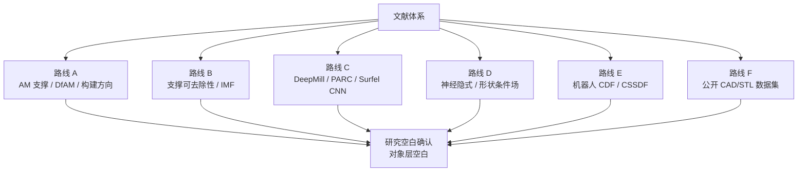
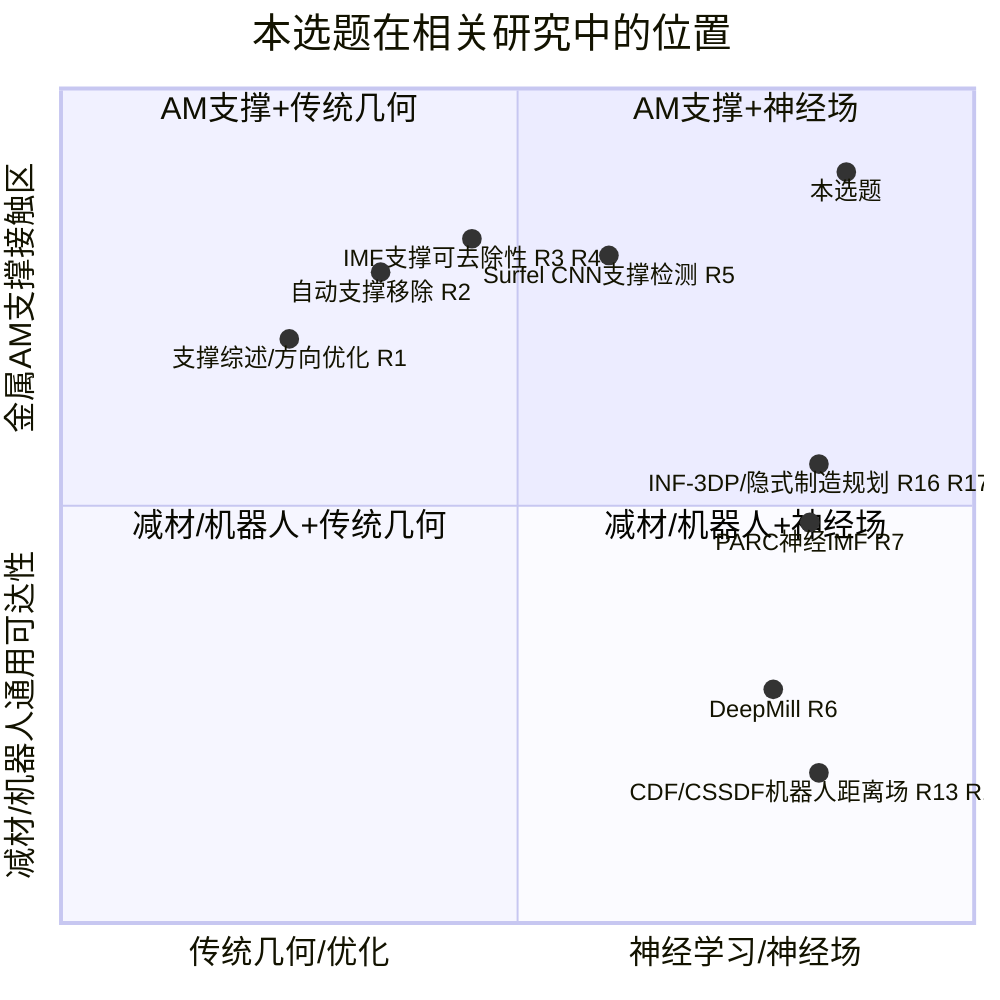
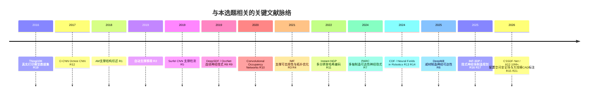
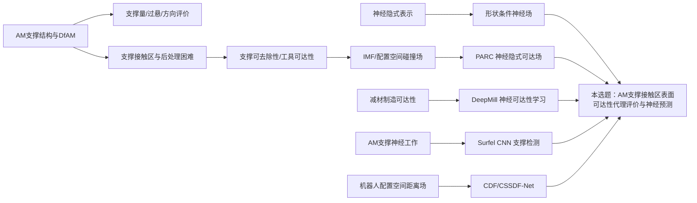
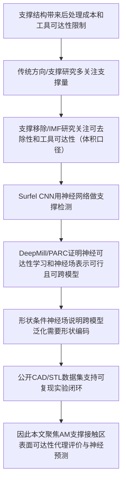

# 2_文献矩阵与相关工作
 
> 文档职责：建立论文相关工作的文献体系、近邻工作辨析、研究空白论证、Related Work 写作骨架，并承载全局唯一引用登记表。
> 公开边界：不含企业内部项目细节、公司零件、参数、测试样例、验收逻辑、代码或内部算法。
> 文献时间策略：优先 2024—2026 年近三年文献；保留 2020—2023 关键工作；2019 及以前只保留不可替代的奠基或数据来源。
> 引用编号：本文档定义全局唯一编号 [R1]–[R27]，其他文档（`0`/`1`/`3`）引用的编号均以本表为准。
 
---
 
## 目录
 
- [1. 文献总体结论](#1-文献总体结论)
- [2. 文献选择原则与时间权重](#2-文献选择原则与时间权重)
- [3. 文献地图总览](#3-文献地图总览)
- [4. 路线 A：AM 支撑结构、DfAM 与构建方向](#4-路线-aam-支撑结构dfam-与构建方向)
- [5. 路线 B：支撑可去除性、工具可达性与 IMF](#5-路线-b支撑可去除性工具可达性与-imf)
- [6. 路线 C：神经制造可达性与 AM 神经支撑工作](#6-路线-c神经制造可达性与-am-神经支撑工作)
- [7. 路线 D：神经隐式表示与形状条件神经场](#7-路线-d神经隐式表示与形状条件神经场)
- [8. 路线 E：机器人配置空间距离场与神经安全场](#8-路线-e机器人配置空间距离场与神经安全场)
- [9. 路线 F：公开几何数据集](#9-路线-f公开几何数据集)
- [10. 关键近邻工作逐篇辨析](#10-关键近邻工作逐篇辨析)
- [11. 研究空白验证](#11-研究空白验证)
- [12. Related Work 章节组织建议](#12-related-work-章节组织建议)
- [13. 文献矩阵](#13-文献矩阵)
- [14. 必读优先级与阅读顺序](#14-必读优先级与阅读顺序)
- [15. 审稿人文献质疑与预设回答](#15-审稿人文献质疑与预设回答)
- [16. Related Work 段落骨架](#16-related-work-段落骨架)
- [17. 全局引用登记表](#17-全局引用登记表)
- [18. 单篇文献阅读模板](#18-单篇文献阅读模板)
---
 
## 1. 文献总体结论
 
核心问题：**本选题站在哪些文献路线的交叉点上，哪些论文是必须正面处理的近邻，Related Work 应如何组织，研究空白是否成立。**
 
结论：
 
> 本选题成立。2024—2026 年出现了若干更近的神经制造可达性、隐式神经场制造规划与机器人配置空间距离场工作，但尚未发现一篇工作以“金属 AM 支撑接触区表面”为评价对象，结合“工具可接近性几何代理评价”“公开模型数据闭环”“形状条件神经预测”。
 
最需要正面处理的近邻分为四组：
 
1. **AM 支撑可去除性与 IMF 路线**：Mirzendehdel、Behandish、Nelaturi 关于构建方向、支撑可去除性与 IMF 的工作 [R2][R3][R4]；
2. **神经制造可达性路线**：DeepMill [R6] 与 PARC [R7]；
3. **AM 神经支撑路线**：Surfel CNN 支撑检测 [R5]；
4. **近三年隐式神经场与配置空间安全场路线**：CDF [R13]、Neural Fields in Robotics 综述 [R14]、INF-3DP [R16]、Implicit Neural Field-Based Process Planning [R17]、CSSDF-Net [R15]。
这些工作共同确立三个判断：工具可达性与支撑可去除性是公开研究问题；把可达性、碰撞、安全距离表达为神经场是近年明确趋势；本文的贡献必须锚定在**评价对象**（AM 支撑接触区表面）而非方法，因为神经可达性预测、跨模型泛化与工具条件已由 DeepMill 实现。
 

 
---
 
## 2. 文献选择原则与时间权重
 
### 2.1 时间权重
 
领域发展快，尤其神经隐式场、CAD 几何学习、制造可达性学习与机器人配置空间距离场，2024—2026 年工作更能体现审稿人关注的技术环境。采用以下权重：
 
| 时间段 | 使用策略 | 在论文中的地位 |
|---|---|---|
| 2024—2026 | 优先引用 | 近邻工作、趋势判断、审稿人最可能关注的对标 |
| 2021—2023 | 重点保留 | 支撑可去除性、IMF、哈希编码、CAD 数据集等关键依据 |
| 2019—2020 | 选择性保留 | DeepSDF、OccNet、ConvONet、ABC、Fusion 360 Gallery 等奠基工作 |
| 2018 及以前 | 极少保留 | 只保留 AM 支撑综述、Thingi10K、O-CNN 等不可替代背景或方法来源 |
 
### 2.2 为什么保留少量旧文献
 
- AM 支撑综述 [R1]（2018）系统说明支撑造成材料、时间、能耗与人工后处理成本，并指出金属工艺支撑移除受工具可达性限制，是背景中最稳的基础引用；
- DeepSDF、OccNet、ConvONet [R8][R9][R10] 是神经隐式与形状条件场的基础，缺之则“神经场为何适合连续几何属性”来源不足；
- ABC 与 Thingi10K [R18][R19] 分别代表大规模 CAD 几何与真实打印网格，是公开实验闭环仍可用的数据来源；
- O-CNN [R12] 较旧，但 DeepMill 采用 octree-CNN 思路，解释其架构背景时可轻量引用。
### 2.3 引用误区
 
- 不把旧文献堆成“历史综述”。本文不是 AM 支撑综述，也不是神经隐式综述。Related Work 中每篇文献必须服务一个明确目的：支撑问题成立、说明近邻差异、提供方法范式、提供数据依据或构成 baseline。
- 不把大量构建方向优化、遗传算法、粒子群、支撑体积优化文献写成主线，否则论文被拖回普通 AM 方向优化。
- 不把机器人神经场写得太多。CDF、CSSDF-Net、Neural Fields in Robotics 只用于说明“距离/碰撞/可达性场化与神经化”趋势。
---
 
## 3. 文献地图总览
 
### 3.1 二维定位
 
本选题位于“增材制造支撑语义”与“神经跨模型几何场”两条轴线的交叉处。
 

 
要点：支撑与构建方向研究在 AM 语义上接近，但通常不做神经跨模型可达性预测；IMF 与支撑可去除性在问题语义上最接近，但通常是传统几何分析/工艺规划/拓扑优化；DeepMill 是神经可达性学习最强近邻，但语义是减材制造；PARC 是神经隐式可达场最强近邻，但侧重逐零件配置空间碰撞场；Surfel CNN 做支撑检测而非可达性；2025—2026 隐式神经场制造规划与机器人 CDF/CSSDF 说明场化、可微化、神经化在扩展，但都不是本选题的直接替代。
 
### 3.2 时间脉络
 

 
### 3.3 研究路线关系
 

 
---
 
## 4. 路线 A：AM 支撑结构、DfAM 与构建方向
 
### 4.1 路线作用
 
解决“为什么支撑接触区值得研究”。金属 AM 中支撑用于几何成形、热传导、抗变形与固定零件，但会增加材料、时间、能耗与后处理成本；支撑移除还影响表面质量，并受手工或工具可达性限制 [R1]。因此支撑问题不只是“支撑体积多少”，还包括“支撑接触区是否能被后处理工具接近”。
 
### 4.2 与普通构建方向优化的区别
 
传统构建方向研究通常围绕支撑体积、悬垂面积、构建高度、表面质量、成本/时间/误差、多目标优化。这些指标不能完全反映后处理可达性：两个方向可能支撑体积相近，但一个接触区在开阔外表面、另一个在深槽或盲腔下方，后者真实后处理风险明显更高。本文正是要把“支撑接触区可达性风险”从普通支撑量指标中分离出来。
 
### 4.3 支撑与不可替代性
 
这条路线提供的支撑：金属 AM 支撑结构具有工艺合理性；支撑后处理成本是真实问题；构建方向影响支撑接触区域；普通支撑量与过悬面积不足以完整描述后处理风险。它不能替代本选题，因为它通常不把“工具可达性场”作为主要输出，也不做跨模型神经预测。
 
---
 
## 5. 路线 B：支撑可去除性、工具可达性与 IMF
 
### 5.1 路线作用
 
这是本选题最直接的问题来源。自动支撑移除研究已把支撑与零件之间的接触区域作为后处理对象，并在避碰条件下安排移除顺序 [R2]。Mirzendehdel 等把支撑可去除性与构建方向联系起来，定义总支撑体积与不可接近支撑体积之间的权衡，并用不可达测度场 IMF 评价工具与夹持条件下的可达性 [R3]。拓扑优化中的可达支撑研究进一步把支撑点可达性作为连续空间场，引入优化敏感度 [R4]。
 
### 5.2 IMF 的意义
 
IMF 的意义不在于完整复现，而在于提供理论桥梁：
 
```text
工具碰撞 / 遮挡 / 可达性
        ↓
配置空间或空间中的连续测度
        ↓
可达/不可达区域、不可达程度、可制造性评价
```
 
它为本文“几何可达场”提供合法来源：本文的可达性标签可解释为面向支撑接触区的轻量几何代理，而非凭空定义的黑箱分数。
 
### 5.3 与本选题的差异
 
| 维度 | IMF / 支撑可去除性路线 | 本选题 |
|---|---|---|
| 主要目标 | 构建方向评价、支撑移除规划、拓扑优化约束 | 支撑接触区几何代理评价与神经预测 |
| 评价对象 | 支撑**体积**可达性（隔绝支撑体积） | 支撑接触区**表面**可接近性 |
| 方法范式 | 传统几何、配置空间、卷积、规划/优化 | 公开数据驱动、形状条件神经场、跨模型预测 |
| 后处理绑定 | 多轴减材铣削去支撑 | 一般后处理，简化球/柱工具，不绑定多轴机床 |
| 输出 | 可达支撑体积、IMF 场、移除顺序或 TO 敏感度 | 接触区可达性热图、预测分数、方向评价图 |
 
### 5.4 写作注意
 
Related Work 中应承认 IMF 是本选题最重要的理论前身之一，不要写成“不足”或“落后”。稳妥写法：IMF 提供严谨的几何可达性测度，其典型用途是传统几何分析、支撑移除规划或拓扑优化，且评价对象是支撑体积；本文关注的是支撑接触区表面的可接近性，并在公开模型上学习跨模型神经代理，用于快速、密集、可解释的预测。
 
---
 
## 6. 路线 C：神经制造可达性与 AM 神经支撑工作
 
### 6.1 DeepMill：必须正面处理的第一近邻
 
DeepMill [R6] 是当前最强的神经可达性学习近邻。它提出面向减材制造的神经可达性框架，预测复杂模型中的不可达与遮挡区域，强调传统几何可达性分析耗时、扩展性差；采用 cutter-aware dual-head octree CNN，并构建多工具尺寸数据集训练。
 
必须清楚认识 DeepMill 的覆盖范围，以免相关工作显得回避：
 
| 能力 | DeepMill 覆盖情况 |
|---|---|
| 跨模型泛化、免逐零件重训 | 已实现（明确不需对输入形状重训） |
| 工具尺寸条件 | 已实现（cutter-aware，多刀具尺寸） |
| CAD + 自由曲面双分布 | 已实现 |
| 密集热图、实时推理 | 已实现（复杂几何约 0.04 秒） |
| 遮挡区域单独识别 | 已实现（双头，一头预测 severe occlusion） |
 
由此得到关键约束：**跨模型预测、工具条件、可解释热图不是本文的方法创新**，它们已由 DeepMill 覆盖。DeepMill 与本选题唯一干净的差异是**制造场景与评价对象**——DeepMill 面向减材加工全表面，本文面向 AM 支撑接触区表面，且该区域由构建方向决定。DeepMill 必须作为相关工作与方法对照的主要参照；本文不声称在方法上超越它。
 
### 6.2 PARC：必须正面处理的第二近邻
 
PARC [R7]（Deep Neural Implicit Representation of Accessibility for Multi-Axis Manufacturing）把多轴制造中的工具碰撞测度看作 6D 非欧配置空间上的标量场，用深度神经网络表示该场，以降低显式配置空间卷积的时间与空间成本。它证明可达性/碰撞测度可用神经隐式表示，强化了“可达性场”而非“单点分类”的方向。
 
它不能替代本选题：它侧重给定几何对应的配置空间可达性/碰撞测度，偏逐零件/逐场景隐式表示，且 DeepMill 已指出其需 per-shape/per-cutter 重训；它不以 AM 支撑接触区为制造语义中心，也不以 DfAM 前端支撑接触区风险热图为主要输出。由此给本文一个关键约束：不要把“逐零件哈希神经场”作为主贡献，否则易被认为是 PARC 的自然延伸；主线必须强调形状条件编码器带来的跨模型泛化。
 
### 6.3 Surfel CNN：AM 支撑的神经工作
 
Surfel CNN for support detection in AM [R5] 用卷积网络预测 AM 零件表面**哪里需要支撑**，落在本选题“支撑接触区提取”这一环。
 
它对本选题是有利先例，但必须处理清楚：它说明“用神经网络预测哪里需要支撑”已被做过，因此本文落点明确从“支撑区识别”移到“支撑区的**后处理可达性**”。本文不做 support detection（已有 [R5]），做的是 support-contact accessibility，两者是 AM 支撑处理链条上前后衔接的不同环节。
 
### 6.4 2025—2026 隐式神经场制造规划
 
INF-3DP 以隐式神经场统一多轴 3D 打印中的工具路径生成与全局无碰撞运动规划，并在机器人辅助多轴系统上做物理验证 [R16]。另有工作将隐式神经场用于多轴制造过程规划，在同一可微框架中表达层生成、刀路设计、碰撞规避与刀路几何控制 [R17]。它们说明神经隐式场正从图形学表示进入制造规划。它们仍不能替代本选题：研究的是多轴打印/制造过程规划，不是 LPBF/SLM/DMLS 语境下的支撑接触区后处理可达性；重点是生成路径/层/运动，而本选题是前端几何代理评价。应作为“近年神经隐式场进入制造规划”的补充引用，不喧宾夺主。
 
---
 
## 7. 路线 D：神经隐式表示与形状条件神经场
 
### 7.1 这条路线解决什么
 
解决“为什么用神经场表示几何可达性是合理的”。DeepSDF 将形状表示为连续符号距离函数，OccNet 将 3D 表面表示为神经分类器的连续决策边界 [R8][R9]，提供“空间几何属性可用连续函数表达并任意查询”的基础范式。ConvONet 进一步说明仅用全连接隐式网络可能缺少局部信息与平移等归纳偏置，通过卷积编码器产生局部/结构化特征、再由隐式解码器查询，可提升复杂几何与跨域泛化能力 [R10]。这是本选题强调“形状条件”的关键来源。
 
### 7.2 为什么不能把 DeepSDF/OccNet 写成主创新
 
DeepSDF 与 OccNet 是成熟基础文献。论文中不能写成“本文提出神经隐式表示”，也不能把“用 MLP 表示连续场”作为核心贡献。正确写法：
 
> 受神经隐式表示与形状条件场启发，本文将支撑接触区工具可接近性表示为可查询的几何属性场；与传统形状重建不同，本文关注的不是几何表面重建，而是制造语义下的支撑接触区可达性预测。
 
### 7.3 哈希编码的定位
 
Instant-NGP 的多分辨率哈希编码显著提升神经图形基元的训练与查询效率 [R11]，但哈希编码本身不是跨模型泛化的来源：裸哈希网格更像对单个场景/形状的高频记忆，换一个零件哈希特征不会自动变成新零件语义。因此哈希编码的合理位置是局部高频查询表示、单零件高分辨率细化、效率模块，而非主创新。若标题写成“Hash-Encoded Accessibility Field”，审稿人可能直接联想到 PARC 的工程扩展，而非 AM 支撑接触区跨模型神经预测。
 
---
 
## 8. 路线 E：机器人配置空间距离场与神经安全场
 
### 8.1 为什么相关
 
机器人领域长期处理碰撞检测、避障、可达性与配置空间自由区。CDF 将符号距离场从任务空间推广到机器人配置空间，用于运动规划中的连续距离查询与梯度 [R13]。Neural Fields in Robotics 综述把神经场总结为机器人感知、规划与控制中的重要表示，强调紧凑性、可微性与规划控制结合潜力 [R14]。CSSDF-Net 进一步在配置空间学习连续符号距离场，用于安全运动规划与避碰查询，强调对未见环境的泛化 [R15]。这条路线的价值：证明“距离/碰撞/安全/可达性”被表达为连续场或神经场是跨领域趋势。
 
### 8.2 与本选题的区别
 
| 维度 | 机器人 CDF/CSSDF 路线 | 本选题 |
|---|---|---|
| 对象 | 机器人、关节空间、障碍物 | 单零件、支撑接触区、简化工具 |
| 输出 | 轨迹优化距离、避碰梯度、安全场 | 接触区可达性预测、热图、方向评价 |
| 目的 | 运动规划与控制 | DfAM 几何代理评价 |
| 是否需要真实机器人 | 通常需要或服务于机器人系统 | 不需要真实机器人或真实后处理设备 |
 
### 8.3 写作策略
 
不要深入展开机器人运动规划。只需在 Related Work 末尾用一小段说明：近年机器人领域也用神经场表达配置空间距离与碰撞安全性，从侧面说明将制造可达性表达为神经几何场具有方法合理性；但本文不研究机器人运动学与路径规划。
 
---
 
## 9. 路线 F：公开几何数据集
 
### 9.1 ABC 数据集
 
ABC 是 CAD 几何学习中最重要的公开数据集之一，含约百万级 CAD 模型，提供参数化曲线曲面，适合几何深度学习、法向估计、特征检测与形状重建 [R18]。对本选题，它提供机械类 CAD 几何来源，适合构造公开可复现的训练/验证数据。限制：ABC 并非为金属 AM 支撑后处理可达性设计，不一定天然包含足够多深槽、盲腔、内腔与典型支撑接触困难案例，需配合程序化模型补足可控几何变量。
 
### 9.2 Thingi10K 数据集
 
Thingi10K 含 10,000 个真实 3D 打印模型，强调“野外”打印模型常见的网格复杂性、非流形、自交与三角面片质量问题 [R19]。价值在于测试模型鲁棒性与跨域泛化。限制：不一定是金属 AM 工业零件，不一定含规范 CAD 拓扑，更适合作为鲁棒性/跨域测试而非唯一训练来源。
 
### 9.3 Fusion 360 Gallery 与 DeepCAD
 
Fusion 360 Gallery 提供 8,625 个基于草图与拉伸操作的人类 CAD 设计序列 [R20]。DeepCAD 提供大规模 CAD 构造序列数据用于基于操作序列的 CAD 生成 [R26]。价值是提供更接近参数化 CAD 建模过程的数据来源。但第一版不建议作为主数据源：论文目标不是 CAD 序列建模或生成 CAD 操作，而是支撑接触区几何可达性评价；它们可作为补充或后续扩展，不应增加数据复杂度。
 
### 9.4 A2Z-10M+ 等 2026 新数据趋势
 
A2Z-10M+ 是面向 ABC CAD 模型的大规模多模态 B-Rep 注释数据，为 CAD 逆向工程、B-Rep 学习与多模态 CAD 理解提供大规模标注 [R21]，说明 CAD 几何学习正向更强语义标注与大规模工程数据发展。但第一版不应依赖它：规模与存储成本较高，公开可用状态需持续确认，任务目标与支撑接触区可达性并不直接一致。可作为“新兴数据趋势”轻量提及。
 
### 9.5 数据路线结论
 
```text
程序化模型：控制变量、验证问题定义
ABC 子集：公开机械 CAD 训练/验证
Thingi10K 子集：真实打印网格鲁棒性/跨域测试
```
 
数据集必须服务于论文问题，不是越新越好。
 
---
 
## 10. 关键近邻工作逐篇辨析
 
### 10.1 Jiang et al. 2018：Support Structures for AM: A Review [R1]
 
解决的问题：系统综述 AM 支撑结构，讨论产生原因、支撑优化分类、构建方向、支撑材料、后处理成本与未来方向。
与本选题关系：提供应用背景与问题合理性，尤其指出支撑增加材料/时间/能耗/人工后处理成本、支撑移除受工具可达性影响。
局限：综述，不提供神经预测方法，不关注跨模型可达性场。
引用策略：必须引用，用于 Introduction 与 Related Work 的 AM 支撑背景小节，不长篇展开。
 
### 10.2 Nelaturi et al. 2019：Automatic Support Removal for AM Post Processing [R2]
 
解决的问题：自动生成支撑移除计划，切断支撑与零件之间的接触区域，同时避免工具与当前 near-net shape 碰撞。
与本选题关系：证明“支撑接触区”是公开研究中的关键几何对象，非人为造词。
局限：研究支撑移除过程规划，含移除顺序、姿态、运动规划。
引用策略：必须引用，支撑“支撑接触区是后处理核心对象”。
 
### 10.3 Mirzendehdel et al. 2021：Build Orientation for Support Removal [R3]
 
解决的问题：在构建方向评价中纳入支撑可去除性，用总支撑体积与不可接近支撑体积做 Pareto 分析，用 IMF 描述工具与夹持下的不可达性。
与本选题关系：问题定义最近的 AM 工作之一，说明构建方向不仅影响支撑量也影响可去除性。评价对象为支撑体积。
局限：侧重传统几何分析与构建方向优化，非跨模型神经预测。
引用策略：必须引用，Related Work 中正面说明关系与“体 vs 面”差异。
 
### 10.4 Mirzendehdel et al. 2022：Topology Optimization with Accessible Support Structures [R4]
 
解决的问题：在拓扑优化中加入支撑可达性约束，用 IMF 表示不可达支撑点并引导优化。
与本选题关系：证明“支撑可达性可作为连续空间场”并服务 DfAM。
局限：关注拓扑优化与制造约束，不关注公开数据集上的神经代理预测。
引用策略：必须引用，支撑“可达性场”概念来源。
 
### 10.5 Huang et al. 2019：Surfel CNN for Support Detection in AM [R5]
 
解决的问题：用 surfel 卷积网络预测 AM 零件表面哪里需要支撑。
与本选题关系：AM 支撑的神经工作先例，落在支撑接触区提取环节。
局限：做的是支撑检测（哪里要支撑），不是支撑接触区的后处理可达性。
引用策略：必须引用，明确本文落点从支撑检测移到支撑接触区可达性，二者是 AM 支撑链条上的不同环节。
 
### 10.6 DeepMill 2025：Neural Accessibility Learning for Subtractive Manufacturing [R6]
 
解决的问题：面向减材制造预测不可达与遮挡区域，解决传统几何可达性分析耗时、扩展性差。已实现跨模型泛化、工具尺寸条件、CAD+自由曲面、实时密集热图、遮挡单独识别。
与本选题关系：最强神经近邻，证明工具可达性可被神经模型学习，且跨模型/工具条件已实现。
局限：制造语义是减材制造；对象是加工不可达/遮挡区域，不是 AM 支撑接触区；不涉及构建方向产生的支撑接触区域。
引用策略：必须引用，作为神经 baseline 与方法对照的主要参照；明确本文不声称方法超越，差异在对象与 AM 后处理语义。
 
### 10.7 PARC / Harabin et al. 2024 [R7]
 
解决的问题：用 DNN 隐式表示多轴制造中的工具碰撞测度场，降低显式配置空间卷积的时间与空间成本。
与本选题关系：“神经可达性场”最直接近邻。
局限：重点是给定几何下的配置空间碰撞测度表示，需 per-shape/per-cutter 重训，非形状条件跨模型泛化；不以 AM 支撑接触区为核心语义。
引用策略：必须引用，Related Work 中明确写出区别，否则易被认为创新不足。
 
### 10.8 INF-3DP 2025 [R16] 与 Dutta et al. 2025 [R17]
 
解决的问题：用隐式神经场统一多轴 3D 打印的路径生成与无碰撞运动规划 [R16]；用隐式神经场把层生成、刀路设计与碰撞规避放入可微过程规划框架 [R17]。
与本选题关系：说明神经隐式场进入 AM 过程规划是近年趋势。
局限：关注多轴打印路径/过程规划，不关注 LPBF 支撑接触区可达性代理评价。
引用策略：建议引用，作为近三年神经场制造规划趋势补充。
 
### 10.9 CDF 2024 [R13] 与 CSSDF-Net 2026 [R15]
 
解决的问题：在机器人配置空间表达距离场，提供连续距离查询、梯度与安全规划能力。
与本选题关系：从机器人领域支持“可达性/碰撞/安全距离可场化并神经化”。
局限：对象是机器人与关节空间，非 AM 支撑接触区。
引用策略：作为 Related Work 短小方法背景，不宜占太大篇幅。
 
### 10.10 Convolutional Occupancy Networks 2020 [R10]
 
解决的问题：将卷积编码器与隐式占据解码器结合，支持复杂几何、局部特征与跨域泛化。
与本选题关系：“形状条件神经场”的关键方法依据。
局限：目标是几何重建，非制造可达性评价。
引用策略：必须引用，说明为什么跨模型泛化需要形状编码器。
 
### 10.11 Instant-NGP 2022 [R11]
 
解决的问题：用多分辨率哈希编码提高神经图形基元效率。
与本选题关系：局部高频查询与逐零件细化的效率支撑。
局限：原生哈希编码不等于跨模型泛化。
引用策略：建议引用，但不放在贡献第一位。
 
---
 
## 11. 研究空白验证
 
### 11.1 空白锚定在对象层
 
本选题的空白不在“神经可达性预测”或“跨模型泛化”这些能力——它们已由 DeepMill 实现 [R6]。空白在**评价对象**：以“AM 支撑接触区表面”为对象、面向一般后处理工具、基于公开模型、服务 DfAM 预处理的几何可接近性评价与预测，尚无直接工作。
 
### 11.2 近邻覆盖情况
 
判断本选题是否被覆盖，关键看“AM 支撑接触区表面”这一对象列，而非“跨模型”列（DeepMill 与本选题在跨模型列都为“是”）。
 
| 文献 | AM 支撑语义 | 支撑接触区**表面**对象 | 工具可达性 | 神经预测 | 跨模型公开数据 | 覆盖本选题 |
|---|---:|---:|---:|---:|---:|---|
| AM 支撑综述 [R1] | 是 | 否 | 部分 | 否 | 否 | 否 |
| 自动支撑移除 [R2] | 是 | 接触区(过程) | 是 | 否 | 否 | 否 |
| IMF 构建方向 [R3] | 是 | 支撑**体积** | 是 | 否 | 否 | 否 |
| IMF 拓扑优化 [R4] | 是 | 支撑**体积** | 是 | 否 | 否 | 否 |
| Surfel CNN [R5] | 是 | 支撑检测(非可达) | 否 | 是 | 部分 | 否 |
| DeepMill [R6] | 否 | 全表面加工 | 是 | 是 | 是 | 否 |
| PARC [R7] | 部分 | 配置空间体积 | 是 | 是 | 否/弱 | 否 |
| INF-3DP [R16] | 部分 | 路径/运动 | 是 | 是 | 不是核心 | 否 |
| CDF/CSSDF [R13][R15] | 否 | 机器人配置空间 | 碰撞/安全 | 是 | 是/部分 | 否 |
| 本选题 | 是 | **支撑接触区表面** | 是 | 是(采用) | 是 | 是 |
 
### 11.3 最终研究空白表述
 
> 现有 AM 支撑与构建方向研究多关注支撑量、过悬面积、构建高度与制造成本；支撑移除规划与 IMF 类研究已将工具可达性纳入 AM 后处理或拓扑优化，但评价对象是支撑**体积**且通常依赖传统几何分析、工艺规划或优化；Surfel CNN 用神经网络做支撑检测但非可达性；DeepMill 证明神经网络能学习制造工具可达性并实现跨模型预测，但面向减材制造全表面；PARC 证明可达性可被神经隐式场表示，但侧重给定几何的多轴配置空间碰撞测度。针对金属 AM 支撑接触区**表面**，仍缺少一种基于公开几何模型、面向一般后处理工具、以形状条件神经场预测工具可接近性的 DfAM 几何代理评价方法。
 
### 11.4 收窄与声称
 
不建议声称：首次研究支撑可去除性/工具可达性；首次提出神经可达性场；首次将神经场用于制造；首次做跨模型可达性预测；完整解决金属 AM 后处理可达性问题。
 
建议声称：面向 AM 支撑接触区表面的几何代理评价；采用形状条件神经场进行跨模型可达性预测；在公开 CAD/STL 与程序化模型上建立可复现实验闭环；为 DfAM 前端提供不同于支撑量的后处理几何风险维度。
 
---
 
## 12. Related Work 章节组织建议
 
### 12.1 推荐结构
 
四个小节，不分得太碎：
 
```text
2 Related Work
  2.1 Support structures, build orientation, and removability in AM
  2.2 Geometric accessibility analysis for manufacturing
  2.3 Neural accessibility and implicit fields for manufacturing/planning
  2.4 Shape-conditioned neural fields and public CAD datasets
```
 
中文：
 
```text
2 相关工作
  2.1 增材制造支撑结构、构建方向与支撑可去除性
  2.2 制造中的几何可达性分析与不可达测度场
  2.3 神经制造可达性与隐式神经场
  2.4 形状条件神经场与公开几何数据集
```
 
### 12.2 不建议的结构
 
不建议写成“2.1 金属增材制造 / 2.2 支撑结构 / 2.3 构建方向优化 / 2.4 深度学习 / 2.5 神经隐式表示 / 2.6 数据集”这种太泛、像教材综述、不能突出研究空白的结构。
 
### 12.3 论证顺序
 

 
### 12.4 每小节写作目标
 
| 小节 | 目标 | 必引文献 | 写作重点 |
|---|---|---|---|
| 2.1 AM 支撑结构与支撑可去除性 | 说明问题背景成立 | [R1][R2][R3][R4] | 支撑成本、后处理、工具可达性、构建方向影响 |
| 2.2 制造几何可达性与 IMF | 说明可达性可被几何场表达（体积口径） | [R2][R3][R4][R7] | 支撑接触区、IMF、配置空间、可达性场 |
| 2.3 神经制造可达性与隐式场 | 说明近年神经化趋势与近邻覆盖 | [R5][R6][R7][R13][R16][R17][R15] | Surfel CNN、DeepMill、PARC、隐式制造规划、机器人距离场 |
| 2.4 形状条件神经场与数据集 | 说明跨模型架构与公开数据依据 | [R8][R9][R10][R11][R18][R19] | 编码器、局部特征、跨域泛化、公开数据闭环 |
 
---
 
## 13. 文献矩阵
 
### 13.1 A 类：必须精读、必须引用
 
| 编号 | 年份 | 文献 | 作用 | 与本选题关系 | 处理方式 |
|---|---:|---|---|---|---|
| R1 | 2018 | Jiang et al., Support Structures for AM: A Review | AM 支撑背景 | 支撑成本、后处理、工具可达性 | 引言与相关工作背景 |
| R2 | 2019 | Nelaturi et al., Automatic Support Removal | 支撑接触区与移除规划 | 证明接触区是关键后处理对象 | 问题定义来源 |
| R3 | 2021 | Mirzendehdel et al., Build Orientation for Support Removal | 支撑可去除性 + 构建方向 | 最接近的 AM 可达性评价（体积口径） | 必须对比 |
| R4 | 2022 | Mirzendehdel et al., Accessible Support Structures | IMF + TO | 证明支撑可达性可场化 | 必须对比 |
| R5 | 2019 | Huang et al., Surfel CNN for Support Detection | AM 支撑神经工作 | 支撑检测先例，落点区分 | 必须辨析 |
| R6 | 2025 | DeepMill | 神经制造可达性 | 最强神经近邻（方法同源） | 必须正面辨析 + 方法对照 |
| R7 | 2024 | PARC / Deep Neural Implicit Accessibility | 神经隐式可达场 | 最强神经场近邻 | 必须正面辨析 |
| R10 | 2020 | Convolutional Occupancy Networks | 形状条件隐式场 | 跨模型泛化方法依据 | 方法范式依据 |
| R18 | 2019 | ABC Dataset | CAD 数据 | 公开机械几何来源 | 数据依据 |
| R19 | 2016 | Thingi10K | 真实打印网格数据 | 鲁棒性/跨域测试 | 数据依据 |
 
### 13.2 B 类：建议精读、选择性引用
 
| 编号 | 年份 | 文献 | 作用 | 建议用法 |
|---|---:|---|---|---|
| R13 | 2024 | Configuration Space Distance Fields | 配置空间距离场 | 方法趋势补充 |
| R14 | 2024 | Neural Fields in Robotics: A Survey | 神经场综述 | 支撑“场化/可微化”趋势 |
| R16 | 2025 | INF-3DP | 隐式神经场多轴打印 | 近三年制造神经场趋势 |
| R17 | 2025 | Implicit Neural Field Process Planning | 多轴制造过程规划 | 趋势补充 |
| R15 | 2026 | CSSDF-Net | 神经配置空间安全场 | 最新神经距离场补充 |
| R8 | 2019 | DeepSDF | 连续 SDF 表示 | 奠基引用，简短 |
| R9 | 2019 | Occupancy Networks | 连续占据场 | 奠基引用，简短 |
| R11 | 2022 | Instant-NGP | 哈希编码 | 效率模块依据 |
| R26 | 2021 | DeepCAD | CAD 数据/生成 | 数据趋势补充 |
| R20 | 2020 | Fusion 360 Gallery | CAD 程序数据 | 数据趋势补充 |
| R21 | 2026 | A2Z-10M+ | 大规模 CAD 注释 | 最新数据趋势，谨慎引用 |
 
### 13.3 C 类：背景或补充引用
 
| 编号 | 年份 | 文献 | 作用 | 建议用法 |
|---|---:|---|---|---|
| R12 | 2017 | O-CNN | Octree CNN 背景 | 只在解释 DeepMill 架构背景时使用 |
| R24 | 2024 | Hybrid AM/SM CAD Feature Recognition | 混合制造特征学习 | 说明制造特征学习趋势，可不引 |
| R25 | 2024 | Advancing AM through Deep Learning (Review) | AM 深度学习综述 | 背景趋势，可不引 |
 
### 13.4 投稿范围参考
 
| 编号 | 文献 | 作用 |
|---|---|---|
| R22 | Rapid Prototyping Journal — Aims and Scope | 投稿定位 |
| R23 | Progress in Additive Manufacturing — Aims and Scope | 投稿定位 |
| R27 | Journal of Manufacturing Processes — Aims and Scope | 投稿定位（备选） |
 
---
 
## 14. 必读优先级与阅读顺序
 
### 14.1 第一组：直接决定论文边界的近邻工作
 
1. DeepMill [R6]（精读到方法层）
2. PARC [R7]（精读到方法层）
3. Build Orientation for Support Removal [R3]
4. Accessible Support Structures [R4]
5. Automatic Support Removal [R2]
6. Surfel CNN Support Detection [R5]
回答：审稿人会不会说本题已被做过；本题与 DeepMill、PARC、IMF、Surfel CNN 的差异是否足够；是否需要改变标题或贡献表述。DeepMill 与 PARC 必须读到方法细节层，二手概括会低估其覆盖范围。
 
### 14.2 第二组：支撑方法合理性的文献
 
1. AM 支撑结构综述 [R1]
2. 目标期刊近期 2—3 篇 AM/DfAM 应用论文（正式写作时补）
回答：为什么支撑接触区可达性是 AM 问题；为什么不是普通支撑量优化；为什么真实打印不是本文必要条件。
 
### 14.3 第三组：神经场与形状条件表示
 
1. Convolutional Occupancy Networks [R10]
2. DeepSDF [R8]
3. Occupancy Networks [R9]
4. Instant-NGP [R11]
回答：连续几何属性为什么可用神经场表示；跨模型泛化为什么需要形状编码器；哈希编码为什么只能作效率模块。
 
### 14.4 第四组：近三年趋势文献
 
1. CDF [R13]
2. Neural Fields in Robotics [R14]
3. INF-3DP [R16]
4. Implicit Neural Field Process Planning [R17]
5. CSSDF-Net [R15]
回答：神经场是否仍是当前趋势；配置空间距离/碰撞/可达性神经化是否有近年依据；是否有新工作会挑战本选题新颖性。
 
---
 
## 15. 审稿人文献质疑与预设回答
 
**质疑一：这是不是普通构建方向优化？**
不是。本文不提出新的构建方向优化算法，也不以支撑体积最小化为核心。构建方向只是影响支撑接触区的条件变量之一，本文关注支撑接触区工具可接近性的几何代理评价与神经预测。支撑：[R1][R3]。
 
**质疑二：DeepMill 已做了神经可达性学习，区别是什么？**
DeepMill 面向减材制造，预测加工不可达与遮挡区域，且已实现跨模型预测与工具条件；本文面向金属 AM 支撑接触区表面，关注构建方向导致的支撑接触区与后处理可达性。本文不声称方法超越 DeepMill，差异在评价对象与 AM 后处理语义。支撑：[R6]。
 
**质疑三：PARC 已做了神经可达性场，区别是什么？**
PARC 关注多轴制造中给定几何的配置空间碰撞测度神经隐式表示，需逐零件重训；本文关注公开模型上支撑接触区表面可达性的形状条件跨模型预测，核心是在未见零件上预测可达性。支撑：[R7][R10]。
 
**质疑四：Surfel CNN 已用神经网络处理 AM 支撑，区别是什么？**
Surfel CNN 做支撑检测（预测哪里需要支撑），本文做支撑接触区的后处理可达性，二者是 AM 支撑链条上前后衔接的不同环节。支撑：[R5]。
 
**质疑五：没有真实打印实验，结果有效吗？**
本文定位为 DfAM 前端几何代理评价，不声称真实支撑一定可拆或真实刀路可执行。验证目标是神经模型对几何 oracle 标签的预测能力，以及该几何维度相对支撑量/射线可见性等基线能否提供额外解释。支撑：[R1][R2][R3]。
 
**质疑六：为什么不用完整支撑移除规划？**
完整支撑移除规划涉及工具路径、夹具、动态移除、运动规划与工艺参数，不适合作为第一篇公开数据几何代理论文。本文有意收窄到支撑接触区几何可接近性这一前端评价问题。支撑：[R2][R3]。
 
**质疑七：哈希编码是否真正创新？**
不是。哈希编码不作主创新。本文主创新是问题定义、公开数据几何代理闭环与形状条件跨模型预测。哈希编码仅作局部高频查询或逐零件细化的效率工具。支撑：[R11][R7]。
 
---
 
## 16. Related Work 段落骨架
 
### 16.1 AM 支撑结构与支撑可去除性
 
增材制造中的支撑结构用于保证复杂悬垂、桥接、薄壁与热变形敏感区域的成形稳定性，但也带来材料消耗、构建时间、能源消耗与人工后处理成本。尤其在金属 AM 中，支撑移除常涉及切割、打磨或铣削等后处理，且支撑位置受手或工具可达性限制。因此仅以支撑体积或过悬面积评价构建方向并不能完整反映后处理难度。已有工作进一步将支撑接触区与工具可达性纳入支撑移除规划与构建方向评价，说明支撑可去除性已成为 AM 预处理与 DfAM 中的重要几何问题。
 
### 16.2 几何可达性与 IMF
 
制造可达性通常涉及工具、零件与夹具之间的几何碰撞关系，可在配置空间或欧氏空间中表达为可达/不可达区域或连续测度场。IMF 类方法将工具与零件之间的最小碰撞或不可达程度表达为连续场，并用于多轴加工可达性、AM 支撑可去除性与拓扑优化制造约束，其评价对象通常是支撑体积。这些工作为支撑接触区可达性建模提供理论基础，但通常依赖传统几何分析、工艺规划或优化过程，尚未形成面向公开数据集、以支撑接触区表面为对象的跨模型神经预测框架。
 
### 16.3 神经制造可达性
 
近期研究开始将制造可达性转化为可学习问题。面向 AM 的 surfel 卷积网络已用于预测零件表面的支撑需求区域。DeepMill 面向减材制造提出神经可达性学习框架，快速预测不可达与遮挡区域，并实现跨模型预测与工具尺寸条件。PARC 将多轴制造中的碰撞测度表达为神经隐式可达性场，降低显式配置空间卷积的存储与计算成本。隐式神经场也开始进入多轴打印与制造过程规划，用于表达路径、层、碰撞与运动约束。与这些工作不同，本文关注金属 AM 支撑接触区表面这一后处理几何风险对象，采用形状条件神经场面向未见公开模型进行预测，而非提出新的可达性学习方法。
 
### 16.4 形状条件神经场与数据集
 
神经隐式表示能将几何表面、距离或占据关系表达为连续可查询函数。DeepSDF 与 Occupancy Networks 为连续几何表示提供基础范式，Convolutional Occupancy Networks 进一步将卷积编码器与隐式解码器结合，以引入局部几何信息与跨域泛化能力。本文借鉴这种形状条件神经场思想，但预测目标不是几何重建，而是支撑接触区工具可接近性。公开数据方面，ABC 提供大规模 CAD 几何来源，Thingi10K 提供真实 3D 打印网格模型，两者结合程序化模型可支撑公开可复现的实验闭环。
 
---
 
## 17. 全局引用登记表
 
> 本表为全项目唯一引用编号来源。正式写作时可按目标期刊格式转换为 GB/T 7714、APA、IEEE 或 Elsevier Vancouver。按使用角色分组，不完全按年份。
 
### A. AM 支撑结构、支撑移除与 IMF
 
[R1] Jiang, J., Xu, X., & Stringer, J. (2018). *Support Structures for Additive Manufacturing: A Review*. Journal of Manufacturing and Materials Processing, 2(4), 64. https://doi.org/10.3390/jmmp2040064
 
[R2] Nelaturi, S., Behandish, M., Mirzendehdel, A. M., & de Kleer, J. (2019). *Automatic Support Removal for Additive Manufacturing Post Processing*. arXiv:1904.12117.
 
[R3] Mirzendehdel, A. M., Behandish, M., & Nelaturi, S. (2021). *Optimizing Build Orientation for Support Removal using Multi-Axis Machining*. arXiv:2107.07686 / Computers & Graphics.
 
[R4] Mirzendehdel, A. M., Behandish, M., & Nelaturi, S. (2022). *Topology Optimization for Manufacturing with Accessible Support Structures*. Computer-Aided Design, 142, 103117. arXiv:2108.02829.
 
### B. AM 神经支撑与神经制造可达性
 
[R5] Huang, J., Kwok, T.-H., Zhou, C., & Xu, W. (2019). *Surfel Convolutional Neural Network for Support Detection in Additive Manufacturing*. The International Journal of Advanced Manufacturing Technology, 105, 3593–3604.
 
[R6] Zhong, F., Wang, Y., Wang, P.-S., Lu, L., & Zhao, H. (2025). *DeepMill: Neural Accessibility Learning for Subtractive Manufacturing*. arXiv:2502.06093. ACM Transactions on Graphics (SIGGRAPH 2025).
 
[R7] Harabin, G. P., Mirzendehdel, A. M., & Behandish, M. (2024). *Deep Neural Implicit Representation of Accessibility for Multi-Axis Manufacturing*. arXiv:2409.02115 / Computer-Aided Design, 163, 103556.
 
### C. 神经隐式表示、形状条件场与高效表示
 
[R8] Park, J. J., Florence, P., Straub, J., Newcombe, R., & Lovegrove, S. (2019). *DeepSDF: Learning Continuous Signed Distance Functions for Shape Representation*. CVPR 2019 / arXiv:1901.05103.
 
[R9] Mescheder, L., Oechsle, M., Niemeyer, M., Nowozin, S., & Geiger, A. (2019). *Occupancy Networks: Learning 3D Reconstruction in Function Space*. CVPR 2019 / arXiv:1812.03828.
 
[R10] Peng, S., Niemeyer, M., Mescheder, L., Pollefeys, M., & Geiger, A. (2020). *Convolutional Occupancy Networks*. ECCV 2020 / arXiv:2003.04618.
 
[R11] Müller, T., Evans, A., Schied, C., & Keller, A. (2022). *Instant Neural Graphics Primitives with a Multiresolution Hash Encoding*. ACM Transactions on Graphics / arXiv:2201.05989.
 
[R12] Wang, P.-S., Liu, Y., Guo, Y.-X., Sun, C.-Y., & Tong, X. (2017). *O-CNN: Octree-based Convolutional Neural Networks for 3D Shape Analysis*. ACM Transactions on Graphics / arXiv:1712.01537.
 
### D. 机器人配置空间距离场与神经安全场
 
[R13] Li, Y., Chi, X., Razmjoo, A., & Calinon, S. (2024). *Configuration Space Distance Fields for Manipulation Planning*. RSS 2024 / arXiv:2406.01137.
 
[R14] Irshad, M. Z., Comi, M., Lin, Y.-C., Heppert, N., Valada, A., Ambrus, R., Kira, Z., & Tremblay, J. (2024). *Neural Fields in Robotics: A Survey*. arXiv:2410.20220.
 
[R15] Chen, H., Zhou, Y., Zhou, Y., & Wang, H. (2026). *CSSDF-Net: Safe Motion Planning Based on Neural Implicit Representations of Configuration Space Distance Field*. arXiv:2603.18669.
 
[R16] Qu, J., Huang, Z., Guo, D., Sun, H., Lyu, A., Dai, C., Yam, Y., & Fang, G. (2025). *INF-3DP: Implicit Neural Fields for Collision-Free Multi-Axis 3D Printing*. arXiv:2509.05345.
 
[R17] Dutta, N., Zhang, T., Liu, T., Chen, Y., & Wang, C. C. L. (2025). *Implicit Neural Field-Based Process Planning for Multi-Axis Manufacturing*. arXiv:2511.17578.
 
### E. 公开 CAD/STL 数据集
 
[R18] Koch, S., Matveev, A., Jiang, Z., Williams, F., Artemov, A., Burnaev, E., Alexa, M., Zorin, D., & Panozzo, D. (2019). *ABC: A Big CAD Model Dataset for Geometric Deep Learning*. CVPR 2019 / arXiv:1812.06216.
 
[R19] Zhou, Q., & Jacobson, A. (2016). *Thingi10K: A Dataset of 10,000 3D-Printing Models*. arXiv:1605.04797.
 
[R20] Willis, K. D. D., Pu, Y., Luo, J., Chu, H., Du, T., Lambourne, J. G., Solar-Lezama, A., & Matusik, W. (2020). *Fusion 360 Gallery: A Dataset and Environment for Programmatic CAD Construction from Human Design Sequences*. arXiv:2010.02392.
 
[R21] Jena, P. K., Baburaj, B., Anand, T., Dutta, V., Ulavala, V., & Ali, S. A. (2026). *A2Z-10M+: Geometric Deep Learning with A-to-Z BRep Annotations for AI-Assisted CAD Modeling and Reverse Engineering*. arXiv:2603.12605.
 
[R26] Wu, R., Xiao, C., & Zheng, C. (2021). *DeepCAD: A Deep Generative Network for Computer-Aided Design Models*. arXiv:2105.09492.
 
### F. 制造特征学习与 AM 深度学习综述（背景，可不引）
 
[R24] Khan, M. T., Feng, W., Chen, L., Ng, Y. H., Tan, N. Y. J., & Moon, S. K. (2024). *Automatic Feature Recognition and Dimensional Attributes Extraction From CAD Models for Hybrid Additive-Subtractive Manufacturing*. arXiv:2408.06891.
 
[R25] Saimon, A. I., Yangue, E., Yue, X., Kong, Z. J., & Liu, C. (2024). *Advancing Additive Manufacturing through Deep Learning: A Comprehensive Review*. arXiv:2403.00669.
 
### G. 投稿范围参考
 
[R22] Emerald Publishing. *Rapid Prototyping Journal: Aims and Scope*. https://www.emeraldgrouppublishing.com/journal/rpj
 
[R23] Springer Nature. *Progress in Additive Manufacturing: Aims and Scope*. https://link.springer.com/journal/40964
 
[R27] Elsevier. *Journal of Manufacturing Processes: Aims and Scope*. https://www.sciencedirect.com/journal/journal-of-manufacturing-processes
 
---
 
## 18. 单篇文献阅读模板
 
后续精读每篇文献时按此模板记录。
 
```markdown
# 文献编号：Rxx
 
## 基本信息
- 标题 / 作者 / 年份 / 来源 / 链接或 DOI
 
## 解决的问题
用 3—5 句说明该文献真正解决的问题。
 
## 方法核心
只写方法思想，不写细节实现。
 
## 数据与实验
- 数据来源 / 对比对象 / 指标 / 是否有真实实验
 
## 与本文关系
- 支撑本文哪一部分 / 可能挑战哪一部分 / 是否可作 baseline
 
## 局限
该文献没有解决什么。
 
## 本文如何区别
用 2—3 句写清差异。
 
## 可引用句子
将来论文中准备如何引用它。
```

