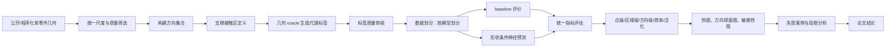
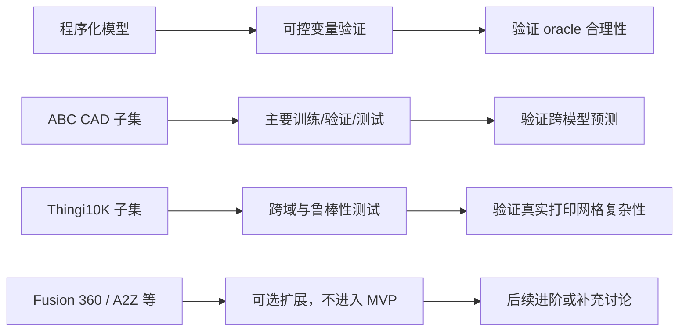
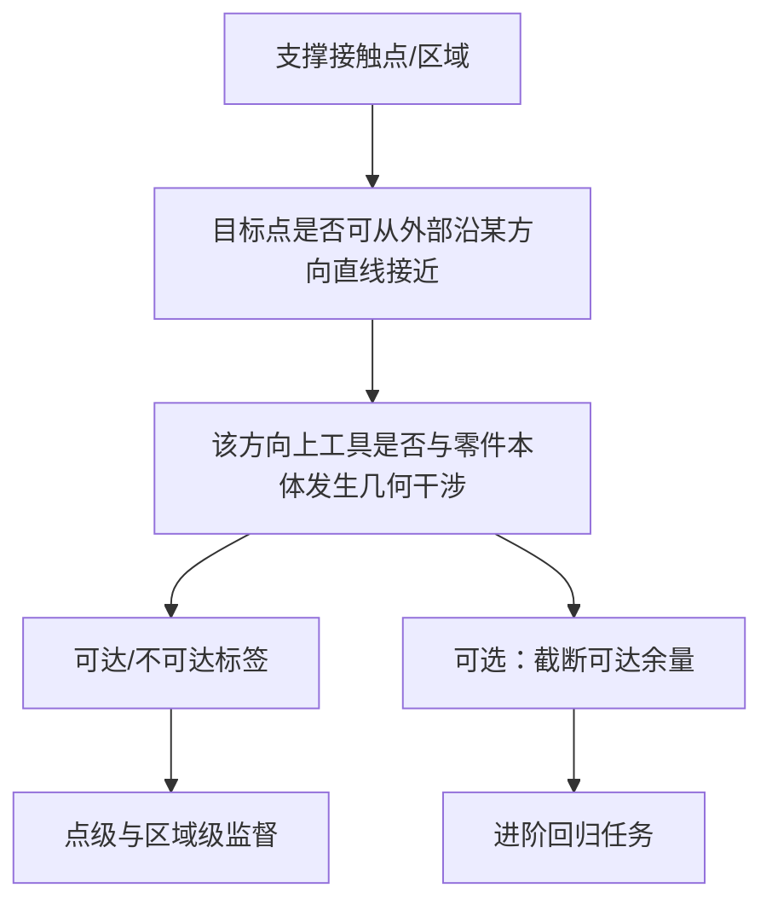
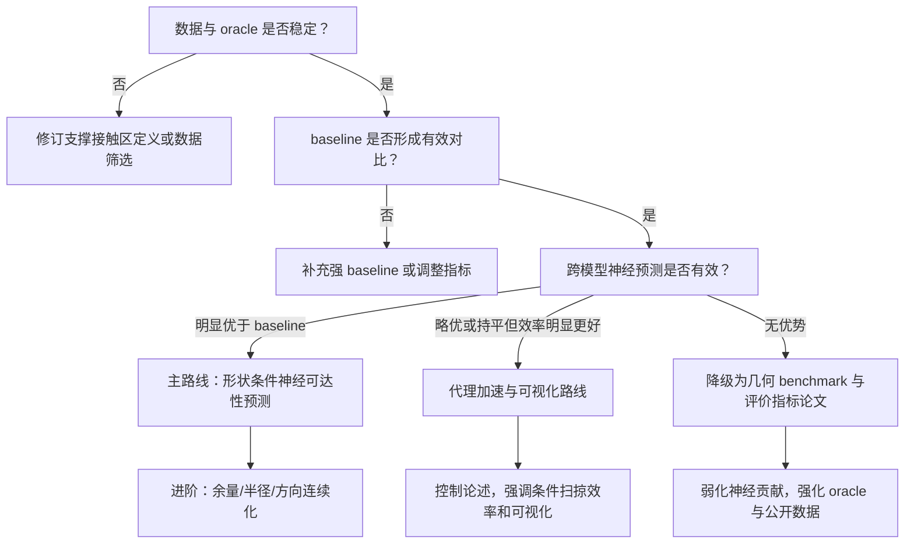

# 3_实验闭环设计
 
> 文档职责：在进入数据获取、几何处理、标签生成与模型实验之前，固定实验闭环、研究假设、数据角色、几何 oracle、评价指标、baseline、消融、鲁棒性、可视化、统计口径、MVP/进阶/降级路线与审稿预案。本文档定义实验设计契约，不含代码、工程实现细节、企业数据或真实工艺参数。
> 公开边界：所有数据为公开或程序化几何，所有标签为公开几何代理标签，所有评价围绕单零件支撑接触区，不涉及多零件排布、防互锁、刚体可分离性认证、企业参数、企业零件或企业验收逻辑。
> 引用编号：全局唯一编号 [R1]–[R27]，定义见 `2_文献矩阵与相关工作`。
> 文档间指向：问题定义与判定语义见 `1_选题与研究定位` 第二部分；执行阶段门见 `0_执行路线与阶段门`。
 
---
 
## 目录
 
- [1. 实验闭环总览](#1-实验闭环总览)
- [2. 研究假设与要回答的问题](#2-研究假设与要回答的问题)
- [3. 实验对象、输入与输出契约](#3-实验对象输入与输出契约)
- [4. 数据策略与数据集角色](#4-数据策略与数据集角色)
- [5. 支撑接触区与标签对象的实验定义](#5-支撑接触区与标签对象的实验定义)
- [6. 几何 oracle 与标签质量控制](#6-几何-oracle-与标签质量控制)
- [7. 实验组设计](#7-实验组设计)
- [8. Baseline 设计](#8-baseline-设计)
- [9. 评价指标体系](#9-评价指标体系)
- [10. 消融实验设计](#10-消融实验设计)
- [11. 鲁棒性与压力测试](#11-鲁棒性与压力测试)
- [12. 可解释性、可视化与失败案例](#12-可解释性可视化与失败案例)
- [13. 统计报告方式与公平性原则](#13-统计报告方式与公平性原则)
- [14. 最小、进阶与降级实验闭环](#14-最小进阶与降级实验闭环)
- [15. 实验风险与审稿质疑预案](#15-实验风险与审稿质疑预案)
- [16. 记录模板](#16-记录模板)
---
 
## 1. 实验闭环总览
 
### 1.1 实验目标
 
本论文的实验目标不是证明某个真实金属零件一定能被成功打印和拆除支撑，也不是复现工业级支撑移除工艺，而是：
 
> 在单零件公开几何模型上，定义并验证一种支撑接触区工具可接近性的几何代理标签；在此标签体系下，评估形状条件神经预测方法能否在未见模型上给出比简单几何启发式更准确、更密集、更高效、更可解释的可达性预测。
 
数据只服务于该闭环，标签只服务于该闭环，模型只服务于该闭环，图表只服务于该闭环。
 
### 1.2 三个前置判断
 
**标签质量比网络结构更重要。** 神经网络用于制造可达性预测已被证明可行 [R6][R7]，但其价值建立在明确的可达性标签与可评价数据集上。本论文成败首先取决于 oracle 是否定义清楚、可复核、可被审稿人理解。
 
**统计单位以模型级为主。** 支撑接触区上可采样大量点，但同一模型上的点强相关；只用百万级点样本报 accuracy 会虚高。应同时报点级、区域级、方向级与模型级统计，模型级均值与置信区间作为主要口径。
 
**第一版不追求连续方向、连续工具半径与真实路径规划。** MVP 先证明单/少量工具半径、离散构建方向、二分类或截断余量标签、跨模型测试、基础 baseline 与可视化闭环成立；连续余量、连续方向、半径泛化、逐零件细化作为进阶。
 
### 1.3 实验闭环一句话
 
> 公开/程序化单零件几何 → 构建方向下的支撑接触区 → 几何 oracle 生成可达性代理标签（判据见 `1_选题与研究定位` 第 10 节）→ 训练/评估形状条件神经预测 → 与几何启发式和非泛化模型对比 → 用点级、区域级、方向级、效率和跨域指标验证 → 输出热图、方向图、敏感性图和失败案例。
 

 
### 1.4 每个环节的证据作用
 
| 环节 | 证据作用 | 审稿人可能关注 |
|---|---|---|
| 公开/程序化单零件 | 数据不依赖企业内部项目 | 是否有代表性、是否可复现 |
| 支撑接触区定义 | 研究对象不是全表面泛泛预测 | 是否合理、是否过于简化 |
| 几何 oracle | 提供可学习、可评价的目标 | 标签是否可信、是否只是人为规则 |
| 标签质量审核 | 证明 oracle 无明显错误 | 是否有人工抽样、失败样例、边界处理 |
| baseline | 证明神经方法不多余 | 是否公平、是否太弱 |
| 跨模型测试 | 证明“可泛化”不是训练集记忆 | 数据划分是否按模型 |
| 指标与统计 | 证明结果有统计意义 | 是否只报 accuracy、类别是否不平衡 |
| 可视化与失败案例 | 解释方法价值与边界 | 是否选择性展示成功案例 |
 
### 1.5 实验闭环不包含的内容
 
不包含：真实金属打印实验；真实材料性能验证；热仿真、残余应力、熔池或显微组织分析；真实支撑生成软件的商业参数；真实机器人或机床路径规划；真实夹具、刀具库、人工拆除工艺；多零件排布或防互锁验证；企业内部模型、参数、样例、验收规则或代码。这些不进入实验闭环，不写成本文贡献，也不应被审稿人误解为本文承诺。
 
---
 
## 2. 研究假设与要回答的问题
 
### 2.1 主研究假设
 
**H1：支撑接触区工具可接近性提供了不同于支撑面积/过悬面积的后处理几何风险信息。** 两个构建方向可能产生相近支撑面积，但接触区位于深槽、盲腔或遮挡区域时后处理风险不同。需通过方向级对比、典型模型热图与支撑面积 baseline 证明。
 
**H2：考虑工具尺寸的可达性标签与纯射线可见性不同。** 纯射线可见性可能判断某点可见，但工具具有非零半径时可能无法进入狭窄空间。需通过“无工具半径可见性 baseline”与“工具条件 oracle”对比证明。
 
**H3：形状条件神经预测能在未见模型上预测支撑接触区可达性。** 若模型只在训练零件上有效，就更接近逐零件隐式场 [R7] 而非跨模型代理预测。必须通过按模型划分的训练/验证/测试集证明。
 
**H4：跨模型预测的价值不只体现在 accuracy，还体现在密集热图、方向评价和条件扫掠效率。** 神经预测不一定在所有点上超过几何 oracle（oracle 本身是标签来源）；其价值应体现在训练后的快速密集查询、方向扫掠、工具条件插值与可视化初筛。
 
**H5：公开数据 + 程序化模型足以支撑几何代理论文，但不能支撑真实制造认证。** ABC、Thingi10K 与程序化几何足以验证几何定义、标签预测与泛化趋势，但不等同于真实 LPBF/SLM/DMLS 工艺验证 [R18][R19]。
 
### 2.2 论文必须回答的问题
 
1. 如何把支撑接触区工具可接近性定义成可计算、可学习、可评价的几何代理问题？
2. 该几何代理标签是否能区分支撑面积相近但后处理几何风险不同的情况？
3. 形状条件神经预测是否能在未见模型上达到可接受的点级与区域级预测效果？
4. 与支撑面积、纯射线可见性、局部几何规则、无形状条件模型、逐零件拟合模型相比，本文方法的优势在哪里？
5. 该方法是否能生成有解释性的支撑接触区热图、方向评价图与工具半径敏感性图？
6. 该方法在哪些几何情况下失败，失败原因是什么？
### 2.3 论文不回答的问题
 
某个真实金属零件是否一定能成功打印；某个真实支撑结构是否一定能被人工或机床拆除；哪一种真实 LPBF/SLM/DMLS 参数最优；支撑结构如何生成最优；多零件排布是否合法；多刚体最终能否分离；某工业软件的支撑参数是否正确；某材料的残余应力、变形或组织性能如何。
 
### 2.4 假设与实验对应
 
| 假设 | 需要的实验 | 需要的图表 |
|---|---|---|
| H1 可达性不同于支撑面积 | 支撑面积 baseline vs 可达性 oracle；方向级排序对比 | 方向球面热图、支撑面积与不可达比例散点图 |
| H2 工具尺寸不可忽略 | 纯射线可见性 vs 工具半径条件标签 | 深槽/窄孔案例图、半径敏感性曲线 |
| H3 跨模型预测成立 | 按模型划分训练/测试；ABC 内部分割；ABC→Thingi10K | 模型级指标表、跨域下降图 |
| H4 神经预测有应用价值 | 推理时间、密集热图、方向/半径扫掠 | 时间对比表、热图案例 |
| H5 公开数据足够支撑几何代理 | 程序化 + ABC + Thingi10K 组合验证 | 数据来源矩阵、失败案例图 |
 
---
 
## 3. 实验对象、输入与输出契约
 
### 3.1 实验对象
 
> 单个公开或程序化三维零件模型，在给定构建方向下由悬垂表面形成的支撑接触区，以及该区域在简化工具条件下的几何可接近性。
 
不是完整支撑结构体，也不是支撑材料、支撑路径、实际拆除顺序或真实后处理工艺。
 
### 3.2 输入契约
 
| 输入 | 说明 | 是否属于 MVP |
|---|---|---|
| 单零件几何模型 P | 来自程序化模型、ABC 或 Thingi10K | 是 |
| 构建方向 d | 离散采样方向；进阶可视为连续条件 | 是 |
| 支撑接触区候选点 x | 位于支撑接触区上的表面采样点或区域单元 | 是 |
| 工具条件 r | 简化工具半径或等价尺寸参数 | 是，先单/少量半径 |
 
### 3.3 输出契约
 
| 输出 | 用途 | MVP 要求 |
|---|---|---|
| 可达/不可达标签 | 主监督目标和主评价对象 | 必须 |
| 截断可达余量 | 二分类之外的增强输出 | 可选，建议进阶 |
| 支撑接触区热图 | 展示局部风险 | 必须 |
| 不可达区域比例 | 区域级统计 | 必须 |
| 方向级可达性评分 | 辅助构建方向评价 | 建议 |
| 工具半径敏感性 | 展示工具条件影响 | 进阶 |
| 失败案例分类 | 说明方法边界 | 必须 |
 
### 3.4 任务层级
 
| 层级 | 任务 | 是否主任务 |
|---|---|---|
| 点级任务 | 判断支撑接触点是否可达，或预测截断余量 | 主任务 |
| 区域级任务 | 估计不可达区域面积、区域 IoU、热图一致性 | 主任务 |
| 方向级任务 | 对不同构建方向做可达性评分和排序 | 辅助任务 |
 
标题与摘要应突出点级/区域级可达性预测。方向级结果写为 DfAM 预处理应用展示，不能把论文改写成“构建方向优化算法”。
 
### 3.5 变量控制
 
| 类型 | 变量 | 处理方式 |
|---|---|---|
| 主变量 | 零件几何、构建方向、工具半径 | 进入实验设计 |
| 控制变量 | 尺度归一化、采样密度、支撑接触区阈值 | 固定或少量鲁棒性测试 |
| 暂不纳入 | 材料、真实支撑参数、打印机型号、热变形、夹具、路径规划 | 不进入本文 |
 
### 3.6 工具方向模型
 
主实验默认工具方向相对灵活（近似手工/打磨类后处理），采用球模型，判据为 `1_选题与研究定位` 第 10 节的多方向直线插入。若后处理工具方向受限（如特定角度铣削/切割头），判据收窄为“受限方向集合内是否存在无碰撞直线插入”，对应的 oracle 成本、baseline 与工具半径耦合都会变化。方向受限情形作为进阶变体，不进入 MVP。
 
---
 
## 4. 数据策略与数据集角色
 
### 4.1 总原则
 
不从一开始追求数据规模，而追求数据角色明确：程序化模型验证几何逻辑；ABC 子集作机械 CAD 分布下主训练/测试；Thingi10K 子集作真实打印网格分布下鲁棒性/跨域测试；Fusion 360 Gallery、A2Z-10M+ 等仅作可选扩展，不作 MVP 前提。
 

 
### 4.2 程序化模型
 
程序化模型用于构造公开数据集中不一定均衡出现的几何变量：开放槽、深窄槽、盲孔、通孔、内凹腔、悬臂下表面、薄肋遮挡、不同开口方向、不同腔深/槽宽/孔径与工具半径比例。其价值在于可解释性：当工具半径增大、槽宽减小、腔深增加或开口方向改变时，可达性标签应出现可解释变化。程序化模型上得不到合理趋势，就不进入真实数据实验。
 
### 4.3 ABC 数据集
 
ABC 是主要 CAD 数据来源，约百万级 CAD 模型，面向几何深度学习，提供显式参数化曲线曲面，可生成不同格式与分辨率 [R18]。优势：更接近机械设计几何、规模大可筛选、适合主训练/验证/测试、支撑“公开 CAD 模型上的几何学习”定位。限制：不一定都代表金属 AM 零件；并非所有模型都适合支撑接触区分析；需筛选水密性、复杂度、尺度、薄壁与异常几何；网格化版本仍需处理面片质量与法向一致性。
 
### 4.4 Thingi10K 数据集
 
Thingi10K 含 10,000 个真实 3D 打印共享模型，强调实际打印模型常见的三角汤、非流形、自相交等问题 [R19]。价值：检查真实打印分布上的鲁棒性、暴露网格质量对支撑接触区与 oracle 标签的影响、作 ABC 之外的跨域测试、支撑“公开模型不依赖企业数据”论证。限制：类别杂、不一定是金属 AM 工业件；网格异常多可能导致标签不稳定；作训练主集会引入过多无关噪声；更适合测试、鲁棒性与失败案例分析。
 
### 4.5 Fusion 360 Gallery 与 A2Z-10M+
 
Fusion 360 Gallery 提供人类设计序列与程序化 CAD 构造数据 [R20]。A2Z-10M+ 是面向 ABC CAD 模型的大规模 B-Rep 多模态标注集合，提供大规模注释与元数据，但规模与存储需求大 [R21]。这两类不是 MVP 必要条件，可作“近年 CAD 数据集趋势”背景或进阶补充，不应把数据成败绑定到这些更复杂数据源。
 
### 4.6 数据集切分原则
 
必须按模型划分训练/验证/测试。禁止把同一模型上的不同点随机拆到训练和测试，否则严重数据泄漏。
 
| 切分方式 | 是否允许 | 原因 |
|---|---|---|
| 按模型切分 | 必须 | 验证未见模型泛化 |
| 按点随机切分 | 禁止作为主结果 | 同一模型点强相关，容易虚高 |
| 按方向切分 | 可作辅助实验 | 验证方向条件外推，但不能替代模型切分 |
| ABC 内部切分 | 必须 | 主泛化实验 |
| ABC 训练、Thingi10K 测试 | 建议 | 跨域鲁棒性实验 |
| 程序化训练、ABC 测试 | 可选 | 检查程序化数据是否能迁移 |
 
### 4.7 数据规模顺序
 
| 阶段 | 数据规模建议 | 目标 |
|---|---|---|
| 极小试运行 | 10–30 个程序化/公开模型 | 验证流程是否通顺 |
| 标签审核试验 | 50–100 个模型 | 检查 oracle 合理性 |
| MVP 实验 | 200–500 个模型 | 支撑普通中文期刊级实验闭环 |
| 完整实验 | 500–1000+ 个模型 | 增强跨模型泛化说服力 |
| 跨域测试 | 50–200 个 Thingi10K 模型 | 检查真实打印网格鲁棒性 |
 
不建议第一版直接处理全量 ABC 或全量 Thingi10K，全量处理会把研究重心拖入工程清洗与计算资源问题。
 
### 4.8 纳入与排除标准
 
建议纳入：单连通或少量连通分量的实体模型；有明确外表面与法向；存在一定比例悬垂面；复杂度适中可可视化；有槽、孔、腔、悬臂等可达性挑战。
 
建议排除或单独记录：非水密且无法稳定判断内外；自相交严重导致法向混乱；极薄壳、装饰性碎片或非实体；面片过多无法在个人设备稳定处理；完全无悬垂或支撑接触区过少；尺度异常、单位不明且无法归一化。
 
### 4.9 数据代表性表述
 
推荐：本文使用公开 CAD/STL 与程序化模型验证几何代理评价方法。ABC 用于机械 CAD 分布下的主要实验，Thingi10K 用于真实 3D 打印共享模型分布下的鲁棒性检查，程序化模型用于可控变量分析。本文不声称这些数据覆盖所有金属 AM 工业零件，而是用于验证所提出几何可达性代理定义与预测方法的可复现性。
 
不推荐：本数据集能够代表所有金属 3D 打印零件。
 
---
 
## 5. 支撑接触区与标签对象的实验定义
 
### 5.1 为什么固定支撑接触区定义
 
本文不是完整支撑生成论文，不能把实验建立在复杂商业支撑生成器上。支撑接触区应被定义为公开、可解释、可重复的几何代理对象。支撑综述说明支撑带来材料、时间、能源与后处理负担，且支撑移除受工具可达性限制 [R1]；自动支撑移除研究把支撑与零件之间的接触区域作为后处理目标对象 [R2]。因此选择支撑接触区作为评价对象是合理的。
 
需要注意的是，AM 支撑的神经工作已有先例：Surfel CNN 用神经网络预测零件表面哪里需要支撑 [R5]。本文不做支撑检测（哪里要支撑），而做支撑接触区的后处理可达性，两者是 AM 支撑链条上前后衔接的不同环节。
 
### 5.2 定义原则
 
支撑接触区定义应满足：依赖构建方向；由公开几何规则确定；能在不同公开模型上重复计算；不依赖企业内部支撑参数；不要求真实支撑结构生成；能与支撑后处理语义对应。
 
### 5.3 推荐实验口径
 
MVP 阶段定义为：在给定构建方向下，零件外表面中满足悬垂条件、理论上可能需要支撑接触的下朝区域。论文中明确这是“支撑接触区代理”，不是工业软件生成的真实支撑接触区。（完整定义与判据见 `1_选题与研究定位` 第 9、10 节。）
 
### 5.4 定义风险
 
| 风险 | 说明 | 应对 |
|---|---|---|
| 过于简化 | 真实支撑生成还受热、变形、工艺策略影响 | 明确为几何代理，不是完整支撑生成 |
| 支撑区域过多 | 纯悬垂判据可能高估支撑区域 | 报告支撑区域比例和失败案例 |
| 边界不稳定 | 接近阈值处表面点易受法向噪声影响 | 设边界不确定带或在鲁棒性实验测阈值变化 |
| 与金属 AM 工艺差距 | 真实 LPBF 支撑策略复杂 | 只研究几何可达性维度，不研究工艺支撑策略 |
 
### 5.5 标签对象层级
 
| 对象 | 用途 | 说明 |
|---|---|---|
| 点标签 | 训练和点级指标 | 每个支撑接触采样点可达/不可达 |
| 区域标签 | 可视化和区域级指标 | 不可达区域面积、IoU、热图 |
| 方向标签 | DfAM 评价展示 | 一个构建方向的总体可达性评分 |
 
点标签用于训练，区域标签用于论文图表，方向标签用于说明应用价值，三者不能混淆。
 
---
 
## 6. 几何 oracle 与标签质量控制
 
### 6.1 oracle 的地位
 
几何 oracle 是实验闭环的核心，不是实现细节，而是论文方法与评价的基础。oracle 定义不清，后续神经网络结果没有意义。
 
> 本文 oracle 是在简化工具模型和公开几何规则下，对支撑接触区点或区域进行工具可接近性判断的几何代理判定器。
 
它输出几何代理标签，不是真实生产标签。
 
### 6.2 oracle 必须满足的条件
 
| 条件 | 含义 |
|---|---|
| 可解释 | 审稿人能理解为什么某点被判为可达或不可达 |
| 可复现 | 使用公开模型和公开规则即可复现 |
| 可审计 | 能抽样可视化检查标签是否合理 |
| 可扩展 | 能在数百个模型上生成标签 |
| 可降级 | 如果余量不稳定，能降级为二分类标签 |
| 可对比 | 能与纯射线可见性、支撑面积等 baseline 区分 |
 
### 6.3 概念层级
 
oracle 不需在此指定实现算法，但需定义概念层级（判据本身见 `1_选题与研究定位` 第 10 节）：
 

 
### 6.4 二分类标签与余量标签的取舍
 
MVP 优先二分类：更容易检查、更容易与 baseline 比较、更容易在普通中文期刊形成闭环、更不容易被追问余量物理意义。余量标签作进阶，前提是余量定义稳定、边界区域处理明确、余量与可达/不可达符号一致、能展示余量随工具半径与几何开口变化的合理趋势。
 
### 6.5 标签置信度分层
 
| 标签类型 | 说明 | 处理方式 |
|---|---|---|
| 高置信可达 | 与障碍边界距离较远，多个检查方式一致 | 用于训练和主评价 |
| 高置信不可达 | 明显被遮挡或工具无法进入 | 用于训练和主评价 |
| 边界不确定 | 接近可达边界、受采样或法向影响明显 | 可排除、降权或单独报告 |
 
### 6.6 标签质量审核
 
人工只用于检查 oracle 是否合理，不等于人工标注。
 
| 审核方式 | 目的 |
|---|---|
| 典型几何审核 | 深槽、盲孔、通孔、开放面、悬臂下表面是否符合直觉 |
| 随机抽样审核 | 避免只看成功案例 |
| 边界样本审核 | 检查可达/不可达边界是否稳定 |
| 工具半径趋势审核 | 半径增大时不可达区域不应反常减少 |
| 方向变化审核 | 构建方向改变后支撑接触区和可达性应有合理变化 |
| 跨数据审核 | 程序化、ABC、Thingi10K 上都检查 |
 
### 6.7 标签质量阶段门
 
进入神经模型实验前，至少完成：至少 5 类程序化几何上的标签趋势符合预期；随机公开模型上的热图无大规模明显错误；同一模型不同构建方向的支撑接触区变化可解释；工具半径变化导致的标签变化符合几何直觉；边界不确定样本有明确处理策略；标签失败案例被记录而非删除后不报告。不满足则回到 oracle 定义与数据筛选，不直接训练网络。
 
### 6.8 oracle 的论文表述边界与局限
 
推荐表述：本文构建的是几何代理 oracle，用于生成支撑接触区工具可接近性标签。该 oracle 反映给定简化工具模型下零件本体几何的遮挡与接近可能性，不包含真实夹具、路径规划、切削力、人工操作或材料因素。
 
避免表述：该 oracle 能保证支撑真实可去除。
 
必须写出的局限（否则熟悉 AM 后处理的审稿人会追问）：
 
1. **未建模支撑间相互遮挡与移除顺序**：真实后处理时尚未移除的其它支撑本身也会遮挡工具。本文 oracle 只算零件本体几何造成的遮挡，给出的是遮挡**下界**，未建模支撑结构间相互遮挡与移除顺序依赖。
2. **代理 ≠ 真实工艺**：oracle 是几何代理，不含夹具、刀路、切削力、人工操作、材料强度。
3. **工具模型简化**：球/柱模型不等于真实刀具/工具几何；方向受限工具需按 3.6 的变体处理。
4. **网格质量依赖**：非水密、自相交、法向混乱会影响 oracle 稳定性，需筛选或纳入失败分析。
### 6.9 oracle 与近邻工作的关系
 
与 IMF [R3][R4]：IMF 说明可达性可表达为连续空间场，评价对象是支撑体积；本文借鉴“场化可达性”思想但对象是支撑接触区表面，且不做完整多轴工艺规划。与 DeepMill [R6]：DeepMill 说明神经网络可学习制造可达性并已实现跨模型预测与工具条件；本文 oracle 是 AM 支撑接触区语义下的公开几何代理标签，神经预测在此对象上采用而非首创。与 PARC [R7]：PARC 说明碰撞测度场可被神经隐式表示，但主要是逐零件配置空间场；本文 oracle 用于跨模型预测训练与评价。与 Surfel CNN [R5]：它做支撑检测，本文做支撑接触区可达性，是不同环节。
 
---
 
## 7. 实验组设计
 
### 7.1 实验总结构
 
不应只有一个“模型准确率”表。组织为八组实验：
 
| 编号 | 实验名称 | 目的 | 是否 MVP 必须 |
|---|---|---|---|
| E0 | 标签与数据 sanity check | 证明数据和 oracle 合理 | 必须 |
| E1 | 支撑面积 vs 可达性差异 | 证明问题有价值 | 必须 |
| E2 | 工具条件影响实验 | 证明工具尺寸不可忽略 | 必须 |
| E3 | 跨模型预测实验 | 证明主方法有效 | 必须 |
| E4 | baseline 对比 | 证明不是简单规则即可解决 | 必须 |
| E5 | 方向级评价实验 | 展示 DfAM 预处理应用 | 建议 |
| E6 | 消融实验 | 证明模块必要性 | 必须 |
| E7 | 鲁棒性与跨域测试 | 证明方法边界 | 建议，Thingi10K 可作进阶 |
| E8 | 效率与密集可视化 | 证明代理模型价值 | 必须 |
 
### 7.2 E0：标签与数据 sanity check
 
在进入模型训练前确认数据、支撑接触区和 oracle 标签无明显逻辑错误。展示：程序化几何上的可达/不可达图；ABC 样本上的支撑接触区热图；Thingi10K 问题网格上的失败案例；不同工具半径下标签变化；不同方向下支撑接触区变化。可转化为论文“数据与标签验证”小节。
 
### 7.3 E1：支撑面积 vs 可达性差异
 
证明本文研究的不是普通支撑面积/过悬面积问题。选择多个构建方向，比较支撑接触面积与不可达区域比例，展示：支撑面积相近但不可达比例差异显著；支撑面积较小但接触区集中在深腔或遮挡区；支撑面积较大但接触区位于开放外表面、工具可接近性较好。这是论文立论关键之一。
 
### 7.4 E2：工具条件影响实验
 
证明非零工具半径不能被忽略。比较纯射线可见性、工具半径条件下的可达性、不同工具半径下不可达区域变化。若工具半径变化对结果几乎无影响，说明数据中缺少深槽/窄孔/遮挡案例，需回到程序化模型与数据筛选。
 
### 7.5 E3：跨模型预测实验
 
验证形状条件神经预测能否在未见模型上预测 oracle 标签。必须：训练、验证、测试按模型划分；同一模型不同点不跨训练/测试泄漏；同时报点级、区域级、模型级指标；不能只展示训练集或验证集结果。
 
| 实验 | 说明 |
|---|---|
| ABC 内部泛化 | ABC 训练/验证/测试按模型切分 |
| 程序化 → 程序化 | 检查几何变量控制能力 |
| ABC → Thingi10K | 检查跨域鲁棒性，建议作进阶 |
| 少数据训练 | 检查数据规模对性能影响，建议作补充 |
 
### 7.6 E4：baseline 对比
 
证明神经方法不是简单启发式规则即可替代。必须与以下 baseline 对比：支撑面积/过悬面积方向评分；不考虑工具半径的射线可见性；局部几何规则或局部特征分类器；无形状条件的查询模型；逐零件拟合/逐零件场对照。若未严格复现 DeepMill 或 PARC，不得声称“优于 DeepMill/PARC”，可用“DeepMill-like”“PARC-style”对照描述可比较的实验变体，但需谨慎命名。
 
### 7.7 E5：方向级评价实验
 
展示本文方法可用于 DfAM 预处理风险提示，不写成“提出新的构建方向优化算法”。推荐写法：对一组候选构建方向，统计支撑接触区不可达比例或可达性评分，形成方向球面热图，辅助设计者识别后处理风险较高的方向。评价方式：方向评分误差、方向排序相关、Top-k 方向一致性、支撑面积评分与可达性评分的差异案例。
 
### 7.8 E6–E8
 
E6 消融见第 10 节；E7 鲁棒性见第 11 节；E8 效率与可视化见第 9.6、第 12 节。
 
---
 
## 8. Baseline 设计
 
### 8.1 设计原则
 
baseline 不是越多越好，而要对应论文主张。
 
| 论文主张 | 需要 baseline 证明 |
|---|---|
| 可达性不同于支撑量 | 支撑面积/过悬面积 baseline |
| 工具尺寸不可忽略 | 纯射线可见性 baseline |
| 跨模型神经预测有价值 | 无形状条件模型、局部模型、逐零件模型 |
| 方向评价有意义 | 支撑面积方向排序 baseline |
| 密集预测有效率 | oracle 时间对比 |
 
### 8.2 必须 baseline
 
**支撑面积/过悬面积**：最基础 baseline，用于方向级对比，说明传统方向评价关注支撑量、展示支撑量与不可达比例可能不一致、避免被认为只是普通构建方向优化。
 
**纯射线可见性**：不考虑工具半径，只判断接触点是否存在外部可见方向，证明工具尺寸不是可忽略细节、展示窄槽/孔洞/深腔中“可见但工具进不去”的情况。这与判据 C 在工具半径上的耦合（`1_选题与研究定位` 第 10.4 节）直接对应。
 
**局部几何规则**：局部曲率、邻域开口、到边界距离、法向方向、局部凹陷程度等概念性特征，证明问题不是简单局部特征即可解决、检查全局遮挡与局部几何的相对影响、给非神经 baseline 一个较强位置。
 
**无形状条件查询模型**：只看查询点坐标、方向和工具条件，不看零件整体形状，证明“看见形状”是必要的、跨模型预测不能只靠坐标统计，对应形状条件神经场的核心。
 
**逐零件拟合/逐零件场**：对比逐零件表示思想 [R7]，说明逐零件 overfit 可在单零件上拟合得很好但不能直接泛化到新零件，证明“跨模型”主张的意义，避免被认为只是逐零件神经场。
 
### 8.3 可选 baseline
 
**DeepMill-like 形状分类器**：DeepMill 使用刀具感知八叉树卷积网络预测不可达与遮挡区域并报告快速推理，且已实现跨模型预测与工具条件 [R6]。若实现条件允许，可设一个 DeepMill-like 的形状编码分类器作为强 baseline。注意：不应声称完整复现 DeepMill，除非完全对齐其输入、任务与实现；本文任务是 AM 支撑接触区而非减材全表面；DeepMill-like baseline 只用于说明类似形状编码分类器在本文任务上的表现。
 
**PARC-style 逐零件隐式场**：PARC 用神经隐式表示近似多轴制造碰撞测度场，重点是逐零件配置空间场 [R7]。可设 PARC-style 逐零件拟合作对照，合理比较单零件拟合精度、新零件是否需重新拟合、存储与时间成本、与跨模型预测的不同应用定位；不合理比较是声称全面优于 PARC，或用本文 AM 支撑接触区任务直接评价 PARC 的多轴制造目标。
 
### 8.4 公平性要求
 
所有 baseline 使用相同数据划分、相同支撑接触区样本、相同 oracle 标签作为评价目标、报告相同指标、区分点级/区域级/方向级、明确哪些 baseline 只能输出方向级结果、不选择性报告对本文有利的指标。若某 baseline 需重新拟合每个测试模型，应报告其拟合成本。
 
---
 
## 9. 评价指标体系
 
### 9.1 设计原则
 
不能只报 accuracy：可达/不可达样本可能类别不平衡；点样本强相关；区域边界比单点分类更重要；方向评价是排序问题；神经代理的价值还包括效率与可视化。指标分五层：点级、区域级、方向级、泛化级、效率级。
 
### 9.2 点级指标
 
| 指标 | 用途 | 注意事项 |
|---|---|---|
| Accuracy | 基础分类准确率 | 类别不平衡时不够充分 |
| Precision | 预测可达/不可达的精确性 | 需说明正类定义 |
| Recall | 不可达风险召回或可达召回 | 建议重点关注不可达召回 |
| F1 | 综合 precision 与 recall | 主指标之一 |
| AUROC | 阈值无关分类能力 | 类别极不平衡时补充 PR-AUC |
| PR-AUC | 不可达稀少时更有价值 | 建议作补充 |
 
建议把“不可达”作为风险正类，重点报告不可达区域的 recall 和 F1：在 DfAM 预处理风险提示中，漏掉不可达区域通常比误报更严重。
 
### 9.3 区域级指标
 
| 指标 | 用途 |
|---|---|
| 不可达区域 IoU | 预测与 oracle 不可达区域重叠程度 |
| 不可达面积误差 | 预测不可达面积比例与 oracle 的差异 |
| 可达面积比例误差 | 方向级可达性评分基础 |
| 热图相关性 | 预测热图与 oracle 热图的空间一致性 |
| 边界一致性 | 可选，用于余量场或边界质量分析 |
 
区域级指标应作主结果之一，论文关注的是支撑接触区区域风险而非孤立点分类。
 
### 9.4 方向级指标
 
| 指标 | 用途 |
|---|---|
| 方向评分误差 | 每个方向的不可达比例或风险评分误差 |
| Spearman 相关 | 方向排序一致性 |
| Kendall 相关 | 排序稳定性 |
| Top-k 命中率 | 推荐低风险方向是否与 oracle 一致 |
| 支撑面积排序差异 | 说明本文指标不同于支撑量 |
 
方向级是辅助应用，不应喧宾夺主。
 
### 9.5 泛化指标（按模型统计）
 
| 指标 | 用途 |
|---|---|
| ABC 内部测试性能 | 同分布未见模型泛化 |
| ABC → Thingi10K 性能下降 | 跨域鲁棒性 |
| 程序化 → 公开模型性能 | 检查可控几何是否可迁移 |
| 不同复杂度分组性能 | 检查对复杂模型是否退化 |
| 不同支撑比例分组性能 | 检查对稀疏支撑接触区是否稳定 |
 
### 9.6 效率指标
 
| 指标 | 用途 |
|---|---|
| 单模型热图生成时间 | 展示可视化效率 |
| 单方向预测时间 | 对比 oracle 查询 |
| 多方向扫掠时间 | 展示方向评价效率 |
| 多工具半径查询时间 | 展示条件查询能力 |
| 模型存储/显存占用 | 说明个人设备可执行性 |
| 标签生成时间 | 说明离线 oracle 成本 |
 
效率主张需谨慎界定。“神经预测比逐点几何分析快”本身已由既有工作体现，不作为本文新发现。本文的效率价值应收窄到**训练后对方向、工具半径等条件的密集扫掠与插值摊销**：一次训练后可在同一模型上快速生成多方向、多半径热图，而逐条件重跑几何 oracle 成本较高。效率结果应诚实区分：oracle 离线生成标签慢，神经模型训练也需要时间；优势主要在训练后的条件扫掠与密集查询。
 
### 9.7 统计口径与优先级
 
报告三类统计：点级总体指标；每模型指标的均值和标准差；每模型 bootstrap 置信区间或分位数。不建议只报所有点混合后的单一 accuracy（会让复杂模型贡献过多样本）。
 
MVP 主指标：不可达类 F1；不可达区域 IoU；不可达面积比例误差；方向排序相关；单模型热图生成时间；ABC 测试与 Thingi10K 跨域结果。Accuracy 只作辅助。
 
---
 
## 10. 消融实验设计
 
### 10.1 设计原则
 
消融应证明论文核心主张，而非展示大量任意网络变体，围绕四个问题：形状条件是否必要？工具条件是否必要？构建方向条件是否必要？局部/全局几何特征是否必要？
 
### 10.2 必须消融项
 
| 消融项 | 目的 | 预期结论 |
|---|---|---|
| 去掉形状条件 | 检查模型是否只学坐标统计 | 性能应明显下降 |
| 去掉工具半径条件 | 检查工具尺寸是否重要 | 半径变化测试中应下降 |
| 去掉构建方向条件 | 检查方向变化是否被建模 | 方向级指标应下降 |
| 只用局部几何 | 检查全局遮挡是否重要 | 深腔/遮挡案例应失败更多 |
| 只用支撑面积方向评分 | 检查传统指标局限 | 方向排序相关有限 |
 
### 10.3 建议消融项
 
程序化预训练 vs 无程序化预训练（检查可控几何是否提升泛化）；ABC 训练量变化（数据规模敏感性）；不同支撑接触区阈值（支撑区定义稳定性）；边界不确定样本处理方式（标签噪声影响）；不同输入几何表示（是否依赖某种表示）。
 
### 10.4 不建议做的消融
 
网络层数 4→8 的细碎比较；激活函数替换；优化器差异；大量超参数表格；与论文主张无关的训练技巧。这些会削弱主线。
 
### 10.5 消融写作方式
 
按“贡献主张”组织而非按“模型模块”组织：为证明跨模型泛化，展示去掉形状条件后的模型级指标下降；为证明工具条件必要，展示半径变化下无工具条件模型的错误；为证明方向条件必要，展示方向排序相关的下降；为证明局部/全局结合必要，展示深槽、盲腔和开放面案例。
 
---
 
## 11. 鲁棒性与压力测试
 
### 11.1 作用
 
鲁棒性实验不是证明方法完美，而是主动展示方法边界。对普通中文期刊与工程应用类期刊，清楚的边界说明通常比回避失败更可信。
 
### 11.2 网格质量鲁棒性
 
Thingi10K 暴露真实打印模型的非流形、自相交、三角汤问题 [R19]。
 
| 情况 | 可能影响 | 报告方式 |
|---|---|---|
| 非流形 | 内外判断和法向不稳定 | 记录失败率或排除比例 |
| 自相交 | 支撑接触区和遮挡判断异常 | 展示典型失败案例 |
| 面片过密/过疏 | 采样偏差和计算成本变化 | 分复杂度报告 |
| 法向混乱 | 悬垂判断错误 | 法向修正前后对比或排除 |
 
### 11.3 尺度鲁棒性
 
工具半径与零件尺度高度相关，应统一尺度归一化并检查不同相对工具半径下的结果。重点不是使用某个真实刀具尺寸，而是测试：小半径时可达区域是否增多；大半径时不可达区域是否增多；窄槽/孔洞案例是否对半径敏感；网络是否能学习半径条件而非只记住单一半径。
 
### 11.4 方向采样鲁棒性
 
测试方向采样数量对方向级评价的影响。MVP 用离散方向；进阶再声称方向连续查询。写作中避免说“连续优化构建方向”，除非实验确实覆盖连续方向泛化。
 
### 11.5 支撑接触区阈值鲁棒性
 
悬垂阈值变化会影响支撑接触区。测试少量阈值变化，报告支撑接触区面积变化、不可达比例变化、模型预测性能变化、边界样本是否显著增多。
 
### 11.6 跨域鲁棒性
 
推荐至少做一组 ABC → Thingi10K 测试。预期跨域性能下降，这不是失败而是诚实展示：ABC 更规范适合作主训练集；Thingi10K 更接近真实打印网格噪声适合作鲁棒性测试；跨域下降可说明未来需要更强网格清洗或数据增强。
 
### 11.7 失败压力案例
 
必须提前准备：极深盲孔；开口很窄但射线可见的槽；薄壁导致法向或内外不稳定；自相交模型；支撑接触区极小的模型；大面积开放下表面；多连通分量模型；尺度异常模型。这些应进入失败分析，而非全部清洗掉。
 
---
 
## 12. 可解释性、可视化与失败案例
 
### 12.1 可视化是重要结果
 
本文属于几何评价与预测方法论文，可视化不是装饰而是主要证据之一。没有热图与典型案例，审稿人难以理解“支撑接触区可达性”与“支撑面积”的区别。
 
### 12.2 必备可视化
 
| 图 | 作用 | 是否必须 |
|---|---|---|
| 支撑接触区高亮图 | 说明研究对象 | 必须 |
| oracle 可达性热图 | 说明标签含义 | 必须 |
| 预测 vs oracle 对比图 | 展示模型效果 | 必须 |
| 不可达区域高亮图 | 展示风险区域 | 必须 |
| 工具半径敏感性图 | 展示工具条件影响 | 建议 |
| 方向球面热图 | 展示 DfAM 预处理应用 | 建议 |
| 失败案例图 | 展示方法边界 | 必须 |
 
### 12.3 典型成功案例
 
开放外表面支撑接触区预测为可达；深槽底部支撑接触区预测为不可达；盲腔内下表面工具半径增大后不可达区域扩大；支撑面积相近但可达性差异明显的两个方向；ABC 机械件上的清晰案例；Thingi10K 真实打印网格上的鲁棒案例。
 
### 12.4 失败案例分类
 
| 类型 | 可能原因 | 论文价值 |
|---|---|---|
| oracle 边界失败 | 可达边界附近标签不稳定 | 说明标签不确定带必要 |
| 网格质量失败 | 非流形、自相交、法向混乱 | 说明公开 STL 清洗限制 |
| 深腔预测失败 | 全局遮挡信息不足 | 说明模型改进方向 |
| 极薄结构失败 | 几何尺度接近工具半径 | 说明尺度敏感性 |
| 跨域失败 | 训练与测试数据分布差异 | 说明未来数据增强方向 |
 
### 12.5 可解释性来源
 
不要求使用复杂解释算法。可解释性主要来自支撑接触区热图、方向球面评分、工具半径敏感性曲线、程序化几何变量控制、成功与失败案例对照。这些比报告神经网络内部特征更适合本论文定位。
 
### 12.6 图表选择原则
 
每张图对应一个研究假设；不展示与主线无关的网络结构细节；成功案例和失败案例都要有；方向级图不暗示本文完成了方向优化；热图颜色含义统一；可达、不可达和不确定区域清楚区分。
 
---
 
## 13. 统计报告方式与公平性原则
 
### 13.1 模型级统计优先
 
训练与评价可能基于点样本，但主结果应以模型级统计为主：同一模型上的点强相关，点数量多的模型会在总体点级指标中占过大权重。推荐每个模型计算一次 F1/IoU/面积误差，再对模型求均值与标准差，同时报中位数与分位数，补充点级总体指标。
 
### 13.2 类别不平衡处理
 
不可达区域可能比可达区域少，也可能在某些深腔模型中占比较大。必须报告类别比例，避免只用 accuracy。报告可达/不可达样本比例；使用 F1、PR-AUC、recall；对不可达类作为风险类单独报告；按不可达比例高/中/低分组评价。
 
### 13.3 数据划分与结果透明性
 
必须明确训练/验证/测试模型互不重叠；程序化与公开模型角色不同；调参只用验证集；测试集只用于最终报告；失败模型不随意删除，除非符合预先定义的排除标准。论文应报告数据筛选数量、排除模型数量与原因、支撑接触区为空或过少的模型数量、标签不确定样本比例、各数据集失败率、跨域性能下降，以增加可信度。
 
---
 
## 14. 最小、进阶与降级实验闭环
 
### 14.1 MVP 定义
 
| 项目 | MVP 设置 |
|---|---|
| 数据 | 程序化模型 + ABC 子集；Thingi10K 少量鲁棒测试 |
| 构建方向 | 离散少量方向 |
| 工具半径 | 单一主半径 + 一个变化半径 |
| 工具方向 | 方向灵活球模型（方向受限作进阶） |
| 标签 | 二分类可达/不可达；可选截断余量 |
| 任务 | 支撑接触区点级和区域级预测 |
| baseline | 支撑面积、射线可见性、局部规则、无形状条件、逐零件拟合 |
| 指标 | F1、AUROC/PR-AUC、IoU、面积误差、方向排序、效率 |
| 可视化 | 热图、方向图、半径敏感性、失败案例 |
| 结论 | 几何代理评价有效，神经方法能跨模型预测 oracle 标签 |
 
### 14.2 MVP 必须证明的三件事
 
1. 这个问题值得研究：支撑接触区可达性不同于支撑面积和纯射线可见性；
2. 这个问题能被可靠评价：oracle 标签可解释、可审计、可复现；
3. 神经方法有价值：未见模型上优于简单 baseline，或在相近精度下显著提升条件扫掠与密集查询效率。
三点不能证明则不进入复杂进阶功能。
 
### 14.3 进阶实验闭环
 
| 项目 | 进阶内容 |
|---|---|
| 连续余量 | 从二分类扩展到截断有符号余量 |
| 连续方向 | 方向作为连续条件输入，生成方向球面场 |
| 连续工具半径 | 半径条件泛化与插值测试 |
| 方向受限工具 | 受限方向集合下的判据与 baseline 变体 |
| ABC→Thingi10K | 更系统的跨域测试 |
| 高分辨率细化 | 对单个指定模型做更密集热图和细节分析 |
| 更多数据集 | Fusion 360/A2Z 子集作为补充趋势 |
 
### 14.4 降级实验闭环
 
**降级路线 A：几何可达性代理评价与公开 benchmark。** 重点从神经模型转向支撑接触区可达性定义、oracle、公开数据统计、baseline benchmark 与可视化，适合普通中文工程/图学类期刊。
 
**降级路线 B：逐零件可达场可视化与加速。** 重点从跨模型泛化转向单零件高分辨率可达场拟合、热图与方向扫掠。新意弱于主路线，因为逐零件神经场方向已接近 PARC [R7]，只作保底方案。
 
**降级路线 C：支撑接触区可达性与构建方向评价分析。** 不强调神经网络，以几何评价指标与方向热图为主，展示支撑面积无法反映后处理风险。发表难度较低，创新性也较弱。
 
### 14.5 决策树
 

 
---
 
## 15. 实验风险与审稿质疑预案
 
### 15.1 风险总表
 
| 风险 | 严重程度 | 可能表现 | 应对 |
|---|---|---|---|
| oracle 被质疑 | 高 | 标签像人为规则，不像真实问题 | 明确代理定义、可视化审核、IMF/近邻文献支撑 |
| baseline 太弱 | 高 | 审稿人认为简单方法即可 | 设置射线、局部规则、无形状条件、逐零件拟合等对照 |
| 跨模型泛化不明显 | 高 | 测试集性能低或不稳定 | 降级为 benchmark/几何评价，或减少任务难度 |
| 数据代表性不足 | 中高 | ABC/Thingi10K 不等于金属 AM | 明确几何代理，不声称工业覆盖；加入程序化变量 |
| 类别不平衡 | 中 | accuracy 虚高 | 使用 F1、PR-AUC、不可达 recall、区域 IoU |
| 方向实验被误读为方向优化 | 中 | 审稿人要求优化算法对比 | 写成方向评价热图，不写方向优化 |
| 与 DeepMill/PARC 混淆 | 高 | 被认为已有工作 | 承认方法同源，强调 AM 支撑接触区表面对象、非减材全表面/非逐零件 |
| 支撑间相互遮挡未建模 | 中 | AM 后处理审稿人追问 | 声明只算零件本体遮挡下界，未建模支撑间遮挡与移除顺序 |
| 没有真实打印实验 | 中 | 应用期刊可能追问 | 明确几何代理评价，定位 CAD/DfAM 前端风险提示 |
| 公开网格质量差 | 中 | 标签错误多 | 设置排除标准和失败案例报告 |
| 工程工作量过大 | 中 | 数据清洗、标签生成卡住 | 先 MVP，程序化 + 小规模 ABC |
 
### 15.2 预设回答
 
**没有真实打印实验，结果有效吗？** 本文研究 DfAM 预处理阶段的几何代理评价，不是完整生产认证。类似 CAD/几何学习论文可先在公开几何数据上验证代理指标、标签一致性与预测能力，真实打印、材料性能与后处理工艺属于后续工作。
 
**oracle 是否只是人为规则？** oracle 是明确的几何代理判据，与支撑移除、工具可达性与 IMF 文献中的几何可达性思想一致 [R2][R3]。本文不把 oracle 等同真实制造标签，而用它作可复现的代理目标，并通过程序化趋势、人工抽样审核、baseline 差异与失败案例说明其合理性。
 
**这是不是 DeepMill 换成 AM？** DeepMill 面向减材制造不可达与遮挡区域预测，已实现跨模型预测与工具条件 [R6]。本文对象是 AM 支撑接触区表面，方向与工具条件来自支撑后处理代理评价，输出包括支撑接触区热图、方向评价与工具敏感性。本文不声称方法超越 DeepMill，差异在评价对象与 AM 后处理语义。
 
**这是不是 PARC 的 future work？** PARC 关注多轴制造中的配置空间碰撞测度隐式表示，主要是逐零件场且需重训 [R7]。本文核心是形状条件、跨模型预测，即新零件不通过逐零件 overfit 也能进行支撑接触区代理预测；逐零件场只作 baseline 或细化分支。
 
**为什么不用完整支撑移除规划？** 完整支撑移除规划需要支撑体、夹具、工具路径、动态几何与工艺约束。本文定位为更前端的 DfAM 几何风险评价，只研究支撑接触区的工具可接近性代理标签，更适合公开数据与可复现实验，也能为后续完整规划提供输入。
 
**数据集是否代表金属 AM？** ABC 提供机械 CAD 分布，Thingi10K 提供真实 3D 打印共享模型分布，程序化模型提供可控几何变量 [R18][R19]。本文不声称覆盖所有金属 AM 工业件，只验证几何代理定义与预测方法的可复现性。
 
**神经模型为什么必要？** 对大量表面点、多方向与多工具条件逐一运行几何可达性分析成本较高。既有工作已体现几何可达性/碰撞/距离查询向神经场、连续表示与快速查询发展的趋势 [R6][R7][R13][R15]。本文的神经模型用于跨模型摊销预测与条件扫掠密集可视化，不是替代所有几何分析，也不把“神经更快”作为独立新发现。
 
---
 
## 16. 记录模板
 
### 16.1 实验记录模板
 
```text
实验编号：E__
实验名称：
对应研究假设：H__
数据来源：程序化 / ABC / Thingi10K / 其他
模型数量：
构建方向数量：
工具半径设置：
工具方向模型：灵活球 / 方向受限
支撑接触区定义版本：
oracle 版本：
baseline：
主指标：
辅助指标：
是否按模型切分：是 / 否
是否包含失败案例：是 / 否
主要结论：
主要异常：
是否进入论文主结果：是 / 否 / 待定
```
 
### 16.2 数据集记录模板
 
```text
数据集名称：
数据来源链接：
许可/使用限制：
原始模型数量：
下载模型数量：
通过初筛数量：
排除数量：
排除原因统计：非水密 / 自相交 / 法向异常 / 无支撑接触区 / 面片过多 / 其他
模型复杂度统计：
支撑接触区比例统计：
训练/验证/测试划分：
是否用于主训练：是 / 否
是否用于跨域测试：是 / 否
备注：
```
 
### 16.3 标签质量检查模板
 
```text
模型编号：
数据来源：
构建方向：
工具半径：
支撑接触区是否合理：是 / 否 / 部分
可达热图是否合理：是 / 否 / 部分
明显错误区域：
边界不确定区域：
是否存在深槽/盲孔/遮挡案例：
不同半径趋势是否合理：是 / 否 / 不适用
不同方向趋势是否合理：是 / 否 / 不适用
人工审核结论：通过 / 暂缓 / 排除
失败原因分类：
截图编号：
备注：
```

