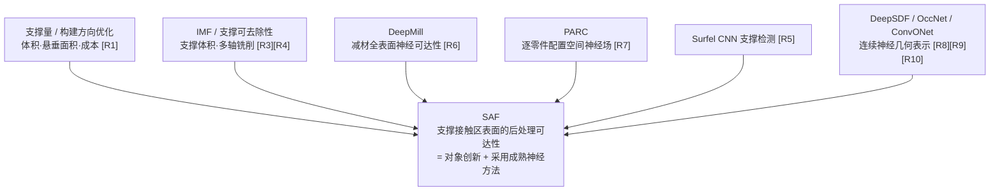

# 研究背景与设计

这份文档说明 SAF 要解决什么问题、为什么这样定义、和相近工作的区别在哪里，以及整套实验是怎样设计的。它是帮助读者理解领域内容的参考资料，**不裁决当前项目状态**：当前生效的规则看 [铁律约束](../governance/铁律约束.md) 和 [决策台账](../governance/决策台账.md)，数值结果看 [结果账本](../governance/结果账本.md)。文中的 [R*] 是文献编号，登记表见 [文献矩阵与相关工作](文献矩阵与相关工作.md)。

## 1 问题与定位

### 1.1 一句话定义

在单个公开三维零件上，识别由构建方向决定的**支撑接触区**，评价这些表面区域在简化工具条件下的**几何可接近性**，并用形状条件神经网络在**未见零件**上预测这个可接近性，为 DfAM（面向增材制造的设计）预处理提供一个不同于支撑体积、悬垂面积的后处理几何风险维度。

### 1.2 为什么值得研究

- **支撑的代价不只是用量。** 金属增材的支撑带来材料、时间、能耗和后处理负担，支撑移除常需切割、打磨或铣削，并受手或工具能否伸到的限制 [R1]。传统构建方向研究多看支撑体积、接触面积、构建高度，这些量不能等价于后处理难度：两个方向的支撑量相近，一个接触区在开阔外表面，另一个在深槽或盲腔里，后者更难清理。
- **接触区是后处理的关键对象。** 自动支撑移除的工作把“切断支撑与零件之间的接触区域”作为后处理目标 [R2]；可接近支撑的工作把不可接近性表达为连续场 [R3][R4]。
- **神经场适合做密集、可复用的预测。** 对大量接触点、多个方向逐一做几何碰撞分析成本很高；连续可查询的神经表示（DeepSDF、Occupancy Networks 等）[R8][R9] 和卷积编码的形状条件表示 [R10] 使“训练一次、在未见零件上直接预测”成为可能。机器人领域把距离、碰撞和安全性表达为神经场也是跨领域的旁证 [R13]–[R15]。

### 1.3 贡献的定位：对象与问题，而不是方法

SAF **不声称首创神经可达性预测**。贡献落在对象层：把评价对象收缩到“AM 支撑接触区**表面**的后处理工具可接近性”，并在这个对象上建立公开、可复现的几何代理评价与跨模型预测闭环。

| 编号 | 贡献 | 措辞要点 |
|---|---|---|
| C1 | 对象定义 | 以支撑接触区表面的可接近性为评价对象，区别于 IMF 的支撑体积可达性 [R3][R4] 和 DeepMill 的全表面加工可达性 [R6] |
| C2 | 公开代理闭环 | 在公开模型上构建可复现、可审计的几何代理标签与评价流程，使问题可度量、可对比 |
| C3 | 跨模型预测（采用） | 采用形状条件神经场 [R10] 做跨模型摊销预测，不声称首创该范式 |
| C4 | 可解释评价 | 用接触区热图和方向级输出提供不同于支撑体积、悬垂面积的风险维度 |

C1、C2、C4 是立足点，C3 明确写成“采用”。创新强度属于对象层加应用语义，而非方法层突破。

## 2 与最近邻工作的差异

| 工作 | 做了什么 | 与 SAF 的差异 |
|---|---|---|
| DeepMill [R6] | 减材（CNC）**全表面**神经可达性；跨模型、免重训；工具尺寸作条件；CAD 与自由曲面；密集热图；单独预测遮挡区域 | 方法层面同源，SAF 不声称超越。差异在制造场景和对象：SAF 评价 AM **支撑接触区表面**，失效语义是“工具够不到 → 事后难清理”，方向语义是单一构建方向决定接触区分布 |
| IMF 系列 [R3][R4] | 以不可达**支撑体积**（secluded support volume）评价构建方向并用于拓扑优化，绑定多轴铣削去支撑 | 对象是“体”还是“面”：IMF 评价体积能否被整体去除，SAF 评价表面区域是否可接近；SAF 面向更一般的后处理，用简化球工具，不绑定多轴机床 |
| PARC [R7] | 把碰撞测度表达为 6D 配置空间上的神经隐式场，偏逐零件、需逐形状重训 | SAF 面向跨模型预测，对象是支撑接触区表面。若只做逐零件拟合，创新会接近 PARC，所以跨模型是关键区分点 |
| Surfel CNN [R5] | 预测零件表面**哪里需要支撑** | 属于支撑检测环节；SAF 做的是支撑区的后处理可达性，是链条上前后衔接的不同环节 |

**不能声称的空白**：没人研究过 AM 支撑或工具可达性；首次用神经网络做制造可达性预测；首次做跨模型可达性预测；首次用神经网络处理 AM 支撑问题；哈希编码是新的。这些都已有工作在先 [R1]–[R7][R11]。

**可以声称的空白**：IMF 把 AM 支撑可达性表达为支撑体积并绑定多轴铣削，DeepMill 做减材全表面，PARC 做逐零件场，Surfel CNN 做支撑检测；尚缺一种以“AM 支撑接触区表面”为评价对象、面向一般后处理工具、基于公开模型、可跨模型预测其几何可接近性、服务 DfAM 预处理的方法。

## 3 研究对象与边界

| 纳入 | 不纳入 |
|---|---|
| 单个公开或程序化零件 | 多零件排布、防互锁、刚体可分离性认证 |
| 构建方向决定的支撑接触区代理 | 完整支撑生成、支撑间相互遮挡、移除顺序 |
| 简化球工具下的几何可接近性 | 刀路、机器人、夹具、切削力 |
| 点级、区域级、方向级预测与热图 | 真实打印、真实拆支撑、材料、热变形、残余应力 |

推荐的表述是“支撑接触区**几何可达性代理评价**”，它只评价几何风险，不承诺真实后处理一定成功；要避免“完整生产可行性认证”“自动排布合法性验证”“构建方向优化”这类过重或越界的说法。方向只是决定接触区分布的条件变量，不是优化对象；方向级输出只作应用展示。

## 4 判定语义：把“可达”变成可计算的几何事实

“支撑接触区可达性”在被赋予精确的判定语义之前既不可计算，也不可评价。同一句话可以对应多种判据，它们在关键几何（尤其是盲腔）上给出相反的标签，所以判定语义必须先于数据和模型冻结，并属于论文正文的问题定义部分。

### 4.1 支撑接触区的代理定义

不做完整支撑生成（它依赖热、变形和工艺策略），所以支撑接触区取为一个公开、可解释、可重复的几何代理：给定构建方向 d，零件外表面中外法向与 d 的夹角超过阈值（等价于局部倾角低于自支撑临界角）的**下朝悬垂面**。它随构建方向变化，这是 SAF 区别于 DeepMill（任意刀向）的关键之一。

| 风险 | 说明 | 应对 |
|---|---|---|
| 过于简化 | 真实支撑还受热、变形和策略影响 | 明确是几何代理，不做完整支撑生成 |
| 区域高估 | 纯悬垂判据可能多标记 | 报告接触区占比和失败案例 |
| 边界不稳 | 阈值附近的点受法向噪声影响 | 法向翻转的伪下朝面在前端剔除 |

### 4.2 三种候选判据

| 判据 | 含义 | 盲腔底部 | 深窄槽底 | 开阔外表面 | 踩运动规划边界 |
|---|---|---|---|---|---|
| A 局部可容纳 | 该点处放得下一个不与零件相交的工具球 | 可达（错） | 可能可达（错） | 可达 | 否 |
| B 连通路径 | 存在从包围盒外到该点的无碰撞运动路径 | 不可达 | 不可达 | 可达 | 是 |
| C 多方向直线插入 | 存在某个方向，工具沿直线从无穷远逼近而不碰撞 | 不可达 | 视开口与半径 | 可达 | 否 |

**选定 C。** 盲腔判例自动正确；它就是 DeepMill 对不可达点的定义 [R6]，也与 IMF 对多个工具朝向取碰撞测度同族 [R3]；避开运动规划边界；计算成本可控。A 会在最想论证问题价值的盲腔上给出错标签，B 属于运动规划问题。

工具半径 r 直接决定判据的严格度：r 增大，能插入的方向减少。因此“射线可见但有限工具进不去”正是 SAF 要捕捉的现象，也是与“零半径射线可见性”基线拉开差异的机制。需要注意：在一般几何上，不可达区域**并不随 r 单调增加**（点接触语义下大球反而能从更远处够到开阔面上的点，见决策台账 D-008），所以半径单调只在受限腔体几何上作为趋势检查。

### 4.3 输入、输出与任务层次

| 输入 | 含义 |
|---|---|
| P | 单零件几何 |
| d | 构建方向（定量实验固定为 +z） |
| x | 接触区上的查询点 |
| r | 球工具半径（定量实验固定为 0.05，零件最长边归一为 1） |

| 层级 | 任务 | 角色 |
|---|---|---|
| 点级 | 接触点可达 / 不可达 | 主任务，训练与点级指标 |
| 区域级 | 不可达区域 IoU、点占比误差、热图 | 主任务，论文图表 |
| 方向级 | 每个逼近方向是否被挡；方向排序 | 辅助任务，DfAM 展示，不写成方向优化 |

点级标签是方向级结果的“存在性归约”（任一方向可达则可达）。可达性是**几何代理概念**，不等同于真实生产可行性。

## 5 标签的可信度与局限

标签由两级几何判定器生成：体素距离场筛选明确的方向，边界带内的方向交给精确的胶囊—网格求交细化。标签进入神经实验前必须通过审核（不通过则回到判据或数据，不训练）：

- 程序化几何上，槽宽变小、腔深变大、开口方向变化时，不可达的增减合理；
- 实现正确性：体素判定与独立暴力参考的差分对拍，robust 不一致率接近 0；
- 离散稳健性：不同分辨率下的标签一致率足够高；
- 分布合理性：不可达占比与两类零件占比构成非退化的学习问题；
- 失败案例被记录而不是静默删除。

局限（论文须主动写出）：

1. 只计零件本体遮挡，得到遮挡**下界**，未建模基板、支撑间相互遮挡与移除顺序；
2. 代理不等于真实工艺：不含夹具、刀路、切削力、人工操作和材料；
3. 球工具与有限的离散方向集只是可复现的近似，不是连续姿态空间的穷尽；
4. 网格质量（非水密、自相交、法向混乱）会影响稳定性，需要筛选或纳入失败分析。

## 6 研究假设与实验设计

### 6.1 假设与对应实验

| 编号 | 假设 | 实验（脚本） |
|---|---|---|
| H1 | 接触可达性提供不同于支撑面积的风险信息 | 支撑面积与可达性的相关（`support_area_vs_accessibility`，`true_triangle_area_check`）；等面积旗舰对 |
| H2 | 考虑工具尺寸的可达性不同于纯射线可见性 | `tool_radius_effect` |
| H3 | 形状条件神经预测能在未见零件上预测可达性 | `cross_model_prediction` |
| H4 | 跨模型预测的价值体现在密集热图、方向评价与条件扫掠效率 | `direction_field_prediction`，`inference_speed` |
| H5 | 公开数据加程序化模型足以支撑几何代理论文，但不能支撑真实制造认证 | `cross_domain_robustness`，`mesh_quality_audit` |

其余实验：`baseline_comparison`（基线对照）、`shape_context_ablation`（消融）、`regression_check`（回归门）、`failure_analysis`（失败案例）、`label_audit`（标签审核）、`oracle_differential_audit`（差分审计）、`direction_field_audit`（方向分母审计）。完整结果与复现命令见结果账本。

### 6.2 数据的角色

| 数据源 | 角色 |
|---|---|
| 程序化生成 | 构造即知答案的受控几何，用于已知答案验证与训练辅助；单独评价的结论不外推 |
| Fusion 360 Gallery [R20] | 主 CAD 数据源，只用最终零件网格；以拉伸与棱柱几何为主，没有自由曲面 |
| Thingi10K [R19] | 野外打印网格，只作跨域测试，永不进训练 |

所有划分按**零件**进行，同一零件的点不跨训练 / 测试，避免形状信息泄漏。ABC 数据集因下载不便已弃用。

### 6.3 基线与公平性

基线对应论文主张，不求多：

| 论文主张 | 基线 |
|---|---|
| 神经预测不是平凡规则 | 多数类、局部几何规则 |
| 工具尺寸不可忽略 | 零半径射线可见性（oracle 在 r = 0） |
| 少量方向的有限工具计算仍保留大量信息 | 粗有限工具代理（16 全局 / 8 下半球方向） |
| 形状上下文是必要的 | 只看局部 patch 的小模型 |

所有基线使用相同的数据划分、相同的接触点和标签，报告相同的指标。没有严格复现 DeepMill 或 PARC，所以不声称“优于它们”。

### 6.4 指标与统计口径

- **不可达是风险正类**，漏报比误报更严重，所以主指标是不可达类 F1 和 IoU，辅以不可达点占比误差；Accuracy 只作辅助。
- **统计单位以零件为主**：同一零件上的点强相关，只报全部点混合后的单一指标会让点多的零件主导。因此同时报**点池**（合并所有测试点）和**零件等权**（每件一个分数再平均）两种口径，并报告零件分数的中位数与四分位距，以反映难零件的长尾。
- 方向级：逐方向 F1、可达方向集 IoU、Top-k 命中率与 precision@k（只在至少有一个可达方向的点上定义），并与随机排序、训练集全局方向先验对照。
- 效率：训练后神经查询与逐点几何判定的每点耗时比。“神经比逐点几何快”本身不是新发现，只作量级示意。

### 6.5 消融与鲁棒性

消融围绕“形状上下文是否必要”：无形状输入、小感受野、本文的中等感受野、加池化的大感受野四个变体。不做与论文主张无关的细碎超参比较。

鲁棒性与边界：跨域（Fusion 训练 → Thingi10K 测试）、原始网格质量审计（水密、边界边、非流形、退化面）、方向数的收敛检查，以及按“每点可达方向数”分箱的失败分析——误判集中在几何余量接近工具半径的边界带。

## 7 常见追问与回答

| 追问 | 回答 |
|---|---|
| 这是不是把 DeepMill 换成 AM？ | 方法同源，不声称超越；差异在评价对象（支撑接触区表面 vs 全表面）和 AM 后处理语义 [R6] |
| IMF 已经做了 AM 支撑可达性？ | IMF 评价支撑体积能否被整体去除；SAF 评价接触区表面的可接近性，不绑定多轴铣削 [R3][R4] |
| 跨模型预测不是 DeepMill 做过了吗？ | 是，所以它被写成“采用”，创新在对象定义和公开代理闭环 |
| 没有真实打印，结论有效吗？ | 验证的是神经模型对几何 oracle 标签的预测能力（surrogate fidelity），不声称真实支撑一定可拆 |
| 标签是不是人为设定？ | 标签是有明确判定语义的几何代理，并经差分、跨分辨率、分布三条审核；区分“标签正确性”和“真实工艺正确性” |
| 和 PARC 的区别？ | PARC 偏逐零件配置空间场、需逐形状重训；SAF 面向跨模型预测 [R7] |
