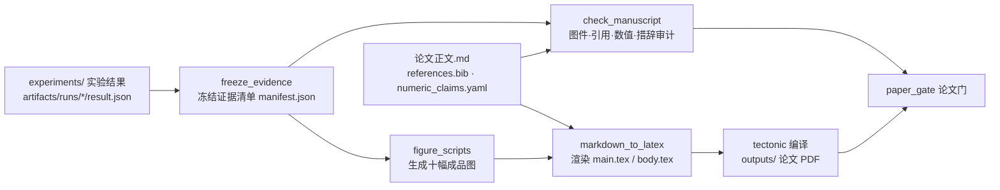

# paper — 论文下游包

论文是工程的下游发布包：这里的流水线只读取 `src/`、`experiments/` 产出的接口和结果，不反向定义工程语义。所有命令在仓库根目录、已激活 `saf` 环境下运行。

## 数据流



唯一的人工维护源稿是 `论文正文.md`：LaTeX 由脚本生成，不手工编辑；正文里的数字由 `numeric_claims.yaml` 逐条登记并与证据核对，重跑实验后数字对不上会被审计拦下。

## 目录

| 目录 / 文件 | 内容 | 入库 |
|---|---|---|
| `manuscript/论文正文.md` | 论文唯一源稿（题目、摘要、正文、图、表、公式、参考文献列表） | 是 |
| `manuscript/references.bib` | BibTeX 书目；条目顺序即正文引用编号 [1]…[n] | 是 |
| `manuscript/numeric_claims.yaml` | 正文数值声明表：每条指向一个实验结果和取值路径 | 是 |
| `manuscript/参考文献核验.md` | 每条文献的存在性与引用语境核验记录 | 是 |
| `manuscript/latex/template.tex` | LaTeX 外壳模板（版式、宏包、题目与摘要占位） | 是 |
| `pipeline/` | 论文专属 Python 代码：构建、论文门、渲染、证据加载 | 是 |
| `pipeline/figure_scripts/` | 十幅主图的生成脚本与共享模块，说明见该目录 README | 是 |
| `pipeline/audits/` | 证据冻结与源稿审计 | 是 |
| `figures/` | 成品图，每幅一对 PNG（600 dpi）和 PDF | 是 |
| `evidence/` | 证据清单 `manifest.json` 与说明 `证据清单.md`；只用逻辑数据标识和哈希，不含本机路径 | 是 |
| `投稿清单.md` | 与具体期刊有关、但不改变科学论证的行政接口 | 是 |
| `outputs/` | 论文 PDF | 否，由入库的源稿、图和证据重建 |
| `build/` | 渲染出的 LaTeX 和编译中间文件 | 否 |

## 常用命令

```bash
python tools/reproduce_experiments.py            # 重跑全部实验，生成证据（耗时较长）
python -m paper.pipeline.audits.freeze_evidence  # 冻结证据清单
python -m paper.pipeline.build_paper             # 冻结证据 → 出图 → 图件 QA → 源稿审计 → 渲染并编译 → 论文门
python -m paper.pipeline.build_paper --skip-figures --skip-latex   # 只做证据与审计的阶段性检查
python -m paper.pipeline.paper_gate              # 论文门（加 --skip-data 可在无外部数据的环境里检查）
```

编译需要 `tectonic`（已写入 `environment.yml`）；缺少编译器时构建会在编译阶段明确失败，前面的审计不受影响。编译前，构建把图件与参考文献按有效字节暂存到 `paper/build/`（逐个核对长度与内容），编译器只读取这些副本。
