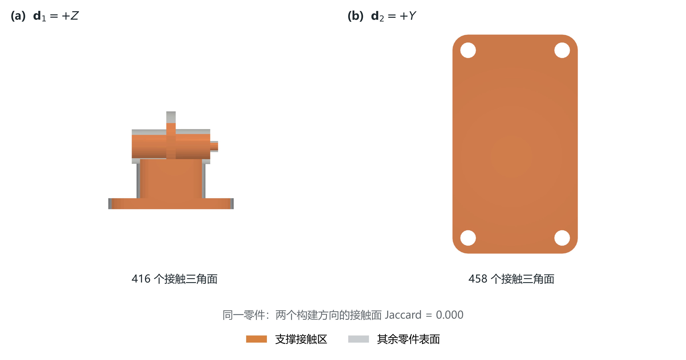
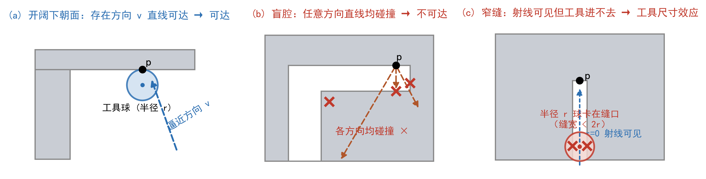
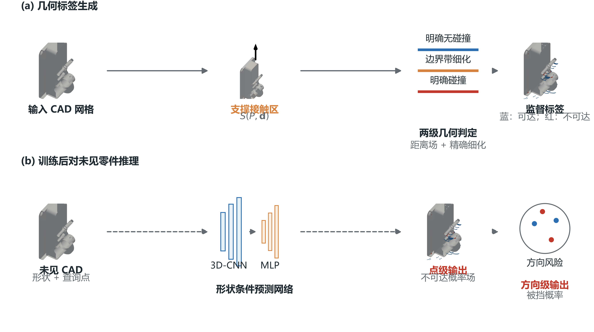
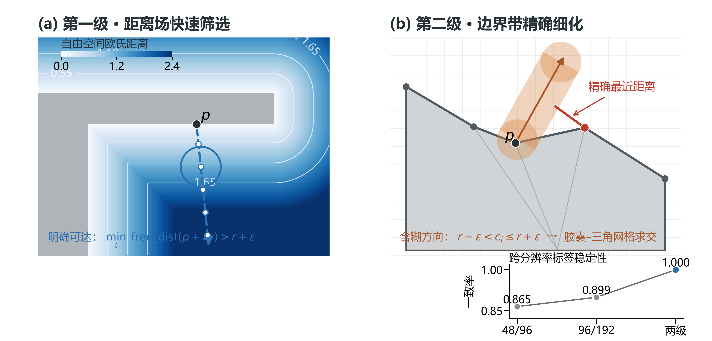
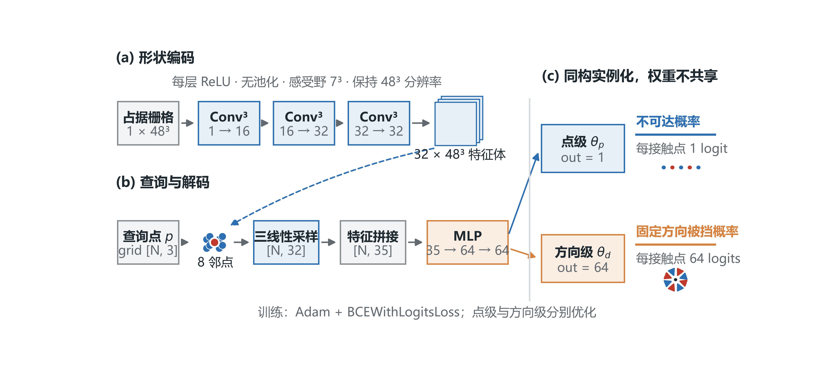
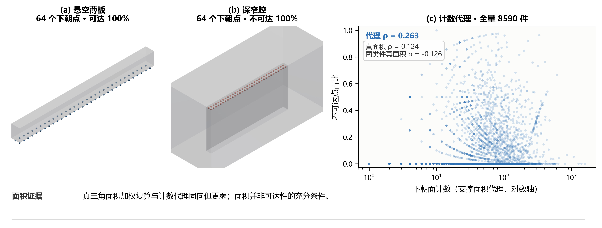
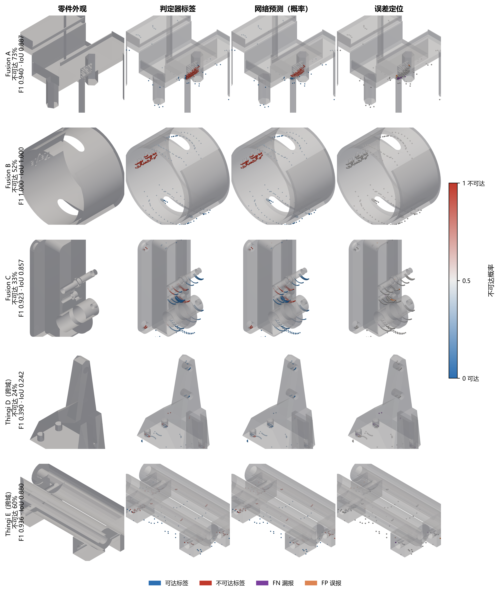
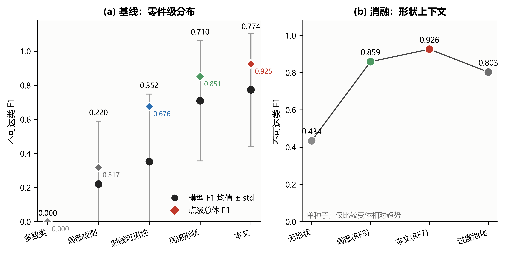
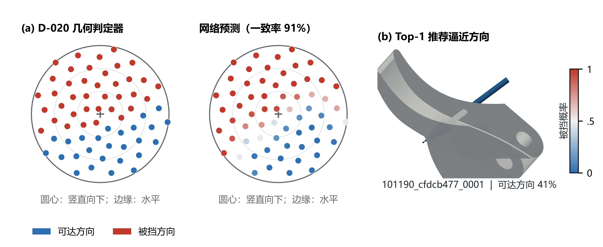
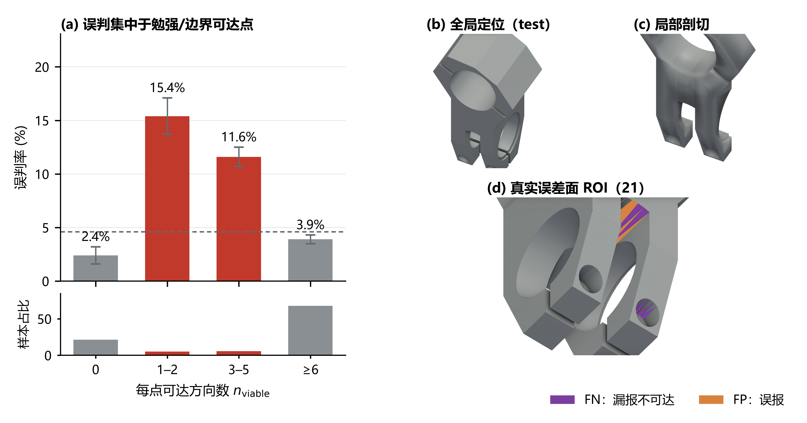

# 面向金属增材制造支撑接触区的几何可达性评价与神经预测方法

**［作者姓名 1］，［作者姓名 2］，［作者姓名 3］**

（［单位名称］，［城市 邮编］）

中图分类号：TP391.7　　文献标志码：A
基金项目：［基金名称及编号，待补］
通信作者：［姓名，电子邮箱，待补］

**英文题目：Shape-Conditioned Neural Prediction of Tool Accessibility for Support-Contact Regions in Metal Additive Manufacturing**

## 摘要

针对金属增材制造中支撑去除受后处理工具可达性制约、而支撑体积和悬垂面积等指标难以反映清理难度的问题，本文定义以支撑接触区表面为对象的几何可达性代理评价，并采用形状条件神经网络预测未见零件上的该属性。首先，在给定构建方向下从下朝悬垂面提取支撑接触区，以“存在一条逼近方向，使半径为 $r$ 的工具球可沿直线无碰撞到达接触点”为判据；随后设计由体素距离场腐蚀和边界带精确胶囊—网格求交组成的两级几何判定器，获得分辨率 48 与 96 下标签一致率为 97.28% 的自动标注。以 8590 个公开 CAD 零件为主数据源，训练网络直接输出点级不可达概率与方向级被挡概率。实验显示，支撑接触量与不可达比例仅弱相关（Spearman $|\rho|\leq0.27$），且存在接触量相同、可达率分别为 100% 和 0% 的对照构型；4.86%～29.25% 的接触点射线可见但有限工具不可达。点级跨模型预测的不可达类 F1 为 $0.886\pm0.012$，跨数据集测试未见显著退化；方向级预测的 Top-1 推荐逼近方向命中率为 0.957。训练后单点查询相对逐点几何判定快约两个数量级。本文给出的结果是零件本体遮挡下的几何代理评价，不构成真实后处理认证，可为面向增材制造的设计提供区别于支撑量的后处理风险维度。

**关键词：** 增材制造；支撑结构；工具可达性；面向增材制造的设计；深度学习；几何代理评价

**英文摘要：** 待中文正文定稿后按本摘要和正文准确对译。

## 1 引言

金属粉末床熔融等增材制造工艺常借助支撑结构抑制悬垂区域的变形、传导热量并提高成形稳定性。支撑同时带来材料、制造时间和后处理负担[1-2]，其中与零件相连的接触区域通常需要切割、铣削或打磨等操作才能清理。已有支撑移除研究也将接触区域视为关键几何对象，因为工具不仅要接近该区域，还必须避免与零件发生干涉[3]。因此，支撑完成成形任务并不等于后处理风险消失；后处理工具能否以合理的几何姿态接近接触区，是设计阶段值得单独辨识的问题。

传统的支撑相关评价多采用支撑体积、悬垂面积、构建高度或其组合。这些量能够衡量材料和成形代价，却不直接编码工具进入路径的空间约束。两个零件即使具有相近的支撑接触量，一个接触区位于开阔外表面，另一个位于深腔或窄缝的内侧，二者的清理风险也可能显著不同。后文的对照实验给出接触量相同、可达率分别为 100% 与 0% 的两件构型；在全量数据上，接触量计数代理与不可达点占比也只呈弱相关。这说明支撑量并非无用指标，而是不能替代针对接触区几何可接近性的描述。

支撑可达性的几何表达已有重要理论前身。Mirzendehdel 等从可接近支撑体积出发，研究多轴加工条件下的支撑去除和制造约束[4-5]。这些工作证明了以空间碰撞关系衡量支撑可去除性的合理性。另一方面，Huang 等以曲面元卷积预测增材制造中的支撑需求区域，关注的是何处需要支撑而不是已生成接触区的清理可达性[6]。近期 DeepMill 已在减材制造全表面上实现跨模型、含工具条件的神经可达性学习[7]；Harabin 等则以逐零件训练的隐式场表达多轴制造可达性[8]。这些成果为本文提供了方法和语义参照，也限定了本文的定位：本文不把神经可达性学习表述为最早工作，而聚焦金属增材制造支撑接触区表面这一后处理几何对象。

基于上述认识，本文将支撑接触区工具可达性表示为可查询的二值几何属性，并将该属性组织为支撑可达性场（Support Accessibility Field，SAF）。离线阶段由两级几何判定器生成标签；在线阶段由形状条件网络在未见零件上预测点级风险和方向级风险。这里的“场”指随位置及离散逼近方向变化的几何属性，而非真实切削过程仿真。公开 CAD 数据上的实验表明，主任务的不可达类 F1 为 $0.886\pm0.012$；在 Thingi10K 跨域测试中，性能与域内结果基本持平；方向级结果的 Top-1 命中率为 0.957。该设计将昂贵的逐点几何扫掠转化为训练后的条件查询，适合在设计审阅中生成风险热图。

本文的贡献如下。

1. 定义以支撑接触区表面为对象的后处理工具可达性评价问题，采用多方向直线逼近判据刻画有限尺寸工具的几何接近条件，并通过盲腔和窄缝实例说明其与接触量指标互补。
2. 提出体素距离场腐蚀与边界带精确胶囊—网格求交相结合的两级几何判定器，使工具半径相关的筛选能够在距离场上摊销，同时以连续求交消除离散边界附近的不确定性。
3. 采用形状条件网络在公开零件上学习点级和方向级可达性场；在保留的跨模型和跨数据集测试中给出基线、消融、失效分布及查询量级分析，为 DfAM 前端提供可视化风险信息。

下文第 2 节讨论相关工作；第 3 节给出对象、输入输出和判定语义；第 4 节说明标签与预测方法；第 5 节报告实验与分析；第 6 节讨论适用边界；第 7 节总结全文。

在实际设计流程中，工程师往往先根据悬垂区域估计支撑量，再以经验判断哪些位置难以清理。然而，支撑接触区的危险性并不只由面积或数量决定，还受开口大小、通道宽度、腔体深度以及工具尺度共同影响。若没有一个与工具接近动作相连的量，设计人员只能从整体支撑量间接推断风险，难以区分“接触量大但空间开阔”和“接触量小却被深腔遮蔽”的情形。本文关心的正是这种在后处理时显化、却可由设计几何预先筛查的差异。支撑量仍是重要的制造成本指标，几何可达性则补充其未编码的后处理空间约束。

从研究方法看，本文并不以网络层数或训练技巧作为工作中心。几何判据先给出监督信号的含义，学习模型再近似这一信号；因此，预测目标、误差和适用边界均可被分开检查。尤其在不可达点稀少的公开 CAD 数据上，先审查标签的稳定性、再评价跨模型预测，有助于避免把局部纹理或网格习惯误读为后处理结论。这样的闭环也使网络输出能够回溯到明确的接触点、工具半径和离散接近方向，并为后续的失效分析提供可解释的几何参照。

## 2 相关工作

### 2.1 增材制造支撑与后处理几何

支撑结构是金属增材制造中连接成形约束与后处理代价的中间实体。综述研究指出，支撑的生成与去除会影响材料消耗、成形时间和表面质量，因而需要同时考虑其制造和后处理代价[1]。在支撑移除场景中，工具与近净成形零件之间的碰撞关系直接影响接触区能否被接近[3]。本文从该事实出发，只评价接触区的几何可接近性；输出并不描述切削力、热历史、表面粗糙度或实际工艺时间。

### 2.2 可接近支撑与制造可达性

可接近支撑的研究将支撑去除问题转化为工具和实体之间的碰撞约束。Mirzendehdel 等使用多轴加工语义讨论支撑去除时的可接近支撑体积[4]，并进一步将可接近性纳入制造约束下的拓扑设计[5]。此类工作是把支撑可达性场化的关键理论基础：有限尺寸工具的扫掠可等价为对自由空间施加半径相关的腐蚀。本文沿用这一几何思想，但评价对象从支撑体积转为支撑与零件之间的表面接触区，目标是生成后处理风险热图而不是求解完整加工过程。

### 2.3 神经制造可达性

Surfel CNN 将局部曲面描述用于预测支撑需求区域，属于增材制造中支撑检测环节的神经方法[6]。DeepMill 面向减材制造全表面，采用神经网络预测不可达和遮挡区域，并显式处理不同工具条件[7]。PARC 以神经隐式形式逼近多轴制造中的可达性测度，但通常针对单个形状训练[8]。与这些研究相比，本文的差异在于：评价对象限定为金属增材制造支撑接触区；标签语义是后处理工具的多方向直线逼近；网络遵循跨模型的形状条件预测范式。因而，本文的工作重点是将一个明确的 DfAM 几何代理对象、稳定的自动标注链路和跨模型预测组织为闭环，而非把既有神经场重新表述为新范式。

### 2.4 形状条件场与公开数据

DeepSDF 和 Occupancy Networks 表明，连续查询网络可表示三维形状的距离或占据属性[9-10]。Convolutional Occupancy Networks 进一步将卷积编码得到的局部形状特征与隐式解码器结合，使查询结果依赖于具体零件几何而非单一零件的独立参数[11]。本文采用这一形状条件范式来表达可达性，而不执行形状重建任务。数据方面，Fusion 360 Gallery 提供由人类设计序列得到的公开 CAD 模型[12]，其拉伸、孔槽等特征适于形成受限接触区；Thingi10K 收录真实三维打印网格，包含更复杂的网格质量和拓扑情况[13]，用于检验跨域泛化。

**表 1  与最近邻工作的对比**

| 维度 | IMF 相关研究[4-5] | DeepMill[7] | PARC[8] | Surfel CNN[6] | 本文 |
|---|---|---|---|---|---|
| 制造场景 | AM 与多轴去支撑 | 减材 CNC | 多轴制造 | 增材制造 | 金属 AM 后处理 |
| 评价对象 | 支撑体积 | 零件全表面 | 单零件配置空间场 | 支撑需求区域 | 支撑接触区表面 |
| 泛化方式 | 几何计算 | 跨模型 | 单形状训练 | 跨模型 | 跨模型形状条件预测 |
| 失效语义 | 支撑体积难以接近 | 加工区域遮挡或不可达 | 碰撞测度 | 支撑需求 | 接触区难以清理 |
| 主要输出 | 体积可达性 | 不可达/遮挡区域 | 连续可达性测度 | 支撑检测结果 | 点级与方向级风险场 |

支撑接触区具有双重几何角色：它既连接支撑与零件的成形关系，也是后处理工具首先必须接近的区域。真实去除操作当然还会受到工具材料、夹持、切削力和表面要求影响；但在这些工艺信息尚未确定时，零件本体是否为工具留下了进入空间是一个先验且可复核的条件。本文从该最低层几何条件出发，避免把未建模的工艺知识伪装为由网格直接得出的结论。

近邻神经工作也清楚地说明了本文的取舍。DeepMill 的公开预印本已说明，神经模型可以学习工具条件下的制造可达性，并生成密集区域预测[7]；因此，本文不将“使用神经网络预测可达性”描述为新的能力。SAF 的研究问题更窄：网络只在 AM 语义的下朝接触区查询，监督信号来自有限工具的几何代理，输出仅用于提示可能存在的清理风险。PARC 的单形状隐式建模还提醒我们，跨模型能力必须由零件级切分验证，不能由同一零件内的点级随机拆分替代。表 1 的差异不构成优劣排序，而是用于划定本文结论的范围：SAF 对接触区的后处理几何风险有效，不能据此替代全表面减材可达性、支撑体积可接近性或单形状配置空间分析。

## 3 问题定义与判定语义

### 3.1 支撑接触区与输入输出

设零件边界为三角网格 $\partial P$，给定构建方向的单位向量为 $\hat{\mathbf d}$，面外法向为 $\mathbf n(p)$。以临界悬垂角 $\theta_c=45^\circ$ 提取下朝悬垂面，其采样点集合定义为支撑接触区代理：

$$
\mathcal S(P,\hat{\mathbf d})=
\{p\in\partial P\mid \mathbf n(p)\cdot\hat{\mathbf d}<-\cos\theta_c\}.
\tag{1}
$$

式（1）不是对真实支撑形貌的重建，而是将下朝面作为可能发生支撑接触的统一几何代理。图 2 显示，同一零件改变构建方向后，接触区的位置和重叠关系都会改变；因此，可达性应与具体接触区共同解释，而不能由零件整体尺度代替。

*图 2  构建方向变化引起的支撑接触区变化*

输入为网格 $P$、构建方向 $\hat{\mathbf d}$、工具球半径 $r$、接触点 $p$ 和候选逼近方向集 $\mathcal V$。输出包括点级标签 $y(p)\in\{0,1\}$，其中 1 表示不可达；以及方向级标签 $\mathbf y_{\mathcal V}(p)$，其第 $k$ 项表示沿 $\mathbf v_k$ 是否被挡。点级结果回答“此处是否至少存在一种接近方式”，方向级结果回答“哪些离散方向具有风险”。两者均服务于几何风险观察，不给出工具路径、姿态轨迹或工艺参数。

### 3.2 多方向直线逼近判据

将工具的接近端近似为半径 $r$ 的球。对从 $p$ 指向外部的候选方向 $\mathbf v$，令球心沿射线 $p+t\mathbf v$ 自外向内逼近。若这条扫掠体与零件内部不相交，则该方向可达：

$$
a(p,\mathbf v;r)=
\begin{cases}
1, & \bigl((p+[0,L]\mathbf v)\oplus B_r\bigr)\cap\operatorname{int}(P)=\varnothing,\\
0, & \text{否则},
\end{cases}
\tag{2}
$$

其中 $B_r$ 为半径 $r$ 的球，$L$ 足以使球心离开零件包围盒，$\oplus$ 表示 Minkowski 和。点级标签取离散方向上的存在性：

$$
y(p)=1-\max_{\mathbf v\in\mathcal V}a(p,\mathbf v;r),
\qquad
\mathbf y_{\mathcal V}(p)=\bigl(1-a(p,\mathbf v_1;r),\ldots,1-a(p,\mathbf v_D;r)\bigr).
\tag{3}
$$

图 3 给出该语义的三类典型情况。开阔下朝面存在至少一个无碰撞方向；盲腔即使局部能容纳球工具，也可能没有从外部直线进入的方向；窄缝则揭示零半径射线和有限工具的差异。相较只检查局部净空，式（2）同时约束了进入过程；相较全自由路径存在性，它避免引入完整运动规划的额外假设和求解成本。

*图 3  有限尺寸球工具的多方向直线逼近判据*

本文有意将判据限制为多方向直线逼近。它只计算零件本体造成的遮挡下界：不引入基板、支撑之间的相互遮挡，也不描述支撑去除时的先后关系。球工具与有限方向集也只是可复现的几何近似。因而，标签表示“在此代理下难以接近”的风险，不可外推为真实车间中的可行性认证。

**表 2  三种候选可达性判据的语义对照**

| 判据 | 盲腔 | 深窄槽 | 开阔下朝面 | 计算代价 | 本文取舍 |
|---|---|---|---|---|---|
| 局部可容纳 | 易误判可达 | 易误判 | 判定正确 | 低 | 不采用 |
| 连通无碰撞路径 | 判定正确 | 判定正确 | 判定正确 | 高 | 不作为主判据 |
| 多方向直线逼近 | 判定正确 | 判定正确 | 判定正确 | 中 | 采用 |

为避免球工具中心恰落在三角网格表面引起数值歧义，实际查询点由接触三角面的质心沿外法向安全外移得到。该外移不改变式（1）中的接触面归属，只用于让工具球的扫掠从自由空间起算。对于网格法向与内外判定不一致的样本，第 4.3 节采用保留真实窄缝面、剔除伪下朝面的规则。候选方向集则是连续方向空间的离散近似：点级输出回答预设方向分辨率下是否存在可接近方向，方向级输出保留各方向的被挡状态。它们都不等价于连续姿态空间的穷尽。

从判据选择看，局部可容纳只检验接触点附近是否放得下工具球，无法排除球体从外部进入时被腔口阻断的情形；连通无碰撞路径虽然表达力更强，却需要引入额外的路径空间、约束和求解假设。多方向直线逼近在这两者之间取得了可复现的折中：既显式检查有限工具的进入过程，又能把每个接触点的判断归结为一组独立、可批量计算的射线扫掠。图 3 的盲腔与窄缝实例正是对这一取舍的直观说明。

## 4 方法

### 4.1 总体框架

SAF 由几何标签链路和预测链路组成，如图 1 所示。给定三角网格，首先将最长包围盒边归一化为 1，利用广义缠绕数获得占据栅格，再按式（1）提取接触点。随后，两级几何判定器在工具半径和方向条件下生成点级或方向级标签。训练时，网络将占据栅格编码为形状相关的特征体；推理时仅输入未见零件的占据栅格、接触点位置及可选方向，即可输出风险概率。这样的分工将高保真几何判定保留在离线标注阶段，把密集查询交给训练后的网络。

*图 1  SAF 的几何标签生成、训练与未见零件推理流程*

### 4.2 两级几何判定器

第一级在分辨率为 48 的占据栅格上计算自由空间欧氏距离场 $\phi(\mathbf x)$。对给定 $p$ 和 $\mathbf v$，若从工具球心起始位置沿 $\mathbf v$ 直到出界的采样均满足 $\phi(\mathbf x)>r+\varepsilon$，则将该方向直接判为无碰撞；若存在采样满足 $\phi(\mathbf x)<r-\varepsilon$，则直接判为碰撞。距离场相当于对自由空间进行半径相关腐蚀，一次计算可被所有接触点和候选方向复用，因而特别适合大量工具条件下的快速筛选。

净空落在 $[r-\varepsilon,r+\varepsilon]$ 的方向进入第二级。此时以连续胶囊体表示工具球沿射线的扫掠，计算其与三角网格的精确距离或交集。只有确认为无交集的方向才保留为可达。图 4 展示了“距离场覆盖大多数明确样本、精确求交处理边界带”的分工。细化前后对分辨率 48、96 和 192 的一致性比较表明，纯体素判定的一致性为 0.865/0.899，而加入边界带细化后达到 1.000；在实际标签审核中，分辨率 48 与 96 的总体一致率为 97.28%。两种统计的样本与口径不同，前者说明判定原语在临界净空处的作用，后者用于报告真实数据标签的稳定性。

*图 4  两级几何判定器及其标签稳定性*

**算法 1  距离场筛选与边界带精确细化**

输入：占据栅格及其自由空间距离场 $\phi$，网格 $P$，接触点 $p$，半径 $r$，方向集 $\mathcal V$，边界带宽度 $\varepsilon$。
输出：点级标签 $y$ 与方向级被挡向量 $\mathbf y_{\mathcal V}$。

1. 对每个 $\mathbf v\in\mathcal V$，沿从 $p$ 通向栅格外部的射线采样工具球心位置。
2. 若所有采样点均有 $\phi>r+\varepsilon$，记 $a(p,\mathbf v;r)=1$，转至步骤 5。
3. 若存在采样点满足 $\phi<r-\varepsilon$，记 $a(p,\mathbf v;r)=0$，转至步骤 5。
4. 对边界带方向构造胶囊 $(p+[0,L]\mathbf v)\oplus B_r$；若其与 $P$ 无交集则记为 1，否则记为 0。
5. 写入 $\mathbf y_{\mathcal V}$ 的对应项为 $1-a(p,\mathbf v;r)$。
6. 若任一方向的 $a$ 为 1，则置 $y=0$；否则置 $y=1$。

算法不等同于完整加工仿真：它没有搜索弯曲路径、没有求解工具姿态序列，也没有引入刀柄、夹具及材料去除机制。其作用是以统一、可批量复现的几何语义生成监督标签。

### 4.3 标注、审核与数据口径

接触点由悬垂三角面的质心沿外法向作安全外移得到。对于法向与占据判内外不一致的情况，若外移点及反向点均落在实体内，则视为深窄空间中的真实下朝面并保留；若外移点落在实体内而反向点自由，则将其视为法向翻转导致的伪下朝面并剔除。该处理在 Fusion 数据中剔除了 11573 个点，在 Thingi10K 数据中剔除了 4321 个点，以避免把本不应属于式（1）的面混入监督数据。

方向采样采用 128 个半球方向生成点级标签，128 与 256 个方向的标签一致率为 0.982。全量 Fusion 标注实测约 0.8 h。标签质量从三个轴审核：其一，将体素判定与独立暴力参考进行差分对拍；其二，比较分辨率 48 与 96 的标签；其三，检查类别分布和双类零件比例。表 4 的结果说明标签不是无误差真值，但误差已被量化并会在局限中讨论。

### 4.4 形状条件预测网络

网络采用卷积占据网络的形状条件思想[11]。设 $O_P$ 为零件占据栅格，编码器 $E_\theta$ 生成三维特征体 $Z=E_\theta(O_P)$；对查询点 $p$，从 $Z$ 三线性采样局部特征 $z(p)$，再与归一化坐标拼接，由 MLP 解码：

$$
q_\theta(p,P)=
\operatorname{MLP}_\theta\bigl([z(p),p]\bigr),\qquad
z(p)=\operatorname{Interp}(E_\theta(O_P),p).
\tag{4}
$$

点级模型以 $\sigma(q_\theta)$ 估计不可达概率；方向级模型将方向编码与 $[z(p),p]$ 联合输入，输出 $D=64$ 个被挡概率。两个头按任务独立训练，避免把方向维度压缩为无法解释的单一标量。训练目标为类别加权二元交叉熵，权重只用于缓解不可达点稀有带来的训练偏置，最终评价仍以不可达类 F1、IoU 和方向排序指标为准。网络结构如图 5 所示。

*图 5 形状条件预测网络*

两级判定器的核心是将“绝大多数明确样本的快速筛选”和“临界样本的连续几何核验”分离。距离场对自由空间中每个位置存储至网格的最小距离，工具球半径只需与这一标量作比较即可完成粗筛。对给定点和方向，若沿射线的全部球心均具有充分净空，可直接给出可达结论；若存在明显不足的净空，则直接给出被挡结论；只有净空接近半径的边界带方向才调用胶囊—网格求交。这样，离散栅格不会主导本应由连续距离决定的边界样本。

该分层计算还带来明确的误差定位方式。若标签在不同栅格分辨率间变化，首先可检查该方向是否进入边界带；若进入，则以精确胶囊求交作为最终依据，而不是简单增加全局栅格分辨率。实际数据中，分辨率 48 与 96 的总体标签一致率为 97.28%，独立差分对拍的不一致率为 0.63%。这两个数字不被当作“绝对真值”的证明，而是说明标签语义已在不同计算路径下接受了量化审查。采用 128 个半球方向生成点级标签，增加到 256 个方向时的一致率为 0.982，也表明当前方向离散足以稳定支持本文的比较。

形状条件网络保持与几何标签相同的输入输出关系。其编码器从整个零件占据栅格中提取多尺度特征，查询点处的局部特征再与空间坐标拼接。对于点级任务，解码器输出不可达概率；对于方向级任务，方向向量与形状特征共同参与解码，因此每个扇区都对应一个明确的被挡概率。点级头和方向级头独立训练，避免把“是否存在一个可达方向”与“各方向是否被挡”混为同一监督任务。图 5 中的共享主干体现的是形状条件范式，而不是对单零件参数的记忆。

为使判定器的输出在不同任务之间保持一致，点级结果由方向级布尔向量按“存在一个可达方向”归约而来：只要某一方向通过胶囊—网格检查，点级标签即为可达；所有方向均被挡时才标为不可达。方向级任务不改变工具半径或接触点生成规则，只是保存每个离散方向的结果。因此，点级热图和方向盘可以用同一几何语义相互解释。图 4 所示的边界带也不是独立类别，而是距离场无法可靠区分时需要进入连续精查的一组方向。

网络输入的占据栅格只编码零件形状，不将支撑几何、基板信息或真实加工参数隐含输入模型。这样做使网络学到的目标与式（2）的代理保持一致，也限制了输出的解释范围。编码器通过三层三维卷积聚合局部和更大范围的空腔、开口信息；解码器在查询点处读取特征并给出概率。图 5 中点级和方向级头分别训练，是因为一个点可存在多个可达方向，直接把方向集合压缩成单一数值会损失对“从何处可接近”的解释。训练后的概率可用于阈值化着色，也可保留为连续风险强度，但本文的量化比较均以与几何标签一致的二值判定和排序指标完成。

从实现组织看，几何判定器承担的是标注和评测参照，形状条件网络承担的是对未见形状的快速逼近。二者不是相互替代关系：若用户需要审查某个高风险点的具体原因，仍可回到距离场、候选方向和胶囊求交观察净空；若需要对大量候选接触点反复生成热图，则网络避免了在每一次显示时重新执行全部几何扫掠。这种分工使方法既能保留显式几何语义，也能获得训练后批量查询的便利。

## 5 实验与分析

### 5.1 数据、切分与指标

实验使用三类公开或程序化数据。程序化零件提供可控几何变量与构造式答案；Fusion 360 Gallery 的网格作为主要 CAD 数据源；Thingi10K 作为恒定跨域测试集。所有训练、验证和测试均按零件切分，而非将同一零件的点随机拆分，以避免形状信息泄漏。Fusion 数据以拉伸和棱柱式几何为主，深孔、槽和腔体提供了可达性差异；Thingi10K 的网格质量和拓扑更复杂，适合检验分布变化下的稳健性。

**表 3  数据集统计**

| 数据源 | 零件或物化数 | 含两类标签件 | 全可达件占比 | 接触点数 | 不可达点占比 | 角色与切分 |
|---|---:|---:|---:|---:|---:|---|
| 程序化生成 | 120 | 构造双类 | — | 受控 | 受控 | 训练辅助信号 |
| Fusion 360 Gallery[12] | 8625 设计记录，8590 有效物化件 | 1553 | 82% | 约 46.7 万 | 5.1% | 主数据源，零件级 5 折 |
| Thingi10K[13] | 137 | 137 | — | 4.09 万 | — | 跨域恒定测试 |

Fusion 中只有 18.1% 的零件同时包含可达和不可达点，故主任务以含两类标签的 1553 件为评测母集；这使模型必须在同一零件内区分风险区域，也意味着类别不平衡不可忽略。点级实验报告不可达类 F1 和 IoU；跨域实验报告与域内结果的差值；方向级实验报告逐方向 F1、可达方向集 IoU、Top-$k$ 命中率和 precision@3。所有带 $\pm$ 的主结果均按其相应重复训练口径说明，避免把不同设置的离散度混读。

### 5.2 接触量、工具尺寸与标签质量

受控对照构型具有相同的接触量，而其可达率分别为 100% 与 0%，说明接触量相等并不决定工具是否能够接近。图 6 左侧给出具有相近接触量、但风险分布明显不同的两个可视化示例；右侧则报告全量统计。对全量 8590 件，接触量计数代理与不可达比例的 Spearman 系数为 0.264；在 1553 件双类零件上为 $-0.221$。以真实三角面积重新计算时，相应系数为 0.124 和 $-0.126$。这些数值均支持“弱相关而非严格独立”的表述：接触量仍携带部分信息，但无法充分预测工具可达性。

有限工具尺寸是上述差异的重要来源。相对于零半径射线，Fusion 的 600 件样本中有 4.86% 的接触点射线可见而有限工具不可达；程序化 120 件中的比例为 29.25%。图 3(c) 和该统计共同说明，以射线可见性替代有限半径扫掠会系统性漏掉窄空间风险。图 6 由此将“量多少”和“能否接近”放在同一视图中：前者是支撑代价的一个维度，后者是本文关心的后处理几何维度。

*图 6 支撑接触量与可达性并非同一维度*

**表 4  代理标签质量审核**

| 审核轴 | 结果 | 判定阈值或说明 | 样本 |
|---|---:|---|---|
| 差分鲁棒不一致率 | 0.63% | 不高于 1% | 160 采样点 |
| 跨分辨率一致率 | 97.28% | 不低于 95% | 10 件，分辨率 48 与 96 |
| 不可达点占比/双类件占比 | 5.1% / 18.1% | 如实报告分布 | 全量 8590 件 |

表 4 显示，标签链路在独立对拍与分辨率变化下保持较高一致性，但并非完美。采用边界带精确细化的意义正是在于把难以由固定栅格分辨的样本显式交给连续几何计算，而不把离散误差隐含为学习目标。

### 5.3 点级跨模型预测与基线

主试验在 Fusion 双类零件上进行 5 折零件级交叉验证。形状条件网络的不可达类 F1 为 $0.886\pm0.012$，IoU 为 0.795。为把这一结果置于可解释的参照中，表 5 还给出同一 80 件留出集上的基线比较：多数类无法识别稀有不可达点；局部规则与零半径射线分别缺少全局形状和有限工具语义；局部形状感知网络有所改善，但仍低于形状条件网络。神经方法与射线可见性基线的逐件配对 bootstrap 差值的 95% 置信区间为 [0.338, 0.527]，未跨越零。

*图 7 未见零件上的点级预测*

**表 5  跨模型点级预测主结果与基线**

| 方法 | 不可达类 F1（点级总体） | 零件级均值 $\pm$ 标准差 |
|---|---:|---:|
| 多数类 | 0.000 | $0.000\pm0.000$ |
| 局部几何规则 | 0.317 | $0.220\pm0.370$ |
| 射线可见性（$r=0$） | 0.676 | $0.352\pm0.397$ |
| 局部形状感知网络 | 0.851 | $0.710\pm0.353$ |
| 形状条件网络 | 0.925 | $0.774\pm0.333$ |
| 配对 bootstrap（网络相对射线） | [0.338, 0.527] | 网络 0.916，射线 0.676，2000 次重采样 |

表 5 的 0.925 是单次训练在同一 80 件留出集上的点级总体 F1，表中标准差是零件间离散度；它不应与主试验的五折种子级 $0.886\pm0.012$ 直接并列为同一统计量。图 7 则定性显示了这一差异：网络不仅能识别局部凹槽附近的不可达点，还可在 Thingi10K 网格上给出与几何标签相近的风险分布；误报和漏报主要集中在空间余量接近工具半径的位置。

图 8 的左侧以同一基线设置可视化表 5 的结果。右侧消融在 400 件受控子集、单种子、60 个训练轮次下完成，因此只用于判断相对趋势：无形状上下文的 F1 为 0.434，局部感受野版本为 0.859，中等感受野版本为 0.926，过度池化版本为 0.803。这说明可达性不是仅靠查询点附近法向或局部空隙即可稳定判别的属性，适当尺度的形状上下文更有助于区分盲腔、通道和开阔区域。

*图 8 基线比较与受控消融*

### 5.4 跨域泛化与方向级场

为考察数据源变化的影响，在 Fusion 留出集和未参与训练的 Thingi10K 双类子集上进行三次重复评测，结果如表 6 上半部分所示。Fusion 域内 F1 为 $0.892\pm0.012$，Thingi10K 上为 $0.895\pm0.009$，差值为 $-0.003$，未观察到显著跨域退化。作为对照，射线可见性在跨域上的 F1 为 0.655。该结果表明，网络对公开 CAD 和真实打印网格间的变化具有一定适应性；但它不证明对所有材料、网格修复策略或未知形状类别均保持同等表现。

方向级模型以 64 个离散方向输出被挡概率。表 6 下半部分给出经边界带精确细化口径得到的结果：逐方向 F1 为 $0.902\pm0.004$，可达方向集 IoU 为 0.864，Top-1 命中率为 0.957，Top-3 命中率为 0.976，precision@3 为 0.952。将所有方向均被挡的点归约为点不可达后，F1 为 0.814。归约指标低于直接点级模型是合理现象，因为它还累积了方向分类的误差；方向场的独特价值在于保留“可从哪里接近”的结构化信息。

*图 9 方向级可达性场与推荐逼近方向*

**表 6  跨域泛化与方向级可达性场结果**

| 项目 | 指标 | 结果 |
|---|---|---:|
| 域内留出 | 不可达类 F1 | $0.892\pm0.012$ |
| Thingi10K 跨域 | 不可达类 F1 | $0.895\pm0.009$ |
| 跨域相对域内 | F1 差值 | $-0.003$ |
| 跨域射线基线 | 不可达类 F1 | 0.655 |
| 方向级场 | 逐方向 F1 | $0.902\pm0.004$ |
| 方向级场 | 可达方向集 IoU | 0.864 |
| 方向级场 | Top-1 / Top-3 命中率 | 0.957 / 0.976 |
| 方向级场 | precision@3 / 归约点级 F1 | 0.952 / 0.814 |
| 方向级多数类基线 | 被挡方向 F1 | 约 0.000 |

图 9 的方向盘将几何判定器和网络结果放在同一接触点上比较。图中蓝色扇区表示可达方向，红色扇区表示被挡方向；Top-1 方向落入几何可达扇区。该图不把离散方向解释为连续姿态方案，而是提供接触区附近的方向风险摘要。

### 5.5 查询量级与失败分析

在当前实现和硬件条件下，逐点几何判定平均为 3.97 ms，训练后神经查询平均为 0.035 ms，约为 112 倍的量级差。这个比值用于说明离线标注后进行密集条件扫掠的摊销潜力，且包含 Python 循环、运行环境和实现方式的影响，不能将其解释为普遍的软件或算法速度结论。

对 Fusion 400 件子集的五次聚合分析显示，总误判率为 $4.7\%\pm0.3\%$，其中误报为 1.4%，漏报为 3.3%。图 10 按每点可达方向数分箱后可见：仅有 1～2 个可达方向的点误判率为 15.7%，有 3～5 个可达方向的点为 10.7%，而开阔点和全被挡点分别为 3.9% 与 2.9%。这与两级判定器的边界带设定一致：几何余量接近工具半径、方向集合发生切换的位置既是标签最敏感的区域，也是预测最容易混淆的区域。

*图 10 误差集中于几何边界带*

实验协议以零件为基本单位，而非以采样点为基本单位。Fusion 360 Gallery 的有效物化件作为主 CAD 源，程序化零件提供开口、腔体和工具尺寸的受控变化，Thingi10K 仅作为固定跨域测试集。这样的分工使程序化数据不替代真实网格的评测，也使跨域结果不会因参与训练而被高估。Fusion 的 82% 零件全可达、不可达点只占 5.1%，因此仅报告总体准确率会掩盖风险类别；本文以不可达类 F1、IoU 和零件级散布作为主要参照。

点级主结果和基线结果需要按统计口径理解。五折零件级交叉验证的不可达类 F1 为 $0.886\pm0.012$，IoU 为 0.795，反映重复训练下主任务的表现。表 5 中 0.925 则来自同一 80 件留出集、单次训练下的点级总体 F1，表中 $\pm$ 是零件间离散度；二者不能相互替换。该留出集上，网络相对射线可见性基线的逐件配对 bootstrap 95% 置信区间为 [0.338, 0.527]，支持网络优势并非由少数零件偶然造成。图 7 的三类案例把这种统计差异落到具体几何位置：凹槽顶部、盲孔邻域和狭窄通道附近更容易出现红色风险区域，也更容易出现误报或漏报。

图 8 的消融只用于解释形状上下文的作用。它在 400 件受控子集、单种子、60 个训练轮次下进行，数值为 0.434、0.859、0.926 和 0.803，分别对应无形状上下文、较小局部感受野、中等感受野和过度池化设置。由于训练规模和重复次数不同，这些数值不能与主试验绝对 F1 并列比较；可得出的结论仅是，在当前任务中，完全忽略形状信息明显不足，而过度压缩局部结构同样会损害判断。该结论与可达性依赖腔体全局开口而非仅依赖局部法向的几何直觉一致。

跨域结果进一步检验了这一关系。Fusion 域内 F1 为 $0.892\pm0.012$，Thingi10K 跨域 F1 为 $0.895\pm0.009$，差值为 $-0.003$；在当前公开网格和固定标签语义下，未观察到显著跨域退化。与之相比，射线基线在跨域上为 0.655，说明有限工具语义和形状上下文并未因网格来源改变而失去作用。方向级模型则提供了点级模型不能给出的排序信息：逐方向 F1 为 $0.902\pm0.004$，可达方向集 IoU 为 0.864，Top-1、Top-3 命中率分别为 0.957、0.976，precision@3 为 0.952。它们衡量的是离散接近方向的风险提示，不涉及构建姿态的全局求解。

图表之间共同支撑了三个层次的结论。首先，图 2 与图 6 从对象层面表明，接触区随构建方向改变，且接触量不能充分代表可达性；这说明仅用整体支撑量无法回答后处理工具是否有进入空间。其次，图 3、图 4 与表 4 从标签层面表明，有限尺寸工具与零半径射线语义不同，边界带精查使标签在分辨率改变时保持较高稳定性。最后，图 7 至图 10 和表 5、表 6 从预测层面表明，网络在未见零件上可以逼近该几何标签，并能把点级风险扩展为方向级风险排序。三个层次彼此衔接，但不应跨越到真实工艺认证的结论。

值得注意的是，表 5 的多数类、局部规则和射线基线分别对应不同的简化假设。多数类忽略稀有风险点，得到的不可达类 F1 为零；局部规则试图从附近几何判断风险，却缺少远处开口或封闭腔体的形状信息；射线可见性保留了直线进入的思想，却把工具半径置零。局部形状感知网络进一步加入邻域特征，F1 达到 0.851，但仍弱于形状条件网络的 0.925。这样的阶梯式比较比单独报告网络分数更能说明：提升并非只来自类别先验，而与有限尺寸工具语义和形状上下文有关。

方向级场还补充了热图的使用方式。点级概率把“至少存在一个可达方向”压缩为单个数，适于全表面快速着色；方向级概率保留了哪些扇区被挡，可用于检查某个红色区域是完全封闭还是仅在少数方向上临界。图 9 的案例和表 6 的排序指标显示，这种信息在当前离散方向集上可被稳定预测。由于方向集本身是采样，本文把它称为接近方向提示，而不把它等同于连续机械姿态或全局路径结果。

## 6 讨论与局限

本文的结果应被理解为明确条件下的几何代理，而不是支撑后处理的生产认证。第一，判据只计算零件本体遮挡形成的下界，不包含基板、支撑间相互遮挡和支撑去除的先后关系；真实工艺中还会受到刀柄、夹持、材料、力学和表面质量等因素影响。第二，球工具、有限方向集及 $45^\circ$ 悬垂阈值是统一标签语义所作的简化。它们便于比较不同零件，却不能覆盖所有工艺装备。

第三，Fusion 主数据集以拉伸和棱柱式 CAD 几何为主，且 82% 的零件全可达，不可达点只占 5.1%，存在明显类别不平衡和形状分布边界。Thingi10K 的 137 件跨域子集及每件不超过 400 点的评测能够提供无偏的采样估计，但不能替代更广泛的材料、零件类型和网格质量验证。第四，标签虽经差分与分辨率审核，仍有 0.63% 的鲁棒不一致率，48 与 96 的一致率也不是 100%；这部分边界不确定性会传递到学习结果。

最后，点级和方向级预测的意义不同。点级模型适合快速突出风险区域，方向级模型适合以离散扇区解释哪些接近方向被挡。二者都不直接生成工具路径，也不包含真实支撑形貌。后续研究可在保持判定对象清晰的前提下，扩展工具几何、连续方向表达以及与实验测量的对照；这些扩展须另行建立可验证的工艺数据，而不能由本文的几何结果直接推断。

查询量级与失败模式需要一起解释。当前实现中，逐点几何判定平均为 3.97 ms，训练后网络查询平均为 0.035 ms，约有两个数量级的差别。前者含有逐点几何流程，后者发生在网络训练完成之后，且比值会受到 Python 循环、硬件和实现方式影响；因此它只说明对同一零件进行密集点、方向条件扫掠时的摊销潜力，不能被理解为普遍的速度承诺。离线建立高质量标签仍依赖几何计算，网络预测也应在需要时由几何判定复核。

失败分析显示，模型最容易混淆的不是明显开阔或完全封闭的位置，而是几何余量接近工具半径的边界带。Fusion 400 件子集的五次聚合总误判率为 $4.7\%\pm0.3\%$，误报为 1.4%，漏报为 3.3%。仅有 1～2 个可达方向的点误判率为 15.7%，有 3～5 个可达方向的点为 10.7%，而开阔点和全被挡点分别为 3.9% 和 2.9%。图 10 以颜色和局部放大展示了这种分布：紫色漏报和橙色误报主要围绕开口边缘、深槽顶部和临界通道出现。该现象与两级判定器对边界带的处理相呼应，也为后续加强临界区域采样提供了明确方向。

除几何和数据边界外，解释模型结果时还需区分“预测正确”与“工艺充分”。网络在 Thingi10K 上获得接近域内的 F1，说明它没有明显依赖 Fusion 的单一网格外观；但 Thingi10K 并非金属零件后处理的完整代表，且跨域评测是固定子集上的点采样估计。类似地，标签的一致率较高并不意味着所有临界接触点的真实工具行为已被完全刻画。将这些不确定性公开写出，是为了让读者知道热图最适合作为设计筛查和复核起点，而不是最终放行依据。

未来可在不改变研究边界的前提下，逐步增加更复杂的工具几何、方向采样密度和公开实验对照。每一项扩展都应重新说明其输入、标签语义、评测样本和误差来源，并与本文的球工具直线逼近代理区分。这样既能保留当前方法的可复现性，也能避免用未经验证的附加假设放大现有结果。

## 7 结论

本文面向金属增材制造的支撑接触区，给出了一种几何可达性代理评价与跨模型预测闭环。通过多方向有限球工具直线逼近判据、距离场筛选与边界带精确细化相结合的两级几何判定器，获得了可审核的自动标签；采用形状条件网络后，未见零件上的不可达类 F1 达到 $0.886\pm0.012$，方向级 Top-1 命中率达到 0.957。实验进一步表明，接触量与可达性仅弱相关，有限工具尺寸不可忽略。该工作提供的是 DfAM 前端的后处理几何风险观察维度，而非真实生产可行性的承诺。

从应用角度看，SAF 最适合作为设计早期的筛查信号：它可以把同一零件上的接触区分为相对开阔、临界和被挡的区域，并用方向级输出提示离散接近方向的风险。它不替代工艺工程师对工具、夹持、材料和表面要求的判断。后续若要把热图与真实后处理结果建立更强关联，需要在保持对象和标签语义清晰的条件下，引入可公开复核的工艺数据与实验对照。

## 参考文献

[1] JIANG J, XU X, STRINGER J. Support structures for additive manufacturing: a review[J]. Journal of Manufacturing and Materials Processing, 2018, 2(4): 64. DOI: 10.3390/jmmp2040064.

[2] 王磊, 卢秉恒. 我国增材制造技术与产业发展研究[J]. 中国工程科学, 2022, 24(4): 202-211. DOI: 10.15302/J-SSCAE-2022.04.018.

[3] NELATURI S, BEHANDISH M, MIRZENDEHDEL A M, et al. Automatic support removal for additive manufacturing post processing[EB/OL]. arXiv:1904.12117, 2019[2026-07-31]. https://arxiv.org/abs/1904.12117.

[4] MIRZENDEHDEL A M, BEHANDISH M, NELATURI S. Optimizing build orientation for support removal using multi-axis machining[EB/OL]. arXiv:2107.07686, 2021[2026-07-31]. https://arxiv.org/abs/2107.07686.

[5] MIRZENDEHDEL A M, BEHANDISH M, NELATURI S. Topology optimization for manufacturing with accessible support structures[J]. Computer-Aided Design, 2022, 142: 103117. DOI: 10.1016/j.cad.2021.103117.

[6] HUANG J, KWOK T H, ZHOU C, et al. Surfel convolutional neural network for support detection in additive manufacturing[J]. The International Journal of Advanced Manufacturing Technology, 2019, 105: 3593-3604. DOI: 10.1007/s00170-019-03792-1.

[7] ZHONG F, WANG Y, WANG P S, et al. DeepMill: neural accessibility learning for subtractive manufacturing[EB/OL]. arXiv:2502.06093, 2025[2026-07-31]. https://arxiv.org/abs/2502.06093.

[8] HARABIN G P, MIRZENDEHDEL A M, BEHANDISH M. Deep neural implicit representation of accessibility for multi-axis manufacturing[J]. Computer-Aided Design, 2023, 163: 103556. DOI: 10.1016/j.cad.2023.103556.

[9] PARK J J, FLORENCE P, STRAUB J, et al. DeepSDF: learning continuous signed distance functions for shape representation[EB/OL]. arXiv:1901.05103, 2019[2026-07-31]. https://arxiv.org/abs/1901.05103.

[10] MESCHEDER L, OECHSLE M, NIEMEYER M, et al. Occupancy networks: learning 3D reconstruction in function space[EB/OL]. arXiv:1812.03828, 2018[2026-07-31]. https://arxiv.org/abs/1812.03828.

[11] PENG S, NIEMEYER M, MESCHEDER L, et al. Convolutional occupancy networks[EB/OL]. arXiv:2003.04618, 2020[2026-07-31]. https://arxiv.org/abs/2003.04618.

[12] WILLIS K D D, PU Y, LUO J, et al. Fusion 360 Gallery: a dataset and environment for programmatic CAD construction from human design sequences[EB/OL]. arXiv:2010.02392, 2020[2026-07-31]. https://arxiv.org/abs/2010.02392.

[13] ZHOU Q, JACOBSON A. Thingi10K: a dataset of 10,000 3D-printing models[EB/OL]. arXiv:1605.04797, 2016[2026-07-31]. https://arxiv.org/abs/1605.04797.
