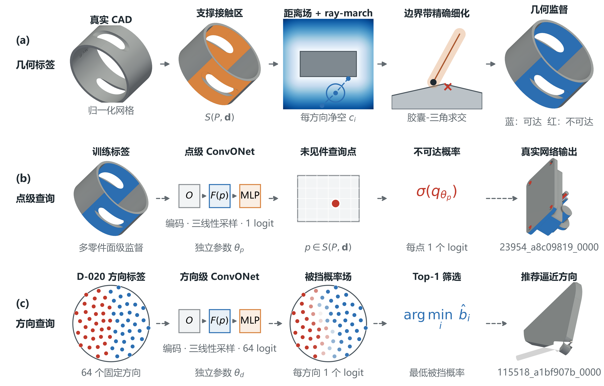
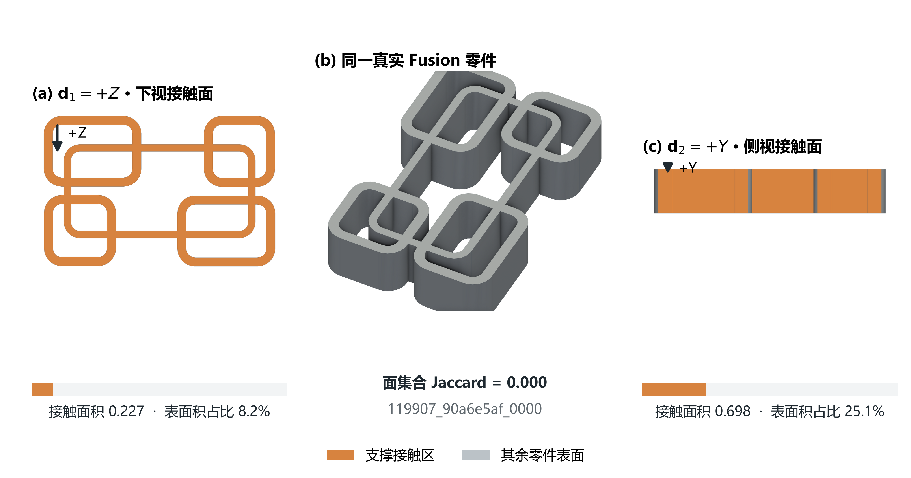
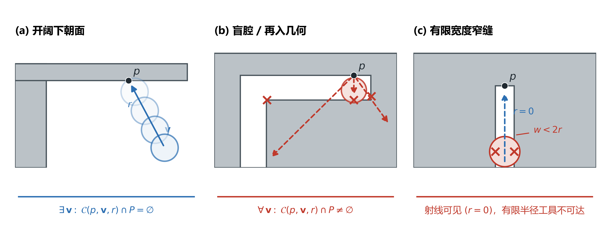
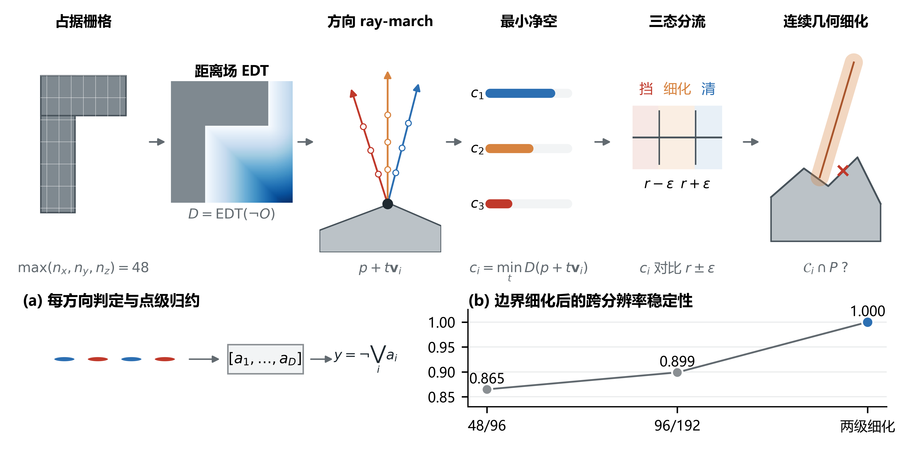
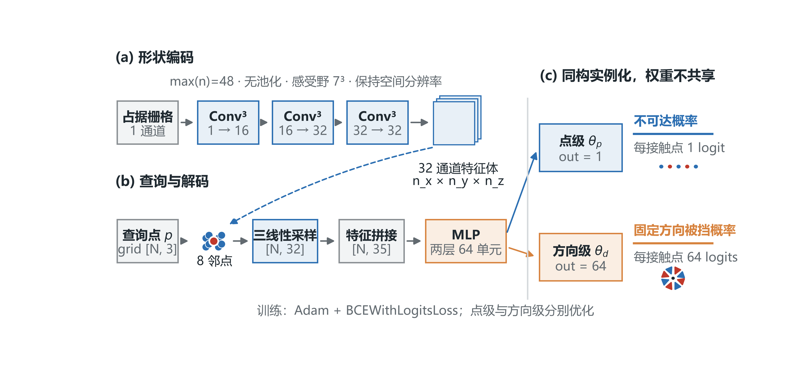
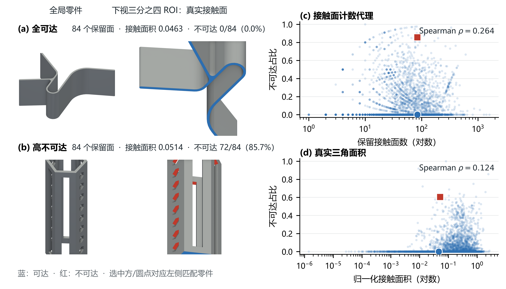
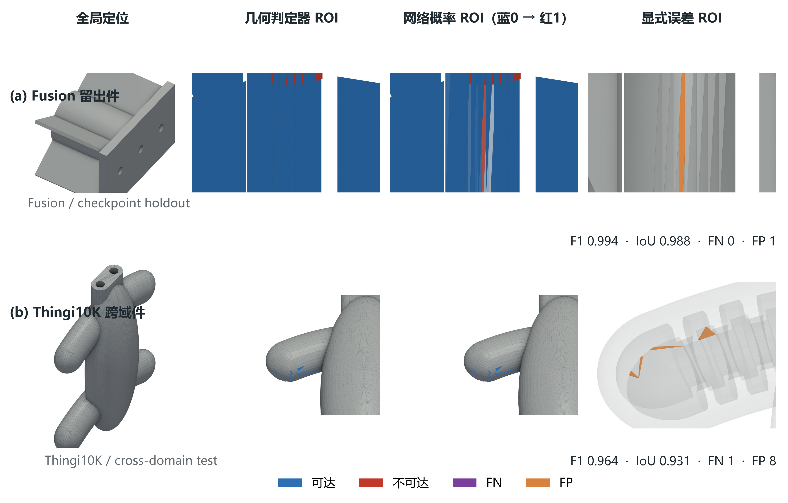
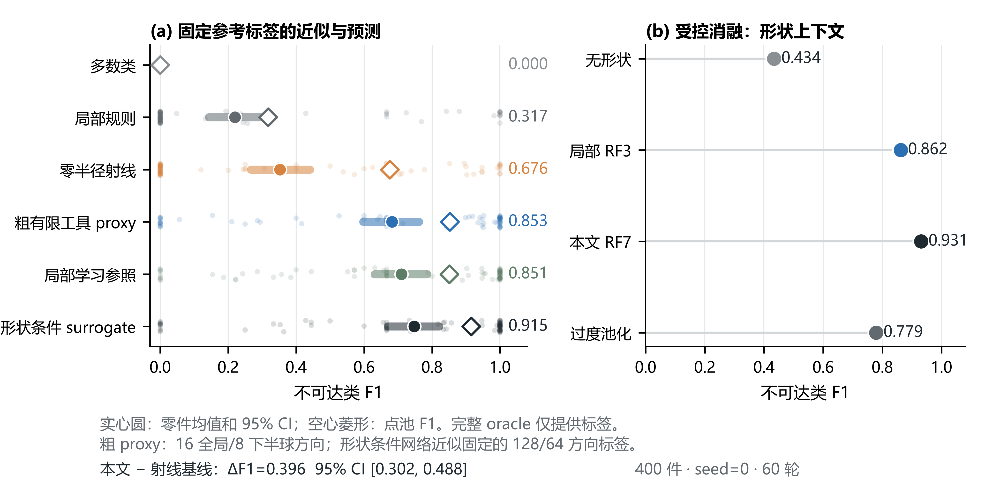
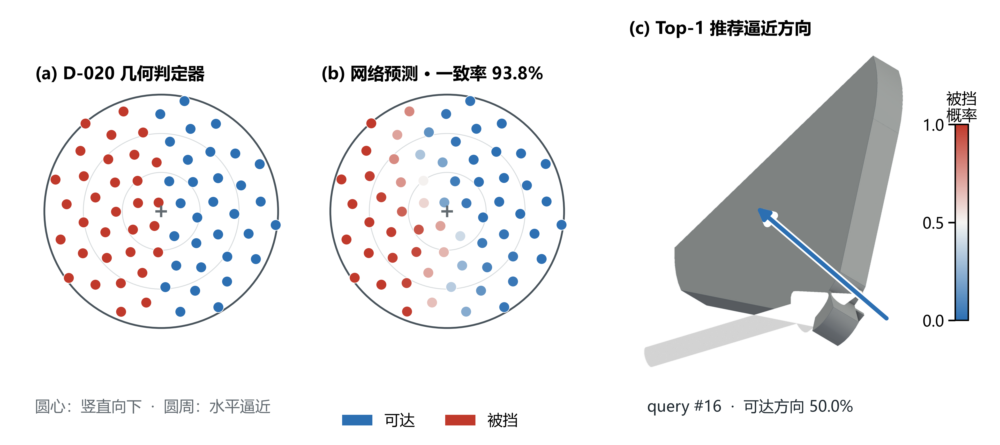
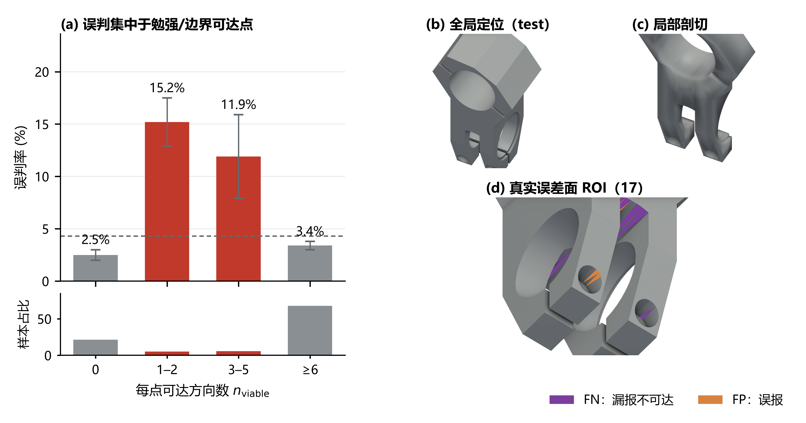

# 金属增材制造潜在支撑接触区的有限球工具几何可达性代理与形状条件预测

**英文题目：A Finite-Spherical-Tool Accessibility Proxy and Shape-Conditioned Prediction for Potential Support-Contact Regions in Metal Additive Manufacturing**

## 摘要

金属增材制造中，下朝悬垂面是否为有限尺寸工具留下进入空间，不能由支撑体积或悬垂面积直接回答。为此，本文将下朝面定义为**潜在支撑接触区代理**，并在固定构建方向、工具半径和离散方向集的几何口径下，构造有限球工具的可达性标签。若存在一个离散逼近方向，使半径为 $r$ 的球工具可沿直线无碰撞到达查询点，则该点在此代理下可达。标签生成由体素距离场筛选与边界带连续胶囊—网格距离细化组成，并以差分、跨分辨率和原始网格质量审计披露离散与数据边界。以 8,590 个公开 CAD 零件为主数据源，形状条件网络分别输出点级不可达概率和 64 个固定方向的被挡概率；网络本身不对工具半径或构建方向参数化。Fusion 与程序化数据中分别有 4.86% 和 29.25% 的接触点射线可见但有限工具不可达。五次重复模型级随机留出（每次按零件 60/20/20 切分，测试集可重叠）得到零件等权不可达类 F1 $0.791\pm0.028$、IoU $0.736\pm0.028$；每次测试零件 F1 的中位数均值为 $0.955\pm0.013$，IQR 均值为 $0.329\pm0.068$，显示总体均值与困难零件长尾并存。在固定 80 件留出集上，形状条件 surrogate 的点池 F1 为 0.915，高于零半径射线的 0.676 和 16 全局方向粗有限工具 proxy 的 0.853；相对射线的逐件配对差为 0.396，95% 置信区间为 $[0.302,0.488]$。方向级模型的逐方向 F1 为 $0.902\pm0.004$，Top-1 离散推荐命中率为 0.960。结果证明的是固定代理标签的跨模型拟合能力，不是对真实支撑接触或后处理工艺的认证。

**关键词：** 增材制造；支撑结构；工具可达性；面向增材制造的设计；深度学习；几何代理评价

## Abstract

In metal additive manufacturing, a downward-facing surface is not necessarily a realized support--part interface, but it can serve as a reproducible proxy for a potential support-contact region. We define a finite-spherical-tool accessibility proxy under a fixed build direction, tool radius, and discrete approach set, and predict its labels on unseen parts with a shape-conditioned network. A point is accessible under this proxy if a spherical tool of radius $r$ reaches it along at least one collision-free discrete straight approach. Labels combine voxel distance-field screening with continuous capsule--mesh distance refinement in a boundary band; differential, cross-resolution, and raw-mesh-quality audits disclose the numerical and data boundaries. The network is not parameterized by tool radius, build direction, or approach vectors and therefore represents one frozen configuration rather than a general tool-conditioned planner. In the Fusion and procedural samples, 4.86% and 29.25% of contacts, respectively, are ray-visible but unreachable by the finite tool. Five repeated model-level holdouts (60/20/20 part splits, with possible test-set overlap) yield equal-part inaccessible-class F1 $0.791\pm0.028$ and IoU $0.736\pm0.028$; the mean per-repeat median F1 is $0.955\pm0.013$ and the mean IQR is $0.329\pm0.068$, revealing a difficult-part tail. On a fixed 80-part holdout, the shape-conditioned surrogate obtains pooled F1 0.915, compared with 0.676 for zero-radius ray visibility and 0.853 for a 16-global-direction coarse finite-tool proxy; the paired difference over ray visibility is 0.396 with a 95% confidence interval of $[0.302,0.488]$. The directional model obtains per-direction F1 $0.902\pm0.004$ and a discrete Top-1 hit rate of 0.960. These results establish surrogate fidelity for the stated geometric proxy under part-body occlusion, not physical post-processing feasibility.

**Key words:** additive manufacturing; support structures; tool accessibility; design for additive manufacturing; deep learning; geometric proxy evaluation

## 1 引言

金属粉末床熔融等增材制造工艺常借助支撑结构抑制悬垂区域的变形、传导热量并提高成形稳定性。支撑同时带来材料、制造时间和后处理负担[1]，其中与零件相连的接触区域通常需要切割、铣削或打磨等操作才能清理。已有支撑移除研究也将接触区域视为关键几何对象，因为工具不仅要接近该区域，还必须避免与零件发生干涉[2]。因此，支撑完成成形任务并不等于后处理风险消失；后处理工具能否以合理的几何姿态接近接触区，是设计阶段值得单独辨识的问题。

传统的支撑相关评价多采用支撑体积、悬垂面积、构建高度或其组合。这些量能够衡量材料和成形代价，却不直接编码工具进入路径的空间约束。两个零件即使具有相近的支撑接触量，一个接触区位于开阔外表面，另一个位于深腔或窄缝的内侧，二者的清理风险也可能显著不同。后文的对照实验给出接触量相同、可达率分别为 100% 与 0% 的两件构型；在全量数据上，接触量计数代理与不可达点占比也只呈弱相关。这说明支撑量并非无用指标，而是不能替代针对接触区几何可接近性的描述。

支撑可达性的几何表达已有重要理论前身。Mirzendehdel 等从可接近支撑体积出发，研究多轴加工条件下的支撑去除和制造约束[3-4]。这些工作表明，以空间碰撞关系描述支撑可去除性具有明确的几何依据。另一方面，Huang 等以曲面元卷积预测增材制造中的支撑需求区域，关注的是何处需要支撑而不是候选接触区的清理可达性[5]。近期 DeepMill 已在减材制造全表面上实现跨模型、含工具条件的神经可达性学习[6]；Harabin 等则以逐零件训练的隐式场表达多轴制造可达性[7]。这些成果为本文提供了方法和语义参照，也限定了本文的定位：本文不把神经可达性学习表述为最早工作，而研究一个更窄的问题——在固定代理配置下，有限工具是否产生接触量和零半径射线无法解释的风险结构，以及形状条件网络能否在零件级留出上复现该结构。

基于上述认识，本文将潜在支撑接触区的工具可达性表示为可查询的二值几何属性，并将该属性组织为支撑可达性场（Support Accessibility Field，SAF）。离线阶段由两级几何判定器生成标签；在线阶段由形状条件网络在未见零件上预测点级风险和方向级风险。这里的“场”指随位置及离散逼近方向变化的几何属性，而非真实切削过程仿真；本研究冻结 $r=0.05$、$\hat{\mathbf d}=+z$、$\theta_c=45^\circ$ 和 $D=64$，网络输入只含占据栅格与查询点，不含这些条件变量。改变半径、构建方向或方向集需要重新生成标签并重训，不能把当前网络当作通用工具条件模型。公开 CAD 数据上的主任务使用五次重复模型级留出，零件等权 F1 为 $0.791\pm0.028$，同时报告每次零件分布的中位数和 IQR；固定 80 件基线集上的 shape-conditioned surrogate 点池 F1 为 0.915，方向级离散 Top-1 命中率为 0.960。固定 Thingi10K 子集上的跨域 F1 为 $0.888\pm0.014$，与 Fusion 域内的 $0.887\pm0.014$ 相当，但该子集只有 137 件，不构成对任意网格的泛化主张。该设计将逐点几何扫掠转化为训练后的条件查询，适合在设计审阅中生成相对风险热图，并在临界位置回到几何判定器复核。

本文围绕以下三个可证伪问题展开：

* **RQ1：** 在给定构建方向下，潜在支撑接触区的接触量或零半径射线可见性，是否遗漏了有限球工具产生的几何风险？
* **RQ2：** 在零件级留出而非点级随机拆分下，形状条件网络能否复现固定代理标签，并在模型等权统计下保持稳定？
* **RQ3：** 方向级输出能否保留离散的可接近方向结构，以及误差是否集中在方向余量临界的区域？

本文的贡献如下。

1. 定义以潜在支撑接触区表面为对象的后处理几何代理，采用多方向有限球工具直线逼近判据，并通过盲腔和窄缝实例说明其与接触量指标互补。
2. 给出体素距离场筛选与边界带连续胶囊—网格距离细化的两级标签链路，量化其离散一致性，并明确该链路不是连续物理真值。
3. 在固定代理配置下，用形状条件网络进行跨模型点级和方向级 surrogate 预测；通过重复模型级留出、基线、消融、跨域和失效分析，评估其能否复现该代理信号，而不把结果外推为工具规划或生产认证。本文没有真实支撑去除或 CAM 后处理标签，因此不把网络与自身代理的一致性解释为外部工艺效用验证。

*图 1  SAF 的几何标签生成、训练与未见零件推理流程。方向级分支以形状和查询点为输入，一次输出 64 个固定方向的被挡对数几率。*

下文第 2 节讨论相关工作；第 3 节给出对象、输入输出和判定语义；第 4 节说明标签与预测方法；第 5 节报告实验与分析；第 6 节讨论适用边界；第 7 节总结全文。

## 2 相关工作

### 2.1 增材制造支撑与后处理几何

支撑结构是金属增材制造中连接成形约束与后处理代价的中间实体。综述研究指出，支撑的生成与去除会影响材料消耗、成形时间和表面质量，因而需要同时考虑其制造和后处理代价[1]。在支撑移除场景中，工具与近净成形零件之间的碰撞关系直接影响候选接触区能否被接近[2]。本文从该事实出发，只评价下朝悬垂面构成的潜在接触区代理的几何可接近性；输出并不描述切削力、热历史、表面粗糙度或实际工艺时间。

### 2.2 可接近支撑与制造可达性

可接近支撑的研究将支撑去除问题转化为工具和实体之间的碰撞约束。Mirzendehdel 等使用多轴加工语义讨论支撑去除时的可接近支撑体积[3]，并进一步将可接近性纳入制造约束下的拓扑设计[4]。此类工作是把支撑可达性场化的关键理论基础：有限尺寸工具的扫掠可等价为对自由空间施加半径相关的腐蚀。本文沿用这一几何思想，但评价对象从支撑体积转为下朝悬垂面构成的潜在接触区代理，目标是生成后处理风险热图而不是求解完整加工过程。

### 2.3 神经制造可达性

Surfel CNN 将局部曲面描述用于预测支撑需求区域，属于增材制造中支撑检测环节的神经方法[5]。DeepMill 面向减材制造全表面，采用神经网络预测不可达和遮挡区域，并显式处理不同工具条件[6]。PARC 以神经隐式形式逼近多轴制造中的可达性测度，但通常针对单个形状训练[7]。与这些研究相比，本文的差异在于：评价对象限定为金属增材制造潜在支撑接触区代理；标签语义是后处理工具的多方向直线逼近；网络遵循跨模型的形状条件预测范式。因而，本文的工作重点是将一个明确的 DfAM 几何代理对象、稳定的自动标注链路和跨模型预测组织为可审计闭环，而非把既有神经场重新表述为新范式。

### 2.4 形状条件场与公开数据

DeepSDF 和 Occupancy Networks 表明，连续查询网络可表示三维形状的距离或占据属性[8-9]。Convolutional Occupancy Networks 进一步将卷积编码得到的局部形状特征与隐式解码器结合，使查询结果依赖于具体零件几何而非单一零件的独立参数[10]。本文采用这一形状条件范式来表达可达性，而不执行形状重建任务。数据方面，Fusion 360 Gallery 提供由人类设计序列得到的公开 CAD 模型[11]，其拉伸、孔槽等特征适于形成受限接触区；Thingi10K 收录真实三维打印网格，包含更复杂的网格质量和拓扑情况[12]，用于检验跨域泛化。

制造可达性与碰撞场的研究还表明，连续距离场或隐式场可以服务于配置空间查询和多轴过程规划[13-15]。这些工作讨论的对象包含机器人构型、演化工件或完整刀路，因而与本文的静态、接触区级代理不同。O-CNN 的稀疏八叉树卷积结构[16]以及 ABC、DeepCAD 的 CAD 数据构造方式[17-18]提供了不同的三维表示与数据来源参照；本文选择规则占据栅格和 Fusion 360 Gallery，是为了使标签判据、网络输入和评测对象保持一致。

**表 1  与最近邻工作的对比**

| 维度 | IMF 相关研究[3-4] | DeepMill[6] | PARC[7] | Surfel CNN[5] | SAF（本文） |
|---|---|---|---|---|---|
| 制造场景 | AM 与多轴去支撑 | 减材 CNC | 多轴制造 | 增材制造 | 金属 AM 后处理 |
| 评价对象 | 支撑体积 | 零件全表面 | 单零件配置空间场 | 支撑需求区域 | 潜在支撑接触区代理 |
| 工具或碰撞条件 | 多轴加工工具 | 显式工具条件 | 多轴碰撞测度 | 不评价去除工具 | 有限球工具、离散直线逼近 |
| 泛化方式 | 几何计算 | 跨模型学习 | 单形状训练 | 跨模型学习 | 跨模型形状条件学习 |
| 主要输出 | 可接近支撑体积 | 不可达/遮挡区域 | 连续可达性测度 | 支撑检测结果 | 点级与方向级风险场 |

潜在支撑接触区代理具有双重几何角色：它以统一规则近似可能发生支撑接触的下朝面，也是后处理工具首先需要接近的候选区域。真实去除操作当然还会受到工具材料、夹持、切削力和表面要求影响；但在这些工艺信息尚未确定时，零件本体是否为工具留下了进入空间是一个先验且可复核的条件。本文从该最低层几何条件出发，避免把未建模的工艺知识伪装为由网格直接得出的结论。

近邻神经工作也清楚地说明了本文的取舍。DeepMill 的正式出版论文已说明，神经模型可以学习工具条件下的制造可达性，并生成密集区域预测[6]；因此，本文不将“使用神经网络预测可达性”描述为新的能力。SAF 的研究问题更窄：网络只在 AM 语义的下朝面代理上查询，监督信号来自固定半径和固定离散方向的几何判定，输出仅用于提示可能存在的清理风险。PARC 的单形状隐式建模还提醒我们，跨模型能力必须由零件级切分验证，不能由同一零件内的点级随机拆分替代。表 1 的差异不构成优劣排序，而是用于划定本文结论的范围：SAF 只评价候选接触区的后处理几何代理，不能据此替代全表面减材可达性、支撑体积可接近性或单形状配置空间分析。

## 3 问题定义与判定语义

### 3.1 潜在支撑接触区代理与输入输出

设零件边界为三角网格 $\partial P$，给定构建方向的单位向量为 $\hat{\mathbf d}$，面外法向为 $\mathbf n(p)$。以临界悬垂角 $\theta_c=45^\circ$ 提取下朝悬垂面，其采样点集合定义为**潜在支撑接触区代理**：

$$
\mathcal S(P,\hat{\mathbf d})=
\{p\in\partial P\mid \mathbf n(p)\cdot\hat{\mathbf d}<-\cos\theta_c\}.
\tag{1}
$$

式（1）不是对真实支撑形貌或真实支撑—零件界面的重建，而是将下朝面作为可能发生支撑接触的统一几何代理。本文所有定量结果固定于 $\hat{\mathbf d}=+z$；图 2 仅用另一方向展示该代理的方向依赖。改变构建方向需要重新提取代理并重新生成标签，可达性应与具体代理区域共同解释，而不能由零件整体尺度代替。

*图 2  构建方向变化引起的潜在支撑接触区代理变化。橙色三角面为同一零件在两种构建方向下的下朝面代理；该定性案例说明代理的方向依赖，不表示物理支撑形貌。*

几何判定器的输入为网格 $P$、构建方向 $\hat{\mathbf d}$、工具球半径 $r$、代理查询点 $p$ 和候选逼近方向集 $\mathcal V$；本文冻结为 $\hat{\mathbf d}=+z$、$r=0.05$（归一化单位）和 $D=64$ 的下半球方向。输出包括点级标签 $y(p)\in\{0,1\}$，其中 1 表示不可达；以及方向级标签 $\mathbf y_{\mathcal V}(p)$，其第 $k$ 项表示沿 $\mathbf v_k$ 是否被挡。点级结果回答“此处是否至少存在一种预设离散接近方式”，方向级结果回答“哪些固定方向具有风险”。两者均服务于几何风险观察，不给出工具路径、姿态轨迹或工艺参数。网络不接收 $r$、$\hat{\mathbf d}$ 或方向向量作为条件，因此换用这些条件时必须重标注和重训。

### 3.2 多方向直线逼近判据

将工具的接近端近似为半径 $r$ 的球。对从接触点 $p$ 指向外部的候选方向 $\mathbf v$，工具与接触点相切时的球心为 $p+r\mathbf v$；因此以 $p+t\mathbf v$（$t\in[r,L]$）表示从相切位置延伸至包围盒外的球心线段。若这条扫掠体与零件内部不相交，则该方向可达：

$$
a(p,\mathbf v;r)=
\begin{cases}
1, & \bigl((p+[r,L]\mathbf v)\oplus B_r\bigr)\cap P^{\circ}=\varnothing,\\
0, & \text{否则},
\end{cases}
\tag{2}
$$

其中 $B_r$ 为半径 $r$ 的球，$L$ 足以使球心离开零件包围盒，$\oplus$ 表示 Minkowski 和，$P^{\circ}$ 为零件 $P$ 的内部（不含边界）。点级标签取离散方向上的存在性：

$$
y(p)=1-\max_{\mathbf v\in\mathcal V}a(p,\mathbf v;r),
\\
\mathbf y_{\mathcal V}(p)=\bigl(1-a(p,\mathbf v_1;r),\ldots,1-a(p,\mathbf v_D;r)\bigr).
\tag{3}
$$

图 3 给出该语义的三类典型情况。开阔下朝面存在至少一个无碰撞方向；盲腔即使局部能容纳球工具，也可能没有从外部直线进入的方向；窄缝则揭示零半径射线和有限工具的差异。相较只检查局部净空，式（2）同时约束了进入过程；相较全自由路径存在性，它避免引入完整运动规划的额外假设和求解成本。

*图 3  有限尺寸球工具的多方向直线逼近判据。开阔面、盲腔和窄缝分别说明存在可达方向、所有方向被挡以及射线可见而有限工具不可达的情形。*

本文有意将判据限制为多方向直线逼近。它只计算零件本体造成的遮挡下界：不引入基板、支撑之间的相互遮挡，也不描述支撑去除时的先后关系。球工具与有限方向集也只是可复现的几何近似。因而，标签表示“在此代理下难以接近”的风险，不可外推为真实车间中的可行性认证。

**表 2  三种候选可达性判据的语义对照**

| 判据 | 盲腔 | 深窄槽 | 开阔下朝面 | 计算代价 | 本文取舍 |
|---|---|---|---|---|---|
| 局部可容纳 | 易误判可达 | 易误判可达 | 可正确判定 | 低 | 不采用 |
| 连通无碰撞路径 | 可正确判定 | 可正确判定 | 可正确判定 | 高 | 不作为主判据 |
| 多方向直线逼近 | 可正确判定 | 可正确判定 | 可正确判定 | 中 | 采用 |

为避免球工具中心恰落在三角网格表面引起数值歧义，实际查询点由接触三角面的质心沿外法向安全外移得到。该外移不改变式（1）中的接触面归属，只用于让工具球的扫掠从自由空间起算。对于网格法向与内外判定不一致的样本，第 4.3 节采用保留真实窄缝面、剔除伪下朝面的规则。候选方向集则是连续方向空间的离散近似：点级输出回答预设方向分辨率下是否存在可接近方向，方向级输出保留各方向的被挡状态。它们都不等价于连续姿态空间的穷尽。

从判据选择看，局部可容纳只检验接触点附近是否放得下工具球，无法排除球体从外部进入时被腔口阻断的情形；连通无碰撞路径虽然表达力更强，却需要引入额外的路径空间、约束和求解假设。多方向直线逼近在这两者之间取得了可复现的折中：既显式检查有限工具的进入过程，又能把每个接触点的判断归结为一组独立、可批量计算的射线扫掠。图 3 的盲腔与窄缝实例正是对这一取舍的直观说明。

## 4 方法

### 4.1 总体框架

SAF 由几何标签链路和预测链路组成，如图 1 所示。给定三角网格，首先将最长包围盒边归一化为 1，利用广义缠绕数获得占据栅格，再按式（1）提取潜在接触区代理点。随后，两级几何判定器在冻结的 $r=0.05$、$\hat{\mathbf d}=+z$ 和 64 个下半球方向条件下生成点级或方向级标签。训练时，网络将占据栅格编码为形状相关的特征体；推理时输入未见零件的占据栅格和代理查询点位置，点级模型输出一个风险概率，方向级模型一次输出固定 64 个方向的被挡概率。这样的分工将可审核的几何判定保留在离线标注阶段，把密集查询交给训练后的网络。由于网络不接收半径、构建方向或方向向量，改变这些条件不属于当前模型的零样本能力。

### 4.2 两级几何判定器

第一级在分辨率为 48 的占据栅格上计算自由空间欧氏距离场。令 $h$ 为体素间距，$\Omega_P$ 为归一化坐标中的占据体素中心集合，则自由点 $\mathbf x$ 的距离及方向最小净空写为

$$
\phi(\mathbf x)=\min_{\mathbf q\in\Omega_P}\|\mathbf x-\mathbf q\|_2,
\\
c(p,\mathbf v)=\min_{t\in[r,L]}\phi(p+t\mathbf v).
\tag{4}
$$

实现中沿球心线段以 $0.5h$ 的步长采样 $c$，距离场只需按零件计算一次，可被所有接触点、方向和工具半径复用。边界带宽度取 $\varepsilon=1.5h$，因此 $c$、$r$ 与 $\varepsilon$ 具有相同量纲。定义连续胶囊 $C(p,\mathbf v;r)=(p+[r,L]\mathbf v)\oplus B_r$，则两级方向判定为

$$
a(p,\mathbf v;r)=
\begin{cases}
1, & c(p,\mathbf v)>r+\varepsilon,\\
0, & c(p,\mathbf v)\le r-\varepsilon,\\
\mathbb I[C(p,\mathbf v;r)\cap P^{\circ}=\varnothing],
   & \text{否则}.
\end{cases}
\tag{5}
$$

因此，净空充分大或充分小的方向由距离场直接筛选，只有 $c\in(r-\varepsilon,r+\varepsilon]$ 的方向进入连续胶囊—网格距离细化。图 4 展示两级分工。分辨率 48 与 96 的总体标签一致率为 97.28%；该结果说明边界带细化抑制了部分栅格离散不稳定性，但不被解释为绝对真值证明。

*图 4  两级几何判定器及其标签稳定性。距离场筛选明确样本，边界带方向以连续胶囊—网格距离细化，并由任一方向可达归约为点级标签。*

**算法 1  距离场筛选与边界带连续细化**

输入：占据栅格及其自由空间距离场 $\phi$，网格 $P$，接触点 $p$，半径 $r$，方向集 $\mathcal V$，边界带宽度 $\varepsilon$。
输出：点级标签 $y$ 与方向级被挡向量 $\mathbf y_{\mathcal V}$。

1. 对每个 $\mathbf v\in\mathcal V$，从球心起点 $p+r\mathbf v$ 沿 $\mathbf v$ 采样至栅格外部。
2. 若所有采样点均有 $\phi>r+\varepsilon$，记 $a(p,\mathbf v;r)=1$，转至步骤 5。
3. 若存在采样点满足 $\phi\le r-\varepsilon$，记 $a(p,\mathbf v;r)=0$，转至步骤 5。
4. 对边界带方向构造胶囊 $(p+[r,L]\mathbf v)\oplus B_r$；计算其与三角网格的最小距离并据此记为 1 或 0。
5. 写入 $\mathbf y_{\mathcal V}$ 的对应项为 $1-a(p,\mathbf v;r)$。
6. 若任一方向的 $a$ 为 1，则置 $y=0$；否则置 $y=1$。

算法不等同于完整加工仿真：它没有搜索弯曲路径、没有求解工具姿态序列，也没有引入刀柄、夹具及材料去除机制。其作用是以统一、可批量复现的几何语义生成监督标签。

### 4.3 标注、审核与数据口径

代理查询点由悬垂三角面的质心沿外法向作安全外移得到。对于法向与占据判内外不一致的情况，若外移点及反向点均落在实体内，则视为深窄空间中的真实下朝面并保留；若外移点落在实体内而反向点自由，则将其视为法向翻转导致的伪下朝面并剔除。该处理在 Fusion 数据中剔除了 11,573 个点，在 Thingi10K 数据中剔除了 4,321 个点，以避免把本不应属于式（1）的面混入监督数据。

点级标签在固定的半球方向集上由方向级结果作存在性归约。标签质量从三个轴审核：其一，将体素判定与独立暴力参考进行差分对拍；其二，比较分辨率 48 与 96 的标签；其三，检查类别分布和双类零件比例。除真实数据的 160 点差分审核外，另以 10,000 个固定种子程序化占据案例作补充差分审计，得到 9,857 个 exact、142 个 operational-boundary 和 1 个 robust mismatch（0.01%）。这些审核说明标签链路满足预设工程门槛，但不是无误差真值，误差会传递到学习结果并在局限中讨论。

### 4.4 形状条件预测网络

网络采用卷积占据网络的形状条件思想[10]。设 $O_P$ 为零件占据栅格，编码器 $E_\theta$ 生成三维特征体 $Z=E_\theta(O_P)$；对查询点 $p$，从 $Z$ 三线性采样局部特征 $z(p)$，再与归一化坐标拼接，由 MLP 解码：

$$
q_\theta(p,P)=
\operatorname{MLP}_\theta\bigl([z(p),p]\bigr),\\
z(p)=\operatorname{Interp}(E_\theta(O_P),p).
\tag{6}
$$

点级与方向级任务分别实例化同一 ConvONetLite 结构，但两套模型不共享权重。点级模型以 $\sigma(q_{\theta_p})$ 估计不可达概率；方向级模型不接收额外方向向量，而是把解码器输出维数固定为 $D=64$，一次给出该代理查询点全部离散方向的被挡概率。三层同分辨率 $3\times3\times3$ 卷积的理论感受野为 $7^3$ 个体素，因此本文将其形状信息描述为**局部至中程占据上下文**，不称为完整全局上下文。训练使用 Adam 和未加类别权重的 `BCEWithLogitsLoss`，最终评价采用不可达类 F1、IoU 和方向排序指标。网络结构如图 5 所示。

*图 5 形状条件预测网络。占据栅格经三层同分辨率卷积编码后，在查询点处作三线性采样并由 MLP 解码；理论感受野为 $7^3$ 个体素，点级和方向级模型独立训练。*

### 4.5 训练目标与推理

设 $s_{ik}$ 为第 $i$ 个点、第 $k$ 个输出的 logit，$y_{ik}$ 为相应风险标签；点级模型取 $K=1$，方向级模型取 $K=D$。两者均使用未加类别权重的二元交叉熵：

$$
\mathcal L(\theta) &=-\frac{1}{NK}\sum_{i=1}^{N}\sum_{k=1}^{K}\\
&\quad\left[y_{ik}\log\sigma(s_{ik})+(1-y_{ik})\log\bigl(1-\sigma(s_{ik})\bigr)\right].
\tag{7}
$$

优化器为 Adam，学习率 $10^{-3}$、权重衰减 $10^{-4}$；0.5 阈值在实验开始前冻结，用于把 logit 转成二值结果，本文不将输出概率当作已校准的失效概率。点级与方向级模型同构但不共享参数，避免把“是否至少存在一个可达方向”和“每个方向是否被挡”混成同一监督任务。所有切分都以零件为单位，程序化样本只加入训练集，验证/测试不含同一零件的其他接触点。

网络输入只编码零件占据和代理查询坐标，不隐含支撑实体、基板、刀柄、夹具、工具半径、构建方向或工艺参数。几何判定器仍是标签与复核依据；网络的作用是在冻结配置下对未见零件摊销密集查询，而不是替代边界点的几何复核。训练后的分数可用于连续热图和相对排序，本文的定量评价则以不可达类 F1、IoU、方向集 IoU 和 Top-$k$ 排序指标为准。

## 5 实验与分析

### 5.1 数据、切分与指标

实验使用三类公开或程序化数据。程序化零件提供可控几何变量与构造式答案；Fusion 360 Gallery 的网格作为主要 CAD 数据源；Thingi10K 的固定子集用于跨域检验。所有训练、验证和测试均按零件切分，而非将同一零件的点随机拆分，以避免形状信息泄漏。Fusion 数据以拉伸和棱柱式几何为主，深孔、槽和腔体提供了可达性差异；Thingi10K 的网格质量和拓扑更复杂，因此在报告跨域结果之前先披露原始网格质量，而不把输入网格默认为理想流形。

**表 3  数据、原始网格质量与实验角色**

| 数据源 | 零件或物化数 | 含两类标签件 | 全可达件占比 | 接触点数 | 点池不可达占比 | 角色与切分 |
|---|---:|---:|---:|---:|---:|---|
| 程序化生成 | 120 | 构造双类 | 不适用 | 受控 | 受控 | 仅作训练辅助与已知答案验证 |
| Fusion 360 Gallery[11] | 8,625 条设计记录；8,590 件有效物化 | 1,553 | 82% | 467,411 | 7.5% | 主数据源；零件级切分与五次重复留出 |
| Thingi10K[12] | 300 件有效物化；137 件固定双类子集 | 137 | 不适用 | 40,864 | 31.8% | 固定跨域测试；每件最多 400 点 |

| 原始网格审计对象 | 清单记录 / 映射 / 审计 | 缺失 / 不可读 | 面数中位数 | watertight | 含边界边网格 | 含非流形边网格 |
|---|---:|---:|---:|---:|---:|---:|
| Fusion 全部物化件 | 8,590 / 8,590 / 8,590 | 0 / 0 | 248 | 96.71% | 0.08% | 3.25% |
| Fusion 两类件 | 1,553 / 1,553 / 1,553 | 0 / 0 | 460 | 91.63% | 0.39% | 8.18% |
| Thingi10K 全部物化件 | 300 / 300 / 300 | 0 / 0 | 4,308 | 74.67% | 20.33% | 12.00% |
| Thingi10K 两类件 | 137 / 137 / 137 | 0 / 0 | 9,030 | 73.72% | 21.17% | 10.95% |

原始网格审计将 Fusion 的 8,590 条和 Thingi10K 的 300 条物化清单记录全部映射到可读源网格，缺失与不可读均为 0。表 3 也揭示这不是一个“已修复网格”集合：在两类件中，Fusion 的 watertight 比例为 91.63%、含非流形边网格比例为 8.18%；Thingi10K 相应为 73.72% 和 10.95%，另有 21.17% 含边界边。审计只描述被保留的源网格和数据可读性，不等价于几何标签、连续碰撞或真实后处理的绝对正确性。

Fusion 点池中有 35,210 / 467,411 个不可达点，点池占比为 7.5%；表 4 的 5.1% 是先逐件计算不可达比例再取零件均值，两种统计单位不混用。Fusion 中只有 18.1% 的零件同时包含可达和不可达点，故主任务以含两类标签的 1,553 件为评测母集；这使模型必须在同一零件内区分风险区域，也意味着类别不平衡不可忽略。点级实验同时报告点池指标和零件等权统计，以避免点数较多的零件主导结论；方向级实验报告逐方向 F1、可达方向集 IoU、Top-$k$ 命中率和 precision@3。F1 的正类始终是不可达/被挡。所有带 $\pm$ 的结果均在相邻文字或表注中说明是种子间、重复间还是零件间标准差，避免把不同设置的离散度混读。

除非另行说明，最长包围盒边归一化为 1，占据网格最长轴为 48 个体素、其余轴按包围盒比例确定，工具半径为 0.05，构建方向为 $+z$，悬垂角阈值为 $45^\circ$，边界带宽度为 1.5 体素；128 个 Fibonacci 球面方向取下半球后得到 $D=64$ 个方向输出。网络不接收上述条件作为输入，所有结果只适用于这一冻结配置。点级主结果采用 5 次重复的模型级随机留出，每次按 0.6/0.2/0.2 切分，测试零件集合可能重叠，不能称为五折交叉验证；每次测试 310 件。六方法基线与消融采用前 400 件双类零件的固定 seed 0 切分。方向级场采用 3 个训练种子、500 件模型级 70/30 切分；跨域检验采用 3 个训练种子，训练制度与点级主结果相同（Fusion 双类件的 60% 训练切分加程序化件），域内在留出的 Fusion 件上测试，跨域在 137 件 Thingi10K 双类子集上测试。实验环境为 Python 3.12.13、PyTorch 2.6.0+cu124 和单卡 NVIDIA GeForce RTX 4060 Ti。

记不可达类的真阳性、假阳性和假阴性为 TP、FP 和 FN，本文报告

$$
\operatorname{F1}=\frac{2\operatorname{TP}}{2\operatorname{TP}+\operatorname{FP}+\operatorname{FN}},
\\
\operatorname{IoU}=\frac{\operatorname{TP}}{\operatorname{TP}+\operatorname{FP}+\operatorname{FN}}.
\tag{8}
$$

点池 F1 先连接所有留出点再计算，用于同一测试集上的方法排序；零件级均值先逐件计算 F1 再平均，用于观察形状间离散度。Top-$k$ 命中率只在至少存在一个几何可达方向的点上统计预测前 $k$ 个方向是否包含真可达方向，因此同时报告 eligible 点数和方向基率；precision@3 则计算前三个方向中的真可达比例，并与随机抽样和训练集全局方向先验排序作对照。

### 5.2 接触量、工具尺寸与标签质量

受控对照构型具有相同的接触量，而其可达率分别为 100% 与 0%，说明接触量相等并不决定工具是否能够接近。图 6 左侧给出具有相近接触量、但风险分布明显不同的两个可视化示例；右侧则报告全量统计。对全量 8590 件，接触量计数代理与不可达比例的 Spearman 系数为 0.264；在 1553 件双类零件上为 $-0.221$。以真实三角面积重新计算时，相应系数为 0.124 和 $-0.126$。这些数值均支持“弱相关而非严格独立”的表述：接触量仍携带部分信息，但无法充分预测工具可达性。

有限工具尺寸是上述差异的重要来源。相对于零半径射线，Fusion 的 600 件样本中有 4.86% 的接触点射线可见而有限工具不可达；程序化 120 件中的比例为 29.25%。图 3(c) 和该统计共同说明，以射线可见性替代有限半径扫掠会漏掉一部分窄空间风险。图 6 由此将“量多少”和“能否接近”放在同一视图中：前者是支撑代价的一个维度，后者是本文关心的后处理几何维度。

*图 6 支撑接触量与可达性并非同一维度。匹配接触量的局部案例和整体关系共同说明，接触量不能替代有限工具的几何可达性评价。*

**表 4  代理标签质量审核**

| 审核轴 | 结果 | 预设阈值或解释 | 样本 |
|---|---:|---|---|
| 差分鲁棒不一致率 | 0.63% | 不高于 1% | 160 个采样点 |
| 跨分辨率一致率 | 97.28% | 不低于 95% | 10 件；分辨率 48 与 96 |
| 零件不可达比例均值 | 5.1% | 如实报告，不作为通过阈值 | Fusion 全量 8,590 件 |
| 双类件占比 | 18.1% | 如实报告，不作为通过阈值 | 1,553 / 8,590 件 |
| 10,000 件补充差分审计 | exact 9,857；operational-boundary 142；robust mismatch 1（0.01%） | robust mismatch 不高于 1%；边界类单列 | 固定种子程序化占据案例 |

表 4 显示，标签链路在独立对拍与分辨率变化下保持较高一致性，但并非完美。10,000 件补充审计与真实数据审核的统计对象不同，前者是固定种子的程序化占据案例，不能替代真实网格或连续几何真值。采用边界带连续胶囊—网格距离细化的意义正是在于把难以由固定栅格分辨的样本显式交给连续几何计算，而不把离散误差隐含为学习目标。

### 5.3 点级跨模型预测与基线

主试验在 Fusion 双类零件上进行五次重复模型级随机留出；每次以 0.6/0.2/0.2 划分训练、验证和测试，测试零件集合可能重叠，因此不将其称为五折交叉验证。每次测试 310 件零件，主统计先在每件内计算不可达类 F1/IoU，再等权平均。五次结果的零件等权 F1 为 $0.791\pm0.028$，IoU 为 $0.736\pm0.028$。仅报均值会掩盖零件间异质性：每次零件 F1 的中位数均值为 $0.955\pm0.013$，IQR 均值为 $0.329\pm0.068$，五个切分中的零 F1 零件比例为 4.52%--11.29%。这意味着多数零件可获得较高分数，但困难零件的长尾不能被点池或中位数掩盖。为把该结果置于可解释的参照中，表 5 给出同一 80 件、6,033 点留出集上的六方法比较：完整 128 全局 / 64 下半球方向 refined 几何 oracle 只提供标签；16 全局 / 8 下半球方向的有限工具计算是低分辨率粗 proxy；局部网络和形状条件网络均是对完整标签的学习近似。固定集上的 shape-conditioned surrogate 相对零半径射线的逐件配对 bootstrap 差为 0.396，95% 置信区间为 $[0.302,0.488]$。另一次独立训练的回归复核给出的差值为 0.459、95% 置信区间为 $[0.371,0.547]$，对应点池 F1 为 0.929；两次训练的点估计相差 0.014，说明同一配置下的训练随机性不可忽略，二者分别报告，不合并。

*图 7 未见零件上的点级预测。展示留出 CAD 件和跨域网格上围绕同一证据焦点、相机朝向匹配的几何标签、连续预测概率及显式误差面；Thingi10K 误差 ROI 在相邻原始三角面遮挡时以半透明 CAD 上下文显示同一映射 face ID 集合，不改变 face mapping 或误差计数。案例不代表总体误差分布。*

**表 5  同一留出集上的点级基线比较**

| 方法 | 证据角色 | 不可达类 F1（点池） | 零件级 F1 均值 $\pm$ 标准差 | 零件级均值的 95% bootstrap CI |
|---|---|---:|---:|---:|
| 多数类 | 平凡类别参照 | 0.000 | $0.000\pm0.000$ | $[0.000,0.000]$ |
| 局部几何规则 | 局部几何启发式 | 0.317 | $0.220\pm0.370$ | $[0.143,0.303]$ |
| 零半径射线（$r=0$） | 有限工具语义消融 | 0.676 | $0.352\pm0.397$ | $[0.267,0.441]$ |
| 粗有限工具 proxy | 16 全局 / 8 下半球方向的几何 proxy | 0.853 | $0.682\pm0.378$ | $[0.598,0.762]$ |
| 局部学习参照 | 局部形状学习模型 | 0.851 | $0.710\pm0.353$ | $[0.631,0.786]$ |
| **形状条件 surrogate** | **跨模型形状条件预测** | **0.915** | **$0.748\pm0.343$** | **$[0.670,0.821]$** |

表 5 的 0.915 是同一 80 件留出集上的点池 F1，零件级均值和标准差描述该固定子集的零件间离散度；它不应与五次重复留出的零件等权统计混作同一量。粗有限工具 proxy 的点池 F1 为 0.853，说明较少方向仍保留大量几何信息，但它不是完整几何 reference oracle，不能据此主张网络优于完整判定器。图 7 以一个 Fusion 留出件和一个 Thingi10K 固定案例展示几何标签、连续概率与显式误差面；案例仅用于解释误差类型，不参与总体统计推断。

图 8 左侧按上述层级汇总表 5 的六个方法：点和区间表示逐件 F1 与其均值 95% bootstrap 区间，空心菱形表示 6,033 个点连接后的点池 F1。完整 oracle 仅提供标签，图中没有将网络与该标签来源作为竞争方法。右侧消融在 400 件受控子集、单种子、60 个训练轮次下完成，因此只用于判断相对趋势：无形状输入、$3^3$ 感受野、本文 $7^3$ 感受野和池化版本的 F1 分别为 0.434、0.862、0.931 和 0.779。这说明仅靠查询坐标或极局部空隙不足以稳定判别；在该受控子集上，局部至中程占据上下文比无形状输入和较小感受野更有效，但该消融不证明网络获得了完整全局形状信息。

*图 8 基线比较与受控消融。左图在同一 80 件留出集上显示六个层级明确的方法；完整 128/64 方向几何 oracle 只提供标签，粗有限工具 proxy 使用 16/8 方向。右图用于在受控设置内比较网络变体的相对趋势。逐件离散度见表 5。*

### 5.4 跨域泛化与方向级场

表 6 上半部分给出三种子固定子集的跨域结果：Fusion 域内 F1 为 $0.887\pm0.014$，Thingi10K 为 $0.888\pm0.014$，按“域内减跨域”定义的差值为 $-0.001$，射线可见性为 0.655。该结果只覆盖固定的 137 件双类子集，只作描述性对照，不能用来证明对任意网格质量、零件类别或金属后处理场景的泛化能力。尤其是表 3 所示的 Thingi10K 拓扑分布较复杂，固定子集的数值不能替代面向未见网格条件的系统验证。

方向级模型以 64 个固定离散方向输出被挡概率。方向级场模型在 500 件 Fusion cohort 上进行 3 次模型级 70/30 切分；每次 350 件训练、150 件测试，测试点数依次为 6,740、6,738 和 8,133，对应 431,360、431,232 和 520,512 个方向标签。三次测试均使用 refined 标签，occupancy fallback 为 0。逐方向 F1 为 $0.902\pm0.004$，可达方向集 IoU 为 0.866，Top-1 命中率为 0.960，Top-3 命中率为 0.978，precision@3 为 0.955。Top-$k$ 只在至少有一个几何可达方向的 eligible 点上定义。对同一 cohort 的 seed 0 切分作确定性分母审计时，150 件测试零件共有 6,740 个点，其中 6,252 点 eligible（92.76%）；eligible 点的单方向可达基率为 82.22%。随机无放回排序的 Top-1/Top-3/precision@3 为 0.822/0.909/0.822，按训练集全局方向可达频率排序的基线为 0.841/0.874/0.847。网络 Top-$k$ 的绝对值部分来自较高方向基率，但由于网络结果是三种子均值、基线使用 seed 0 确定性切分，差值只作描述性比较，不作配对显著性推断。将所有方向均被挡的点归约为点不可达后，F1 为 0.813。归约指标低于专用点级模型是合理现象，因为它还累积了方向分类误差；方向场的价值在于保留“从哪些预设方向接近”的结构化信息，而非输出连续刀路。

*图 9 方向级可达性场与推荐逼近方向。几何方向标签和网络被挡概率在同一代理查询点上比较，箭头标出最低被挡概率对应的 64 个预设方向之一；该箭头不是连续姿态轨迹或完整刀路。*

**表 6  跨域结果与方向级可达性场**

| 任务 | 样本与重复 | 指标 | 结果 |
|---|---|---|---:|
| Fusion 域内留出 | 1,553 件双类母集；3 个训练种子 | 不可达类 F1 | $0.887\pm0.014$ |
| Thingi10K 跨域 | 137 件；40,864 点；3 个训练种子 | 不可达类 F1 | $0.888\pm0.014$ |
| 域内减跨域 | 与上两行相同 | F1 差值 | $-0.001$ |
| Thingi10K 射线基线 | 同一固定跨域子集 | 不可达类 F1 | 0.655 |
| 方向级场 | Fusion 前 500 件；3 个训练种子；64 个方向；每次 350/150 件切分 | 逐方向被挡类 F1 | $0.902\pm0.004$ |
| 方向级场 | 同上；测试点数依 seed 为 6,740 / 6,738 / 8,133；全为 refined、fallback 0 | 可达方向集 IoU | 0.866 |
| 方向级场 | 同上 | Top-1 / Top-3 命中率 | 0.960 / 0.978 |
| 方向级场 | 同上 | precision@3 | 0.955 |
| 方向归约点级结果 | 全方向预测作 AND 归约 | 不可达类 F1 | 0.813 |
| 方向分母审计 | seed 0 测试 150 件；6,740 点 | eligible 点数 / 比例 | 6,252 / 92.76% |
| 方向基率 | 6,252 个 eligible 点；64 个方向 | 单方向可达比例 | 0.822 |
| 随机排序基线 | 同一 eligible 集；无放回抽样 | Top-1 / Top-3 / precision@3 | 0.822 / 0.909 / 0.822 |
| 全局方向先验基线 | 按训练集方向可达频率排序 | Top-1 / Top-3 / precision@3 | 0.841 / 0.874 / 0.847 |

表注：方向审计测试点按可达方向数分为 0、1--2、3--5 和至少 6 个方向四组，点数分别为 488、174、128 和 5,950；随机与全局先验基线采用方向级场的 seed 0 切分，网络 Top-$k$ 为三训练种子均值，二者只作描述性参照。

图 9 的方向盘将几何判定器和网络结果放在同一代理查询点上比较。图中蓝色扇区表示可达方向，红色扇区表示被挡方向；Top-1 方向落入几何可达扇区。该图不把离散方向解释为连续姿态方案，而是提供潜在接触区附近的方向风险摘要。

### 5.5 查询量级与失败分析

在当前实现和硬件条件下，逐点几何判定平均为 5.70 ms，训练后神经查询平均为 0.048 ms，二者约有 118 倍的**单点摊销查询量级差**。该统计来自 30 件 Fusion 零件和 1,323 个点，包含 Python 循环、GPU 调用、运行环境和具体实现的影响；它不包含完整网格预处理、标签生成、模型加载、数据传输或批量端到端设计审阅时间，不能解释为普遍的软件加速、算法复杂度改进或制造周期收益。

对 Fusion 400 件子集（固定 80 件留出）的五个训练种子聚合分析显示，总误判率为 $4.3\%\pm0.5\%$，其中误报为 $1.4\%\pm0.5\%$，漏报为 $2.9\%\pm0.4\%$。图 10 按每点可达方向数分箱后可见：仅有 1～2 个可达方向的点误判率为 $15.2\%\pm2.3\%$，有 3～5 个可达方向的点为 $11.9\%\pm4.0\%$，而开阔点（至少 6 个可达方向）和全被挡点分别为 $3.4\%\pm0.4\%$ 与 $2.5\%\pm0.5\%$。这与两级判定器的边界带设定一致：几何余量接近工具半径、方向集合发生切换的位置既是标签最敏感的区域，也是预测最容易混淆的区域。

*图 10 误差集中于几何边界带。左上图按可达方向数统计误判，左下图分解误报与漏报，右图展示代表性高误差留出件的全局、剖切和局部误差面。*

综合来看，图 2 和图 6 先表明“接触量”与“接近空间”不是同一对象；图 3、图 4 和表 4 再说明有限工具语义与标签质量；图 7 至图 10 则检验网络能否逼近该标签及其误差集中在哪里。三层证据彼此衔接：阶梯式基线表明结果不能由多数类先验或零半径射线单独解释，消融支持形状上下文的作用，方向级输出补充了点级热图丢失的方向结构。它们共同支持将 SAF 用作设计筛查信号，但不支持跨越到真实工艺认证或连续路径规划的结论。

## 6 讨论与局限

实验结果支持三个边界明确的判断。首先，潜在接触区的接触量与工具进入空间是互补维度，前者不能替代后者。其次，零半径射线会遗漏一部分固定半径球工具风险，因而工具尺寸必须进入几何语义。最后，形状条件网络能够在冻结数据与重复留出上逼近该代理，并把方向级信息保留为可解释的离散扇区。固定基线集的点池 F1 为 0.915，而五次重复留出的零件等权 F1 为 $0.791\pm0.028$；高达 $0.955\pm0.013$ 的零件中位数和 $0.329\pm0.068$ 的 IQR 同时出现，表明模型热图更适合筛查与排序，而不是取代困难零件上的几何复核。

几何代理的适用范围由其输入决定。当前判据只计算零件本体遮挡，不包含基板、支撑之间的相互遮挡与去除顺序，也未建模刀柄、夹具、连续姿态轨迹、切削力、材料行为和表面质量。球工具、$r=0.05$、$+z$ 构建方向、64 个离散方向及 $45^\circ$ 悬垂阈值为统一比较所作的冻结配置；网络不对这些量参数化，换条件必须重标注与重训。因此，SAF 输出是后处理几何风险的下界代理，不是生产放行或工艺认证结论。

数据和统计同样限制外推。Fusion 数据以拉伸和棱柱式 CAD 几何为主，类别不平衡明显；Thingi10K 评测只覆盖固定的 137 件双类子集，每件最多采样 400 点。原始网格审计显示 Thingi10K 两类件中 21.17% 含边界边、10.95% 含非流形边，因此不能把固定子集的跨域数值理解为对任意网格质量或零件类别的泛化保证。标签审核仍显示少量差分不一致和分辨率敏感点，这些不确定性会传递到学习结果。与此同时，约 118 倍的单点查询量级差依赖当前硬件、Python 调度和实现方式，只说明离线标注后的摊销潜力，不是普遍速度承诺。

对于设计审阅，本文建议采用一个明确的“筛查—复核”协议：首先验收输入网格可读、尺度归一化成功、占据栅格与法向质量检查通过且存在代理查询点；任何失败均输出“不可用”，而不是把空结果解释为全可达。随后只在冻结的 $r=0.05$、$+z$ 和 64 方向配置下，以网络分数对代理点排序，优先复核高风险和低置信度区域；方向级 Top-$k$ 仅作为离散方向提示。对临界净空、eligible 点数过少、网格非流形/自交或超出训练分布的零件，应回到连续胶囊—网格判定器，并记录复核结果。该协议的输出是风险排序和复核队列，不是连续刀路、姿态方案、支撑生成结果或生产放行决定。

点级模型适合突出风险区域，方向级模型适合提示离散接近方向；二者都不直接生成工具路径。本文没有独立的 CAM、连续几何规划或真实支撑去除标签，因此网络相对自身 oracle 的高一致性只能称为 surrogate fidelity，真实后处理效用仍是待验证假设。后续研究应优先围绕临界净空区域增加采样，并分别评估更复杂工具几何、连续方向表达、基板与夹持约束以及真实支撑去除对照。每项扩展都需要重新声明输入、标签语义和验证样本，不能由本文结果直接外推。

## 7 结论

本文面向金属增材制造的潜在支撑接触区代理，给出了一种几何可达性代理评价与跨模型预测闭环。通过多方向有限球工具直线逼近判据、距离场筛选与边界带连续胶囊—网格距离细化相结合的两级几何判定器，获得了可审核的自动标签；原始网格审计进一步披露了保留数据的可读性与拓扑差异。采用形状条件网络后，五次重复模型级留出的零件等权不可达类 F1 为 $0.791\pm0.028$、IoU 为 $0.736\pm0.028$，每次零件 F1 的中位数均值和 IQR 均值分别为 $0.955\pm0.013$ 与 $0.329\pm0.068$；固定 80 件基线集的 shape-conditioned surrogate 点池 F1 为 0.915，方向级 Top-1 命中率为 0.960。实验进一步表明，接触量与可达性仅弱相关，有限工具尺寸不可忽略。该工作提供的是固定代理配置下的 surrogate fidelity 和 DfAM 前端后处理几何风险观察维度，而非真实生产可行性的承诺。

从应用角度看，SAF 最适合作为设计早期的筛查信号：它可以把同一零件上的代理查询点分为相对开阔、临界和被挡区域，并用方向级输出提示离散接近方向的风险。使用时应遵循输入验收、风险排序和临界点 oracle 复核协议；输出不替代工艺工程师对工具、夹持、材料和表面要求的判断，也不生成连续刀路。后续若要把热图与真实后处理结果建立更强关联，需要在保持对象和标签语义清晰的条件下，引入可公开复核的工艺数据与实验对照。

## 数据与可复现性

本文使用公开的 Fusion 360 Gallery 与 Thingi10K 三维几何数据，以及由确定性脚本生成的程序化数据；研究不涉及人或动物受试者，伦理审查不适用。支撑本文定量结果的运行标识、复现命令、样本口径、统计定义和结果文件的 SHA-256 摘要记录在随稿证据清单 `paper/evidence/manifest.json` 中，说明见 `paper/evidence/证据清单.md`；全部实验可由 `tools/reproduce_experiments.py` 在公开数据上重跑。

## 匿名审稿声明

为保持匿名，本版本不列出作者身份、单位、通信信息、作者贡献、基金来源或利益冲突归属；正式投稿版本应由实际作者依据 CRediT 和真实资助/利益关系逐项填写。本稿不对这些行政事实作推断。

## 参考文献

[1] JIANG J, XU X, STRINGER J. Support structures for additive manufacturing: a review[J]. Journal of Manufacturing and Materials Processing, 2018, 2(4): 64. DOI: 10.3390/jmmp2040064.

[2] NELATURI S, BEHANDISH M, MIRZENDEHDEL A M, et al. Automatic support removal for additive manufacturing post processing[J]. Computer-Aided Design, 2019, 115: 135-146. DOI: 10.1016/j.cad.2019.05.030.

[3] MIRZENDEHDEL A M, BEHANDISH M, NELATURI S. Optimizing build orientation for support removal using multi-axis machining[J]. Computers & Graphics, 2021, 99: 247-258. DOI: 10.1016/j.cag.2021.07.011.

[4] MIRZENDEHDEL A M, BEHANDISH M, NELATURI S. Topology optimization for manufacturing with accessible support structures[J]. Computer-Aided Design, 2022, 142: 103117. DOI: 10.1016/j.cad.2021.103117.

[5] HUANG J, KWOK T H, ZHOU C, et al. Surfel convolutional neural network for support detection in additive manufacturing[J]. The International Journal of Advanced Manufacturing Technology, 2019, 105(9): 3593-3604. DOI: 10.1007/s00170-019-03792-1.

[6] ZHONG F, WANG Y, WANG P-S, et al. DeepMill: neural accessibility learning for subtractive manufacturing[C]//SIGGRAPH Conference Papers '25. New York: Association for Computing Machinery, 2025: 1-11. DOI: 10.1145/3721238.3730657.

[7] HARABIN G, MIRZENDEHDEL A M, BEHANDISH M. Deep neural implicit representation of accessibility for multi-axis manufacturing[J]. Computer-Aided Design, 2023, 163: 103556. DOI: 10.1016/j.cad.2023.103556.

[8] PARK J J, FLORENCE P, STRAUB J, et al. DeepSDF: learning continuous signed distance functions for shape representation[C]//2019 IEEE/CVF Conference on Computer Vision and Pattern Recognition. Long Beach: IEEE, 2019: 165-174. DOI: 10.1109/CVPR.2019.00025.

[9] MESCHEDER L, OECHSLE M, NIEMEYER M, et al. Occupancy networks: learning 3D reconstruction in function space[C]//2019 IEEE/CVF Conference on Computer Vision and Pattern Recognition. Long Beach: IEEE, 2019: 4455-4465. DOI: 10.1109/CVPR.2019.00459.

[10] PENG S, NIEMEYER M, MESCHEDER L, et al. Convolutional occupancy networks[C]//Computer Vision -- ECCV 2020. Cham: Springer International Publishing, 2020: 523-540. DOI: 10.1007/978-3-030-58580-8_31.

[11] WILLIS K D D, PU Y, LUO J, et al. Fusion 360 Gallery: a dataset and environment for programmatic CAD construction from human design sequences[J]. ACM Transactions on Graphics, 2021, 40(4): 1-24. DOI: 10.1145/3450626.3459818.

[12] ZHOU Q, JACOBSON A. Thingi10K: a dataset of 10,000 3D-printing models[EB/OL]. arXiv:1605.04797, 2016. https://arxiv.org/abs/1605.04797.

[13] LI Y, CHI X, RAZMJOO A, et al. Configuration space distance fields for manipulation planning[C]//Robotics: Science and Systems XX. Delft: Robotics: Science and Systems Foundation, 2024. DOI: 10.15607/RSS.2024.XX.131.

[14] QU J, HUANG Z, GUO D, et al. INF-3DP: implicit neural fields for collision-free multi-axis 3D printing[J]. ACM Transactions on Graphics, 2025, 44(6): 1-18. DOI: 10.1145/3763354.

[15] DUTTA N, ZHANG T, LIU T, et al. Implicit neural field-based process planning for multi-axis manufacturing: direct control over collision avoidance and toolpath geometry[J]. Computer-Aided Design, 2026, 198: 104086. DOI: 10.1016/j.cad.2026.104086.

[16] WANG P-S, LIU Y, GUO Y-X, et al. O-CNN: octree-based convolutional neural networks for 3D shape analysis[J]. ACM Transactions on Graphics, 2017, 36(4): 1-11. DOI: 10.1145/3072959.3073608.

[17] KOCH S, MATVEEV A, JIANG Z, et al. ABC: a big CAD model dataset for geometric deep learning[C]//2019 IEEE/CVF Conference on Computer Vision and Pattern Recognition. Long Beach: IEEE, 2019: 9593-9603. DOI: 10.1109/CVPR.2019.00983.

[18] WU R, XIAO C, ZHENG C. DeepCAD: a deep generative network for computer-aided design models[C]//2021 IEEE/CVF International Conference on Computer Vision. Montreal: IEEE, 2021: 6752-6762. DOI: 10.1109/ICCV48922.2021.00670.
