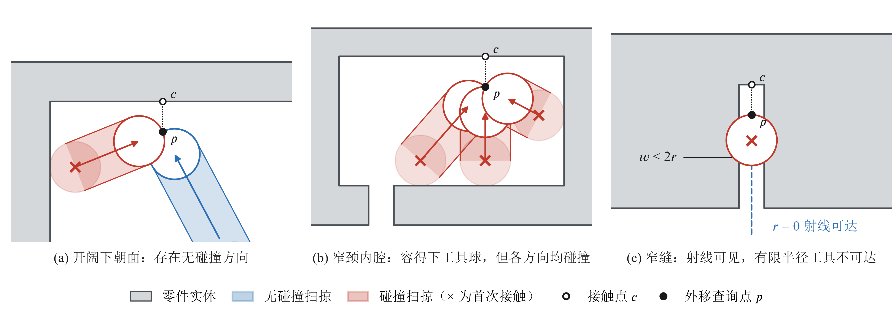
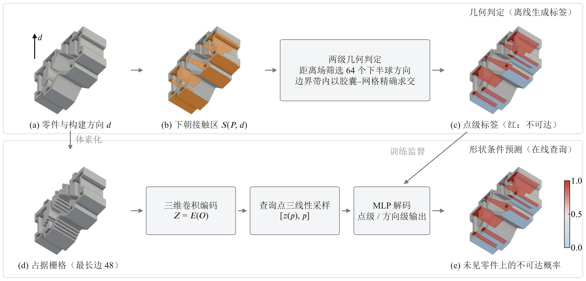
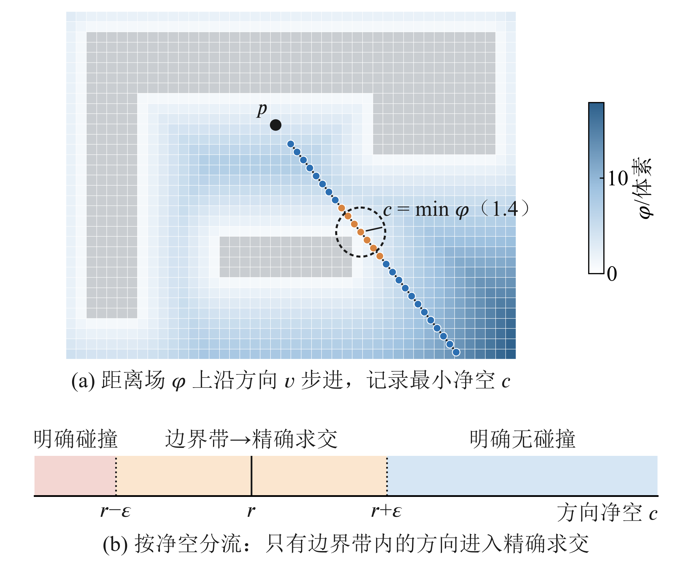
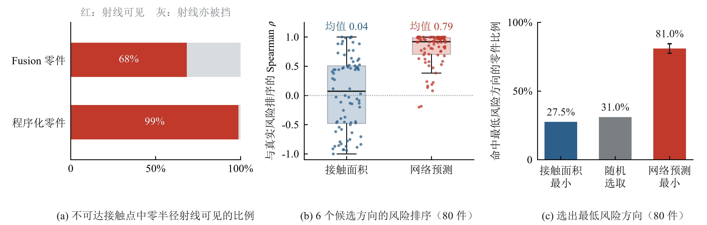
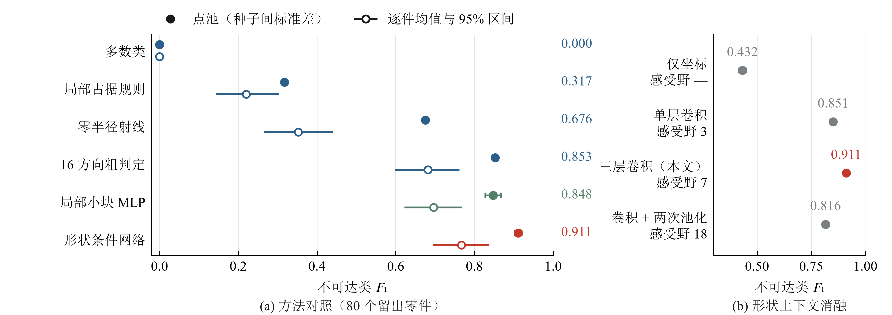
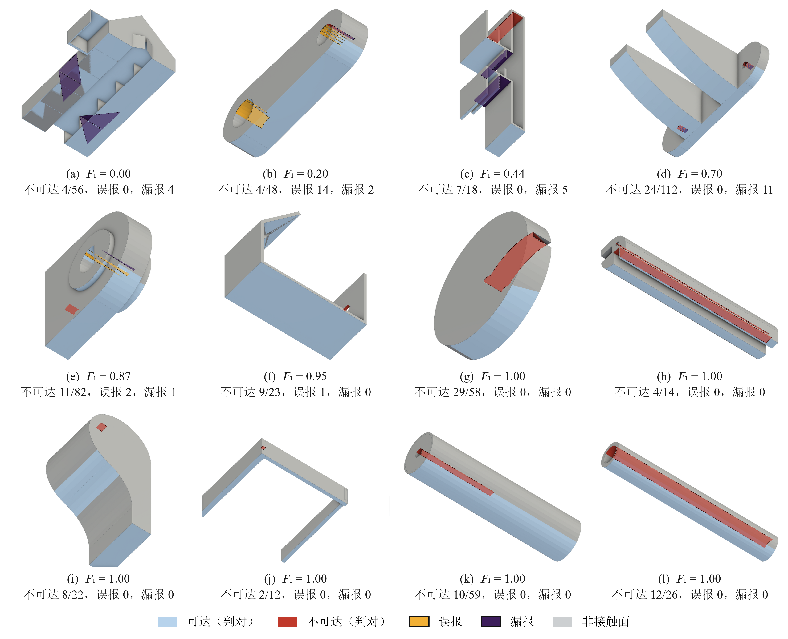
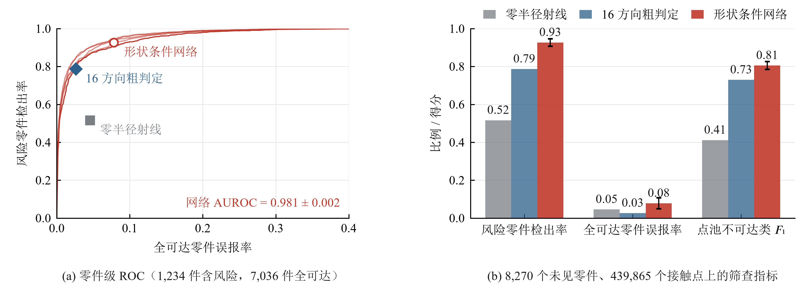
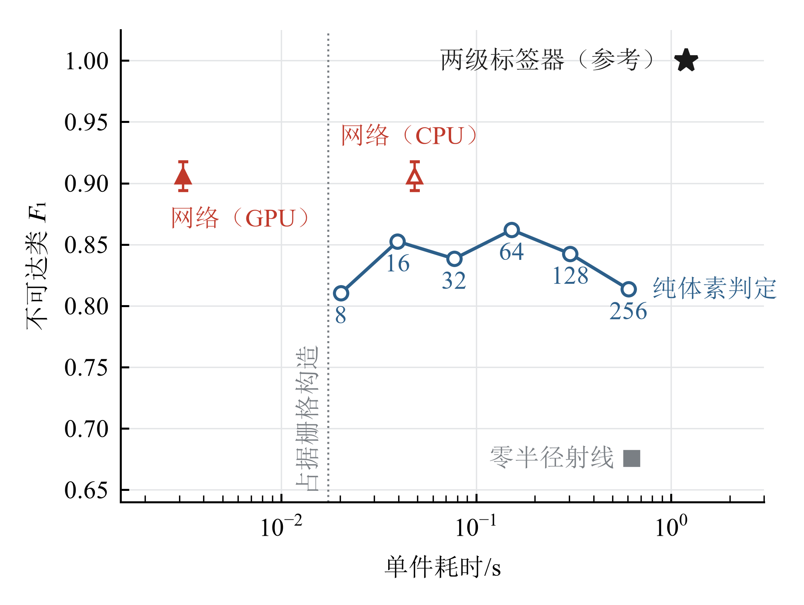
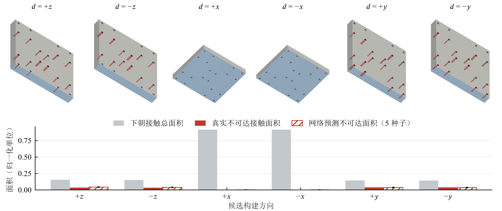
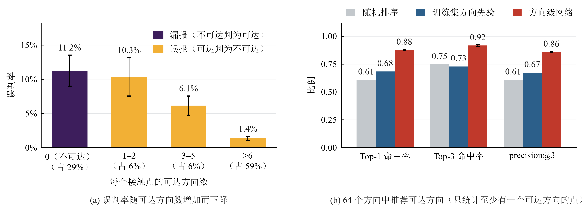

# 金属增材制造支撑接触区的有限工具可达性判定与形状条件预测

**英文题目：Finite-Tool Accessibility of Support-Contact Regions in Metal Additive Manufacturing: Geometric Labeling and Shape-Conditioned Prediction**

## 摘要

金属增材制造中，支撑接触面需在打印后清理，其难易取决于工具能否到达，而非支撑的多少。以下朝悬垂面为接触区代理，定义半径为 $r$ 的球形工具沿离散方向直线无碰撞到达的可达性判据；以体素距离场筛选与边界带精确求交组成的两级判定器生成标签，训练以占据栅格为输入的形状条件网络，在未见零件上预测接触点的可达性与各方向的被挡情况。公开 CAD 数据上的实验表明：68% 的不可达接触点对零半径射线可见；按接触面积选择构建方向，命中最低风险方向的比例（27.5%）不高于随机选取（31.0%）；在 8,270 个未见零件上，网络识别风险零件的 AUROC 为 0.981，在 GPU 上的单件耗时约为（单线程实现的）两级判定器的 1/814。有限工具可达性是独立于支撑量的设计风险，可由形状条件网络高效近似。

**关键词：** 增材制造；支撑结构；工具可达性；面向增材制造的设计；形状条件网络；几何判定

## Abstract

Support-contact surfaces in metal additive manufacturing must be cleaned after printing, and the effort depends on whether a tool can reach them rather than on the amount of support. Taking downward-facing overhangs as a proxy for support contact, we define accessibility as a collision-free straight approach of a ball tool of radius $r$ along a discrete direction set. A two-stage labeler combines voxel distance-field screening with exact capsule–mesh tests in a boundary band, and a shape-conditioned network trained on occupancy grids predicts accessibility on unseen parts. On public CAD data, 68% of inaccessible contacts are visible to zero-radius rays, and choosing the build direction with the smallest contact area finds the lowest-risk direction no more often than random choice (27.5% vs. 31.0%). On 8,270 unseen parts the network flags risky parts with an AUROC of 0.981 at about 1/814 of the single-threaded labeler's cost on a GPU.

**Key words:** additive manufacturing; support structures; tool accessibility; design for additive manufacturing; shape-conditioned network; geometric labeling

## 1 引言

金属粉末床熔融等工艺用支撑结构固定悬垂区域、传导热量并抑制变形，代价是额外的材料、成形时间和后处理工作[1]。支撑与零件相连的接触面需在打印后切除、铣削或打磨，自动支撑移除的研究正是把这些接触区域作为后处理对象，并要求工具在接近时不与零件干涉[2]。拆除支撑本身会引发新的问题，这也是自支撑设计研究的动机之一[3]。

现有的支撑相关评价多采用支撑体积、悬垂面积或构建高度[1,4]，面向金属增材的拓扑优化与自支撑设计也以减少支撑需求为目标[3,5]。这些量衡量的是支撑的多少，并不编码工具的进入空间：接触量相同的两个零件，一个接触面在开阔外表面，另一个在深槽或窄颈腔体内，清理难度可能截然不同。工具可达性已在多轴去支撑的构建方向评价[6]、可达支撑约束下的拓扑优化[7]以及增减材复合制造的拓扑优化[8]中作为约束出现；免装配打印中也有工作用体素路径分析支撑结构能否清除[9]；在减材制造中，DeepMill 用神经网络在全表面上预测刀具可达性[10]。这些工作或以支撑体积、零件全表面为对象，或依赖逐零件的几何计算。对于金属增材的支撑接触面，有限尺寸工具的可达性与支撑量指标有多大差别、能否在设计阶段对未见零件快速给出，尚缺少定量回答。

本文把支撑接触区的工具可达性定义为可计算的几何判据，用两级几何判定器在公开 CAD 数据上生成标签，并训练形状条件网络在未见零件上近似这一判据。主要工作包括：

1. 给出以下朝悬垂面为接触区代理、以有限球工具多方向直线逼近为判据的可达性定义，以及体素距离场筛选与边界带胶囊—网格精确求交相结合的两级判定器，并量化其离散误差；
2. 定量说明零半径射线可见性与支撑接触面积这两类廉价指标遗漏的风险，包括它们在候选构建方向之间对可达性风险的排序能力；
3. 在固定留出集、全部未参与训练的零件、跨来源网格与候选构建方向上评测形状条件网络及其方向级输出，给出它相对几何判定的精度—耗时位置与逼近方向推荐能力，并以误差分析和跨来源分组明确其适用边界。

## 2 相关工作

### 2.1 支撑结构与面向增材制造的设计

支撑的生成、优化与去除影响材料消耗、成形时间和表面质量[1]。图形学与 CAD 领域围绕节省材料、提高强度与稳定性以及减少支撑开展了大量结构优化工作[4]；面向金属增材的拓扑优化把悬垂角、封闭孔洞等工艺约束纳入设计[5]，自支撑设计则试图通过结构本身消除支撑需求[3]。Huang 等用曲面元卷积网络预测零件表面哪里需要支撑[11]。这些工作回答的是需要多少支撑、支撑放在哪里；本文关注的是已出现的支撑接触面在后处理时能否被工具接近。

### 2.2 支撑去除与工具可达性

Nelaturi 等将支撑与零件之间的接触区域作为自动去支撑的目标，并在避碰条件下规划去除过程[2]。Mirzendehdel 等以不可接近的支撑体积评价构建方向[6]，并把可接近支撑作为拓扑优化约束[7]；郭一凡等在增减材复合制造的拓扑优化中引入多轴刀具可达性约束[8]。潘万彬等在免装配打印中对体素化的装配体模型生成体素路径，据此判断支撑结构能否清除，并以此为目标优化打印方向与零件布局[9]。与这些工作相比，本文的评价对象是金属零件上的支撑接触面而非支撑体积，工具具有有限半径，判定在边界带内回到连续几何，且目标是在未见零件上直接预测。

### 2.3 神经可达性与形状条件场

DeepMill 在减材制造中以八叉树卷积网络预测全表面的刀具可达与遮挡区域，并以刀具尺寸为条件[10]；Harabin 等以逐零件训练的隐式网络表示多轴制造的碰撞测度[12]。DeepSDF 与占据网络表明连续查询网络可以表示三维形状属性[13-14]，卷积占据网络进一步以卷积编码的局部特征作为解码条件，使查询结果依赖具体零件的几何[15]。机器人配置空间距离场与多轴制造的隐式场规划也说明碰撞与可达关系可以表示为可查询的场[16-18]。本文采用卷积占据网络的形状条件形式，网络不以工具半径为条件，因而在方法上不超出上述工作；区别在于制造场景、评价对象和评测设计。表 1 归纳了与最近邻工作的差异。

**表 1  与最近邻工作的对比**

| 维度 | 可接近支撑[6-7] | 支撑可清除性[9] | DeepMill[10] | 本文 |
|---|---|---|---|---|
| 制造场景 | 金属增材 + 多轴去支撑 | 免装配增材打印 | 减材加工 | 金属增材后处理 |
| 评价对象 | 支撑体积 | 支撑结构 | 零件全表面 | 支撑接触面 |
| 工具或路径 | 多轴刀具 | 体素直线路径 | 球头刀，尺寸为条件 | 有限半径球，离散直线方向 |
| 判定方式 | 配置空间卷积 | 体素路径 | 网络预测 | 两级几何判定 + 网络预测 |
| 未见零件 | 逐件计算 | 逐件计算 | 跨模型预测 | 跨模型预测 |

## 3 问题定义

### 3.1 支撑接触区代理

设零件边界为三角网格 $\partial P$，构建方向为单位向量 $\hat{\mathbf d}$，面外法向为 $\mathbf n(p)$。以临界悬垂角 $\theta_c=45^\circ$ 提取下朝悬垂面，作为支撑接触区的代理：

$$
\mathcal S(P,\hat{\mathbf d})=
\{p\in\partial P\mid \mathbf n(p)\cdot\hat{\mathbf d}<-\cos\theta_c\}.
\tag{1}
$$

式（1）不重建真实支撑，而是以统一、可复现的规则标出可能与支撑接触的表面。每个下朝三角面取质心 $c$，沿外法向外移 2 个体素得到查询点 $p$，使工具扫掠从自由空间起算（图 1 中的 $c$ 与 $p$）。若外移点落入实体而反向外移点在自由空间，说明该面法向翻转、并非真正的下朝面，予以剔除；若正反两侧均为实体，说明该面位于窄缝中，予以保留，因为这正是最难到达的位置。定量实验固定 $\hat{\mathbf d}=+z$，第 5.7 节以刚体旋转评价其他候选方向。

### 3.2 可达性判据

把清理工具的端部近似为半径 $r$ 的球。对从查询点指向外部的方向 $\mathbf v$，工具与查询点相切时的球心为 $p+r\mathbf v$，工具从远处沿 $-\mathbf v$ 逼近的扫掠体是球心线段 $p+[r,L]\mathbf v$ 与球 $B_r$ 的 Minkowski 和，$L$ 取得足够大，使工具球完全离开零件。若扫掠体与零件内部 $P^{\circ}$ 不相交，则该方向可达：

$$
a(p,\mathbf v;r)=
\begin{cases}
1, & \bigl((p+[r,L]\mathbf v)\oplus B_r\bigr)\cap P^{\circ}=\varnothing,\\
0, & \text{否则}.
\end{cases}
\tag{2}
$$

方向集 $\mathcal V$ 取单位球面上 128 个 Fibonacci 点中位于下半球的 $D=64$ 个（工具从下方逼近下朝面，基板不建模）。点级标签取存在性，方向级标签保留每个方向：

$$
y(p)=1-\max_{\mathbf v\in\mathcal V}a(p,\mathbf v;r),
\\
\mathbf y_{\mathcal V}(p)=\bigl(1-a(p,\mathbf v_1;r),\ldots,1-a(p,\mathbf v_D;r)\bigr).
\tag{3}
$$

$y=1$ 表示不可达，作为风险正类。图 1 给出判据在三类几何上的行为：开阔下朝面存在无碰撞方向；窄颈内腔中工具球在腔内放得下，但任何方向的扫掠都会碰到腔壁或颈口；窄缝宽度小于 $2r$ 时，零半径射线可以直达外部，有限半径的工具却进不去。与只检查局部能否容纳工具球的判据相比，式（2）约束了进入过程，能正确判定窄颈内腔；与求解任意连通路径的判据相比，它把每个方向的判断归结为独立、可批量计算的直线扫掠，避免引入运动规划。判据只计零件本体的遮挡，不含基板、支撑之间的相互遮挡和去除顺序，因此给出的是遮挡的下界。

*图 1  有限球工具的多方向直线逼近判据（二维剖面，扫掠与碰撞位置按判据计算）。空心点为面上接触点 $c$，实心点为外移后的查询点 $p$；带状区域为工具球沿逼近方向的扫掠，× 为首次接触位置。*

## 4 方法

### 4.1 总体流程

方法由离线的几何标注和在线的形状条件预测组成（图 2）。将网格的最长包围盒边归一化为 1，包围盒各向外扩 20% 后按最长边 48 个体素划分栅格，以广义缠绕数判断体素中心在内外，得到占据栅格；按式（1）提取接触区并生成查询点；两级几何判定器在 $r=0.05$、64 个下半球方向下生成点级与方向级标签。网络以占据栅格和查询点为输入，训练后对未见零件一次前向即可给出全部查询点的不可达概率。工具半径、构建方向与方向集在本文中固定，网络不以它们为输入，更换这些条件需要重新生成标签并训练。

*图 2  方法总览。上：几何判定生成标签；下：形状条件网络在未见零件上预测。(a)–(c) 与 (e) 为同一留出零件；(e) 中颜色为预测的不可达概率。*

### 4.2 两级几何判定器

第一级在占据栅格上计算自由空间的欧氏距离场。记 $\Omega_P$ 为占据体素中心集合，自由点 $\mathbf x$ 的距离与方向最小净空为

$$
\phi(\mathbf x)=\min_{\mathbf q\in\Omega_P}\|\mathbf x-\mathbf q\|_2,
\\
c(p,\mathbf v)=\min_{t\in[r,L]}\phi(p+t\mathbf v).
\tag{4}
$$

沿球心线段以半个体素为步长、取所在体素的距离值采样 $c$，球心离开栅格即停止；第一级因此可能放行少量实际碰撞的方向（可能的原因包括薄轴向上栅格外扩小于工具半径、亚体素特征在占据栅格中丢失），其规模在第 5.3 节审核；距离场每个零件只算一次，供全部查询点与方向复用。净空充分大或充分小的方向直接判定，只有落在边界带内的方向进入第二级，以连续胶囊 $C(p,\mathbf v;r)=(p+[r,L]\mathbf v)\oplus B_r$ 与三角网格做精确的距离求交（胶囊轴线到网格表面的最小距离不大于 $r$ 即为碰撞；对从自由空间出发的查询点，这与进入零件内部等价，位于窄缝实体内的查询点则必然判为碰撞，与第 3.1 节保留它们作为不可达样本的意图一致）：

$$
a(p,\mathbf v;r)=
\begin{cases}
1, & c(p,\mathbf v)>r+\varepsilon,\\
0, & c(p,\mathbf v)\le r-\varepsilon,\\
\mathbb I[C(p,\mathbf v;r)\cap P^{\circ}=\varnothing],
   & \text{否则},
\end{cases}
\tag{5}
$$

其中边界带半宽 $\varepsilon=1.5$ 个体素（图 3）。$r=0.05$ 在 48 体素栅格中约为 1.7 个体素，因此临界方向几乎都由精确求交裁决，体素栅格只承担粗筛。第 5.6 节的实验表明，去掉这一级后，无论方向数取多少，体素判定都无法复现两级标签。

*图 3  两级几何判定。(a) 在距离场上沿一个方向步进，记录最小净空；(b) 按净空分流，只有边界带内的方向进入胶囊—网格精确求交。*

### 4.3 形状条件网络

网络沿用卷积占据网络的形状条件形式[15]。占据栅格 $O_P$ 经三层 $3\times3\times3$ 卷积编码为特征体 $Z=E_\theta(O_P)$；对查询点 $p$ 三线性采样局部特征 $z(p)$，与归一化坐标拼接后由多层感知机解码：

$$
q_\theta(p,P)=\operatorname{MLP}_\theta\bigl([z(p),p]\bigr),
\\
z(p)=\operatorname{Interp}\bigl(E_\theta(O_P),p\bigr).
\tag{6}
$$

点级模型输出 1 个不可达 logit；方向级模型结构相同、参数独立，输出 64 个方向的被挡 logit。三层卷积的理论感受野为 $7^3$ 个体素，加上查询点的绝对坐标，网络获得的是局部到中程的形状上下文。两者均用二元交叉熵训练：

$$
\mathcal L(\theta)=-\frac{1}{NK}\sum_{i=1}^{N}\sum_{k=1}^{K}\ell_{ik},
\\
\ell_{ik}=y_{ik}\log\sigma(s_{ik})+(1-y_{ik})\log\bigl(1-\sigma(s_{ik})\bigr),
\tag{7}
$$

其中 $s_{ik}$ 为第 $i$ 个点第 $k$ 个输出的 logit，点级 $K=1$，方向级 $K=D$。优化器为 Adam，学习率 $10^{-3}$，权重衰减 $10^{-4}$，每个零件为一批，训练 80 轮；判定阈值固定为 0.5，未在验证集上调整。

## 5 实验

### 5.1 数据与评测协议

实验使用三类数据（表 2）。Fusion 360 Gallery[19]是主数据源，以拉伸和棱柱式 CAD 零件为主；Thingi10K[20]的网格来自真实打印社区，网格质量更差，只用于跨来源测试；程序化零件（带盲孔的厚板等）只加入训练。所有切分以零件为单位，同一零件的查询点不会同时出现在训练和测试中。

**表 2  数据概况**

| 数据源 | 零件数 | 两类零件 | 水密网格占比 | 含非流形边的网格占比 | 用途 |
|---|---:|---:|---:|---:|---|
| Fusion 360 Gallery | 8,590 | 1,553 | 96.71% | 3.25% | 训练与测试 |
| Thingi10K | 300 | 137 | 74.67% | 12.00% | 跨来源测试 |
| 程序化 | 120 | — | — | — | 仅训练 |

注：两类零件指同一零件内既有可达点又有不可达点；网格质量在去除重复顶点与退化面后统计。Thingi10K 两类零件每件最多取 400 个接触点，共 40,864 个，其中不可达点占 31.8%。

主评测采用固定协议：取 Fusion 前 400 个两类零件，按零件以 0.6/0.2/0.2 切分（验证集不参与任何调参），训练集为 240 个零件加全部程序化零件，在 80 个测试零件上评测；以 5 个训练种子重复训练，报告均值 ± 种子间标准差。全文的点级网络结果都来自这同一组模型：基线对照、消融、误差分析、精度—耗时、设计筛查、候选构建方向评价与跨来源测试只改变测试范围，不重新训练。测试范围除固定留出集外还有三种：全部未参与训练的 8,270 个 Fusion 零件（含全可达零件）、Thingi10K 两类零件，以及为考察切分随机性而重新训练的 5 次重复随机留出；第 5.4 节另以更大的训练集检验训练规模的影响。不可达为正类，主指标为不可达类 $F_1$；点池指标合并全部测试点计算，逐件指标先在每个零件上计算再平均。

### 5.2 廉价指标遗漏的风险

零半径射线可见性是有限工具判据在 $r=0$ 时的特例，计算更简单。但在全部 Fusion 零件中，68% 的不可达接触点对零半径射线是可见的，程序化零件中这一比例为 99%（图 4a）：这些点存在无遮挡的视线，被挡是因为工具有有限尺寸。因此，用射线可见性代替有限工具判据会漏掉大部分风险。

支撑接触量也不能代替可达性。在全部 Fusion 零件上，接触点数与不可达点占比的 Spearman 相关系数为 0.264，按真实三角面积计算为 0.124；只看两类零件时分别为 -0.221 与 -0.126，符号相反、绝对值同样很小，均为弱相关。这一差别在构建方向的选择上更为直接：对固定留出集的 80 个零件，将每个零件分别旋转到 6 个轴向构建方向，重新提取接触区并生成标签。接触面积对 6 个方向的排序与真实不可达面积排序的逐件 Spearman 相关系数均值仅为 0.04，而网络预测的排序为 0.79 ± 0.01（图 4b）；按接触面积最小选出的方向，只有 27.5% 的零件恰好是不可达面积最小的方向，与随机选取的期望 31.0% 相当（80 件中的差别在抽样误差之内），按网络预测选取则命中 81.0% ± 3.5%（图 4c）。换言之，以接触面积为依据挑选构建方向，在降低清理风险这一点上并不比随机选取更好。由于每个接触三角面以其质心查询点的标签代表整面，面积口径会受三角剖分影响；改用点数口径（以不可达点数为风险、接触点数为接触量）重算，结论不变：接触量排序的相关系数为 -0.15，选中最低风险方向的比例为 18.8%（随机期望 31.5%），网络分别为 0.82 与 84.5%。

*图 4  廉价指标遗漏的风险。(a) 不可达接触点中零半径射线可见者的比例；(b) 6 个候选构建方向上，接触面积、网络预测与真实不可达面积排序的逐件 Spearman 相关系数（点为零件，网络取 5 个训练种子的平均）；(c) 选出最低风险方向的零件比例，随机选取为期望值，网络为 5 个训练种子的均值与标准差。*

### 5.3 标签的可信度

网络学习的是两级判定器给出的标签，标签误差会直接传递到学习结果，因此先从三个方面审核标签（表 3）：体素判定与暴力参考的差分对拍、分辨率 48 与 96 之间的标签一致率，以及类别分布。差分审核在真实数据中均匀抽取的 1,000 个采样点（可达与不可达各半）和 10,000 个固定种子的程序化占据案例上进行，只有在工具半径邻域内仍不一致的结果才计为错误；它检验的是第一级体素判定。在这组可达与不可达各半的采样点中，第二级改变了 22.5% 的标签，它的正确性由两方面支撑：精确求交原语在已知答案几何上的单元测试，以及同一组接触面在 48 与 96 两种分辨率下（各自含细化）标签的一致性。后者在全部零件中随机抽取的 30 件上为 99.65%，但这一样本以全可达零件为主；只在两类零件中抽样时降为 93.21%，在任一分辨率判为不可达的面上只有 79.2%。第三项审核检验第二级只覆盖边界带这一设计的代价：对固定留出集上第一级直接放行（净空大于 $r+\varepsilon$）的方向逐一做精确求交，有 7.3% 其实碰撞，使 2.7% 的点（163 个）若改用全方向精确求交会由可达翻为不可达。这两项都表明标签误差集中在风险类；精确求交审核还表明误差的方向是把不可达判为可达，与判据本身给出遮挡下界的方向一致。全方向精确求交的代价高得多，本文未对全部数据采用。审核说明标签链路满足预设门槛，但它是可复现的离散近似，不是连续几何真值。

**表 3  标签审核**

| 审核项 | 结果 | 门槛 | 样本 |
|---|---:|---|---|
| 差分不一致率（真实数据） | 0.20% | ≤1% | 1,000 个采样点 |
| 差分不一致率（程序化） | 0.01% | ≤1% | 10,000 个案例 |
| 分辨率 48 与 96 一致率 | 99.65% | ≥95% | 全部零件中随机 30 件 |
| 同上，两类零件（其中不可达面） | 93.21%（79.2%） | 如实报告 | 两类零件中随机 30 件 |
| 第一级直接放行、精确求交仍碰撞的方向 | 7.3% | 如实报告 | 固定留出集 6,033 个点 |
| 改用全方向精确求交将翻为不可达的点 | 2.7% | 如实报告 | 同上（163 个点） |
| 两类零件占比 | 18.1% | 如实报告 | 8,590 个零件 |

### 5.4 未见零件上的预测

表 4 汇总了网络在不同测试范围上的表现。固定留出集上点池 $F_1$ 为 0.911 ± 0.009；扩展到全部 1,233 个未参与训练的两类零件时为 0.862 ± 0.009，说明固定留出集的数值偏乐观，后者更接近一般表现。同一组模型在网格质量更差的 Thingi10K 两类零件上 $F_1$ 降为 0.848 ± 0.023，与同一子集上的 16 方向粗判定（0.850）相当，仍远高于零半径射线（0.655）：跨来源时网络没有保持它在 Fusion 上对粗判定的优势。按原始网格是否水密分组：36 个非水密零件上所有方法同时变差（网络 0.788、粗判定 0.779、射线 0.578），说明网格缺陷对几何代理与网络的影响相近；而在 101 个水密零件上，网络为 0.859，也只与粗判定（0.862）相当，下降不能只归因于网格缺陷。进一步把训练零件从 240 件扩大到除固定留出验证与测试零件外的全部 1,393 个 Fusion 两类零件（仍不使用 Thingi10K），网络在固定留出集上升至 0.931 ± 0.008，在 Thingi10K 上升至 0.891 ± 0.006，水密与非水密零件分别为 0.904 与 0.814，均高于粗判定。可见主协议的训练规模是跨来源表现偏弱的重要原因：扩大训练后网络在 Thingi10K 上重新优于粗判定，但与 Fusion 之间仍有约 0.04 的差距，非水密零件上的差距也没有缩小，来源差异与网格缺陷的影响依然存在。主协议保留 240 件的规模，是为了让全部下游实验共用一组可多次重复训练的模型。逐件 $F_1$ 的分布有明显长尾：5 次重复留出中，点池 $F_1$ 为 0.882 ± 0.011，零件等权 $F_1$ 为 0.790 ± 0.018，而逐件中位数为 0.943，少数零件得分很低（见第 5.8 节）。

**表 4  未见零件上的不可达类 $F_1$**

| 测试范围 | 零件数 | 训练 | 点池 $F_1$ | 说明 |
|---|---:|---|---:|---|
| 固定留出集 | 80 | 240 件 + 程序化，5 个种子 | 0.911 ± 0.009 | 主协议 |
| 全部未见两类零件 | 1,233 | 同上 | 0.862 ± 0.009 | 含固定留出集 |
| Thingi10K 跨来源 | 137 | 同上 | 0.848 ± 0.023 | 网格质量更差 |
| Thingi10K 跨来源 | 137 | 1,393 件 + 程序化，5 个种子 | 0.891 ± 0.006 | 扩大训练规模 |
| 重复随机留出 | 310/次 | 全部两类零件的 60% + 程序化，5 次切分各训练一次 | 0.882 ± 0.011 | 切分随机性；零件等权 0.790 |

在固定留出集上，网络与五类方法比较（图 5a）。多数类全部预测为可达，$F_1$ 为 0；只看查询点附近实体占比的局部占据规则为 0.317；零半径射线为 0.676；16 方向粗判定（只用 16 个全局方向、不做细化的体素判定）为 0.853；局部小块 MLP（以查询点周围 $11^3$ 的原始占据为输入、不经卷积特征的两层全连接网络）为 0.848 ± 0.020。网络相对零半径射线的逐件配对差为 0.415（95% bootstrap 区间 [0.326, 0.503]），相对 16 方向粗判定为 0.085（[0.023, 0.151]），两个区间都不含 0。消融（图 5b）中，只输入查询点坐标的变体 $F_1$ 为 0.43，感受野为 3 的单层卷积为 0.85，主网络为 0.911，加两次池化扩大感受野但降低分辨率的变体为 0.82。四个变体都以 5 个种子训练，种子间标准差不超过 0.02，差距远大于随机波动：形状信息不可缺少，而局部分辨率比更大的感受野更重要。

*图 5  固定留出集上的方法对照与消融。(a) 实心点为点池 $F_1$（学习类方法附 5 个训练种子的标准差），空心点与线段为逐件 $F_1$ 均值及其 95% bootstrap 区间；(b) 四个网络变体的点池 $F_1$。*

图 6 展示训练种子 0 的模型在留出零件上的预测。为避免挑选，按逐件 $F_1$ 将 80 个零件排序后等距取 12 个，失败件按其比例出现。由于不可达接触面多位于孔、槽和腔体内部，从外部看不到，渲染中零件保持不透明，被遮挡的接触面以半透明色块和虚线轮廓透出外壁。低分零件 (a)–(c) 各只有 4–7 个不可达点，几个漏报（a、c）或一片误报（b）就使单件 $F_1$ 降到很低；(h)、(k)、(l) 中长孔与内槽的不可达区域被完整识别。

*图 6  留出零件上的预测（按逐件 $F_1$ 等距选取 12 件）。浅蓝与红为判对的可达与不可达接触面，橙为误报，深紫为漏报；被遮挡的接触面以半透明色块和虚线轮廓显示。*

### 5.5 设计筛查

主评测只使用两类零件，而实际零件中多数没有任何不可达接触点。设计筛查需要回答的是：在真实分布中，模型会对多少无风险零件报警，能否把有风险的零件排在前面。为此在全部 8,270 个未参与训练的 Fusion 零件上评测，其中 7,036 个（85.1%）全可达；以零件内的最大不可达概率作为零件风险分数。网络的零件级 AUROC 为 0.981 ± 0.001；以 0.5 为阈值时，检出 92.6% ± 2.2% 的风险零件，对全可达零件的误报率为 7.4% ± 2.0%（图 7）。误报率在种子间波动较大，说明固定阈值下的工作点对训练随机性敏感，而排序能力（AUROC）是稳定的；实际使用时宜按可接受的误报率在验证集上选阈值。作为对照，零半径射线只检出 51.6% 的风险零件，16 方向粗判定检出 78.7%、误报率 2.6%。在全部评测点上，网络的点池 $F_1$ 为 0.802，两类代理分别为 0.411 和 0.729。

*图 7  全部未见零件上的设计筛查。(a) 零件级 ROC（5 个训练种子各一条）与三种方法的工作点；(b) 零件检出率、全可达零件误报率与点池 $F_1$。*

### 5.6 精度与代价

网络的价值在于用很低的代价逼近两级判定器。图 8 在固定留出集上比较单件耗时与 $F_1$（以两级标签为参考）。两级判定器单件平均 3.13 s，中位数 1.13 s，长尾来自面数多、边界带方向多的零件；不经细化的体素判定把全局方向数从 8 增加到 256（实际使用其中下半球的一半），耗时线性增长，$F_1$ 却始终在 0.81–0.86 之间，256 个反而低于 64 个，说明两者的差别主要来自体素离散而非方向分辨率，增加方向数替代不了第二级。网络在 GPU（RTX 4060 Ti）上单件 3.8 ms，约为两级判定器的 1/814，而 $F_1$ 高于任何体素判定。网络与体素判定看到的是同一个占据栅格，却更接近两级标签，表明它从细化后的标签中学到了体素判定本身表达不了的修正。网络的速度优势依赖并行硬件：限制为与几何方法相同的单个 CPU 线程时，一次前向需 4.9 s，比两级判定器（3.13 s）还慢。所有方法共享约 37 ms 的占据栅格构造。耗时含 Python 实现、硬件与机器负载的影响，只说明量级。

*图 8  固定留出集上的单件耗时与不可达类 $F_1$（以两级标签为参考）。蓝线上的数字为全局方向数；几何方法与 CPU 上的网络均为单线程，耗时从占据栅格开始计，竖虚线为占据栅格构造耗时；网络精度为 5 个训练种子的均值与标准差。*

### 5.7 候选构建方向的评价

网络只在零件原始朝向（$+z$ 构建）上训练，但把零件刚体旋转后即可评价其他候选方向，无需重新训练。对 80 个留出零件的 6 个轴向，网络在其余 5 个旋转朝向上的点池 $F_1$ 为 0.86，低于原始朝向的 0.911，其中 $+y$ 方向最低（0.81）。一个可能的原因是训练只用原始朝向，旋转后出现的接触区形态在训练集中较少。即便如此，网络对方向的风险排序仍明显优于接触面积（第 5.2 节）。图 9 给出一个带小通孔的板件：竖放（$\pm z$、$\pm y$）时接触面积最小，但接触面大多是窄孔内朝下的孔壁，不可达点占 79%–98%；平放（$\pm x$）时接触面积最大，却因孔壁竖直、接触面全在开阔的底面而没有不可达点。按接触面积会选中竖放的 $-y$ 方向（不可达点占 98%），而网络对两个平放方向预测的不可达面积均为 0，对竖放方向的估计也与几何判定接近。需要说明，这里评价的是给定候选方向集合的风险，而不是在连续方向空间中优化构建方向。

*图 9  同一留出零件在 6 个轴向构建方向下的支撑接触区（上，红为不可达）与各方向的接触面积、真实与预测的不可达面积（下）。选件规则：在接触面积最小的方向按面积与按点数都不是最低风险方向、且最高风险方向至少有 20 个不可达点的零件中，取不可达点占比在方向间差异最大者。*

### 5.8 误差分析

每个查询点的几何余量可以用它的可达方向数刻画：0 个即不可达，1–5 个说明只有少数方向勉强通过，≥6 个为开阔；方向数与点级标签取自同一细化口径。按此分箱（图 10a），误判率随可达方向数增加单调下降：不可达点被漏报的比例为 11.2%，只有 1–2 个与 3–5 个可达方向的点被误报的比例为 10.3% 与 6.1%，而开阔点只有 1.4%。误判因此集中在可达与不可达的分界两侧——不可达点和只有少数方向可通过的点，它们的几何余量接近工具半径，正是两级判定器需要精确求交的边界带。图 6 中的低分零件也属于这一类：不可达点少且处于临界，少量漏报即可使单件 $F_1$ 大幅下降。对设计复核而言，这意味着应把网络判为不可达或接近不可达的区域交回几何判定器确认。

### 5.9 方向级输出与逼近方向推荐

方向级模型与点级网络结构相同，只把输出改为 64 个方向的被挡概率，在同一切分上训练（程序化零件没有三角网格，无法生成细化的方向标签，不参与训练；5 个训练种子）。在固定留出集上，逐方向 $F_1$ 为 0.935 ± 0.001，逐点可达方向集 IoU 为 0.779；把「全部方向被挡」作为不可达，复原的点级 $F_1$ 为 0.916 ± 0.010，与直接训练的点级网络（0.911）相当。方向级输出的用途是推荐逼近方向：只在至少有一个可达方向的点（占 70.9%）上统计，模型最有把握的方向确实可达的比例（Top-1 命中率）为 0.877 ± 0.005，高于随机排序的 0.609 和训练集方向先验（按训练集中各方向的可达频率排序）的 0.684（图 10b）。

*图 10  (a) 固定留出集上按可达方向数分箱的误判率（5 个训练种子的均值与标准差），括号内为各箱样本占比；(b) 方向级模型推荐逼近方向的 Top-1、Top-3 命中率与 precision@3（5 个训练种子的均值与标准差），对照随机排序与训练集方向先验。*

## 6 讨论与局限

实验支持三个判断。第一，有限工具可达性与支撑量是不同的风险维度：多数不可达点对零半径射线可见，接触面积几乎不能对候选构建方向的可达性风险排序。第二，在可达与不可达各半的审核样本中，边界带精确求交改变了约五分之一的标签，它给出的结果无法靠增加体素判定的方向数复现；它的正确性由精确原语测试与跨分辨率一致性支撑，而不是由与自身的比较得出。第三，形状条件网络能在 GPU 上以约 1/814 的代价近似两级判定器；换到网格质量更差的数据源或旋转后的朝向时精度下降，其中跨来源的下降随训练规模扩大而明显缩小但没有消失，对候选方向的风险排序则仍明显优于接触面积。它适合在设计早期对大量零件或候选方向做初筛，再把高风险与临界区域交给几何判定器复核。

结论的适用范围由判据决定。判据只计零件本体遮挡，不含基板、支撑之间的相互遮挡和去除顺序，也未建模刀柄、夹具、连续姿态、切削力和表面质量；球形工具、$r=0.05$、45° 悬垂角和 64 个离散方向是统一比较所作的固定配置，网络不以它们为输入，改变时需重新标注与训练。因此，输出是后处理几何风险的下界估计，不是工艺可行性的结论。标签本身也偏向可达：两级判定器只在边界带内精确求交，在固定留出集上约 2.7% 的点会因被体素级放行的碰撞方向而误标为可达，且风险类标签对分辨率较敏感（第 5.3 节），网络学到的也是这一偏差。数据方面，Fusion 零件以拉伸和棱柱几何为主；主协议的网络只用 240 个训练零件，在 Thingi10K 上降到与 16 方向粗判定相当；训练零件扩大到 1,393 件后跨来源 $F_1$ 回升到 0.891（第 5.4 节），说明结论对训练规模敏感，实际应用应使用更大的训练集，并另留独立的跨来源测试集。网络在临界区域的误差仍然明显，误判零件需要回到几何判定复核。本文没有真实去支撑实验，网络与几何标签的一致性不能替代对实际后处理效果的验证。

## 7 结论

本文以下朝悬垂面为支撑接触区代理，定义了有限球工具多方向直线逼近的可达性判据，用距离场筛选与边界带精确求交相结合的两级判定器生成标签，并训练形状条件网络在未见零件上预测。实验表明，零半径射线可见性和支撑接触面积都会系统性地遗漏有限工具带来的风险；网络在全部未参与训练的零件上能可靠区分有无风险的零件，并在 GPU 上以远低于（单线程）几何判定的代价对候选构建方向排序，其误差集中在几何余量接近工具半径的临界区域。后续工作包括引入更真实的工具几何与基板约束、以工具半径为条件的网络，以及与实际去支撑结果的对照。

## 数据与可复现性

本文使用公开的 Fusion 360 Gallery 与 Thingi10K 数据以及确定性脚本生成的程序化数据。全部定量结果的运行标识、复现命令与结果文件的 SHA-256 摘要记录在证据清单 `paper/evidence/manifest.json` 中，全部实验可由 `tools/reproduce_experiments.py` 在公开数据上重跑。

## 匿名审稿声明

为保持匿名，本版本不列出作者身份、单位、通信信息、作者贡献、基金来源或利益冲突归属；正式投稿版本应由实际作者依据 CRediT 和真实资助/利益关系逐项填写。本稿不对这些行政事实作推断。

## 参考文献

[1] JIANG J, XU X, STRINGER J. Support structures for additive manufacturing: a review[J]. Journal of Manufacturing and Materials Processing, 2018, 2(4): 64. DOI: 10.3390/jmmp2040064.

[2] NELATURI S, BEHANDISH M, MIRZENDEHDEL A M, et al. Automatic support removal for additive manufacturing post processing[J]. Computer-Aided Design, 2019, 115: 135-146. DOI: 10.1016/j.cad.2019.05.030.

[3] 魏伟, 吴海鑫, 吴晓萱, 等. 增材制造自支撑设计综述[J]. 中国激光, 2024, 51(10): 1002307. DOI: 10.3788/CJL240434.

[4] 徐文鹏, 苗龙涛, 刘利刚. 面向3D打印的结构优化研究进展[J]. 计算机辅助设计与图形学学报, 2017, 29(7): 1155-1168.

[5] 刘博宇, 王向明, 杨光, 等. 面向金属增材制造的拓扑优化设计研究进展[J]. 中国激光, 2023, 50(12): 1202301. DOI: 10.3788/CJL221485.

[6] MIRZENDEHDEL A M, BEHANDISH M, NELATURI S. Optimizing build orientation for support removal using multi-axis machining[J]. Computers & Graphics, 2021, 99: 247-258. DOI: 10.1016/j.cag.2021.07.011.

[7] MIRZENDEHDEL A M, BEHANDISH M, NELATURI S. Topology optimization for manufacturing with accessible support structures[J]. Computer-Aided Design, 2022, 142: 103117. DOI: 10.1016/j.cad.2021.103117.

[8] 郭一凡, 吴涛, 吕琳, 等. 面向增减材复合制造的拓扑优化导热结构设计[J]. 计算机辅助设计与图形学学报, 2025, 37(11): 1933-1942. DOI: 10.3724/SP.J.1089.2025-00228.

[9] 潘万彬, 张鑫莹, 陈超, 等. 装配体模型优化的免装配打印方法[J]. 计算机辅助设计与图形学学报, 2022, 34(12): 1828-1841. DOI: 10.3724/SP.J.1089.2022.19363.

[10] ZHONG F, WANG Y, WANG P-S, et al. DeepMill: neural accessibility learning for subtractive manufacturing[C]//SIGGRAPH Conference Papers '25. New York: Association for Computing Machinery, 2025: 1-11. DOI: 10.1145/3721238.3730657.

[11] HUANG J, KWOK T H, ZHOU C, et al. Surfel convolutional neural network for support detection in additive manufacturing[J]. The International Journal of Advanced Manufacturing Technology, 2019, 105(9): 3593-3604. DOI: 10.1007/s00170-019-03792-1.

[12] HARABIN G, MIRZENDEHDEL A M, BEHANDISH M. Deep neural implicit representation of accessibility for multi-axis manufacturing[J]. Computer-Aided Design, 2023, 163: 103556. DOI: 10.1016/j.cad.2023.103556.

[13] PARK J J, FLORENCE P, STRAUB J, et al. DeepSDF: learning continuous signed distance functions for shape representation[C]//2019 IEEE/CVF Conference on Computer Vision and Pattern Recognition. Long Beach: IEEE, 2019: 165-174. DOI: 10.1109/CVPR.2019.00025.

[14] MESCHEDER L, OECHSLE M, NIEMEYER M, et al. Occupancy networks: learning 3D reconstruction in function space[C]//2019 IEEE/CVF Conference on Computer Vision and Pattern Recognition. Long Beach: IEEE, 2019: 4455-4465. DOI: 10.1109/CVPR.2019.00459.

[15] PENG S, NIEMEYER M, MESCHEDER L, et al. Convolutional occupancy networks[C]//Computer Vision -- ECCV 2020. Cham: Springer International Publishing, 2020: 523-540. DOI: 10.1007/978-3-030-58580-8_31.

[16] LI Y, CHI X, RAZMJOO A, et al. Configuration space distance fields for manipulation planning[C]//Robotics: Science and Systems XX. Delft: Robotics: Science and Systems Foundation, 2024. DOI: 10.15607/RSS.2024.XX.131.

[17] QU J, HUANG Z, GUO D, et al. INF-3DP: implicit neural fields for collision-free multi-axis 3D printing[J]. ACM Transactions on Graphics, 2025, 44(6): 1-18. DOI: 10.1145/3763354.

[18] DUTTA N, ZHANG T, LIU T, et al. Implicit neural field-based process planning for multi-axis manufacturing: direct control over collision avoidance and toolpath geometry[J]. Computer-Aided Design, 2026, 198: 104086. DOI: 10.1016/j.cad.2026.104086.

[19] WILLIS K D D, PU Y, LUO J, et al. Fusion 360 Gallery: a dataset and environment for programmatic CAD construction from human design sequences[J]. ACM Transactions on Graphics, 2021, 40(4): 1-24. DOI: 10.1145/3450626.3459818.

[20] ZHOU Q, JACOBSON A. Thingi10K: a dataset of 10,000 3D-printing models[EB/OL]. arXiv:1605.04797, 2016. https://arxiv.org/abs/1605.04797.
